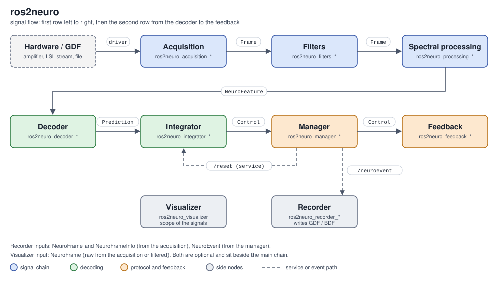

# Architecture

ros2neuro is a chain of ROS 2 nodes. Each node subscribes to the output of the previous one, does one job and
publishes its result. A few nodes (recorder, visualizer) sit beside the chain and only listen.

## The layers

| Layer | Package(s) | Job | Output |
|---|---|---|---|
| Acquisition | `ros2neuro_acquisition` + one backend plugin | read samples from a device or a file | `NeuroFrame`, `NeuroFrameInfo` |
| Filters | `ros2neuro_filters` + filter plugins | clean the signal with a configurable chain | `NeuroFrame` |
| Processing | `ros2neuro_processing_spectral`, `ros2neuro_processing_buffer` | turn frames into features (PSD, spectrogram...) | `NeuroFeature` |
| Decoder | `ros2neuro_decoder` + one model plugin | classify a feature | `NeuroPrediction` |
| Integrator | `ros2neuro_integrator` + one plugin | smooth the predictions over time | `NeuroControl` |
| Manager | `ros2neuro_manager` + one protocol plugin | run calibration, evaluation or control; emit events | `NeuroControl` (flow), `NeuroEvent` |
| Feedback | `ros2neuro_feedback` + one drawing plugin | show the state to the subject | a window |
| Recorder | `ros2neuro_recorder` + one format plugin | write data and events to a file | GDF / BDF |
| Visualizer | `ros2neuro_visualizer` | scope of the signals | a window |

`ros2neuro_msgs` defines the messages exchanged between all of them, `ros2neuro_data` holds the in-memory C++
types used inside plugins before converting to messages.

## Three ideas that explain the design

**1. Everything is a node, everything is replaceable.**
Nodes are connected only by topics, so any stage can be swapped, started on another machine, replayed from a
file or observed with `ros2 topic echo`.

**2. Behaviour comes from plugins.**
A generic node (for example the acquisition node) knows how to talk ROS but not how to talk to a specific
amplifier. The amplifier driver is a plugin selected by a parameter. See [Plugins](plugins.md).

**3. The protocol is separate from the signal chain.**
The signal chain ends at the integrator, which knows nothing about trials or cues. The **manager** adds the
experimental protocol on top and the **feedback** is passive: it only draws what the manager says. See
[Protocols](protocols.md).

## Closing the loop

The loop of a BCI task is:

1. the subject produces brain activity, the amplifier samples it;
2. the chain acquisition → filters → spectral → decoder → integrator turns it into class probabilities;
3. the manager normalises them, decides the outcome of the trial and forwards the values to the feedback;
4. the feedback shows them, and the subject adapts.

Two side channels complete the picture: the manager publishes **events** (`/neuroevent`) that the recorder
stores next to the signal, and it can ask the integrator to **reset** through a ROS service.

## Running without hardware

Replacing the amplifier with a GDF file (`ros2neuro::acquisition::XDFDevice`) or the dummy generator
(`ros2neuro::acquisition::DummyDevice`) leaves the rest of the chain untouched. The
[`ros2neuro_devel_test`](../packages/devel-test.md) launchers use this to start a full pipeline, from the
file to the wheel or the bars, on a laptop. The first tutorial,
[Hardware-free pipeline](../tutorials/hardware-free-pipeline/index.md), walks through it.
