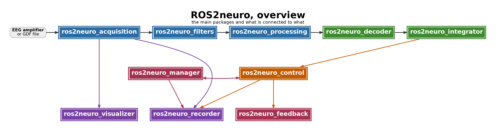
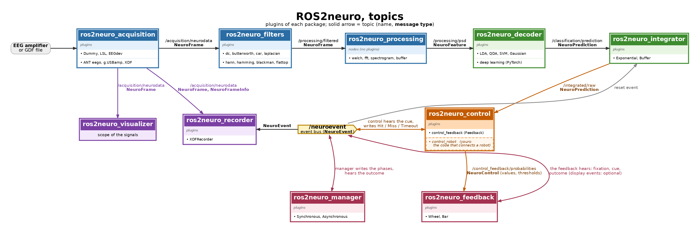
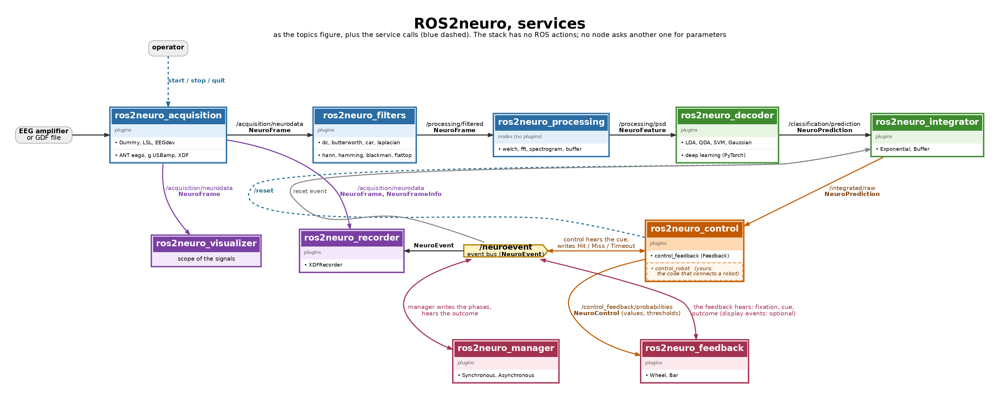
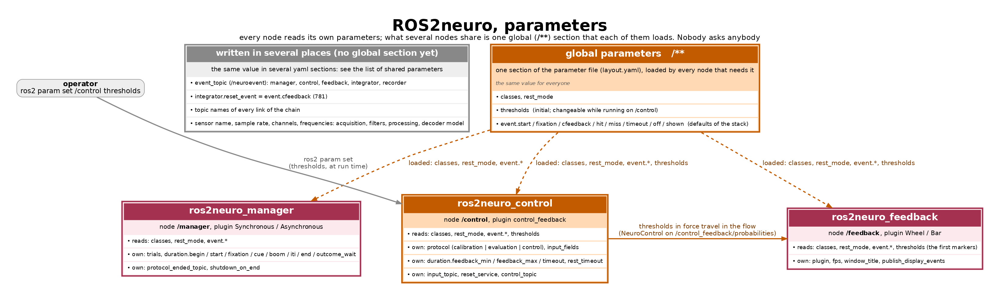
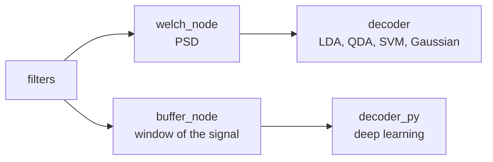

# Architecture

## Four figures

The four figures show the same system with more and more detail. Click one to open it at full size (each one has an SVG version in
`assets/` that you can zoom). They are generated by `docs/tools/make_architecture_diagrams.py`.

### 1. Overview

The main packages (by the name of the parent package) and what is connected to what: the general flow, nothing else.

### 2. Topics and plugins

The same packages, with the plugins each one can load, and on every arrow the **topic** and the **message type**. The event bus
`/neuroevent` is drawn as a node because several packages read or write it. The feedback hears it (the phases the manager writes and
the outcome control writes) and also the flow of control (values and thresholds). In [`ros2neuro_control`](../packages/control/index.md) the dashed plugin
`control_robot` stands for **your** code: the one that connects a robot (see the
[tutorial](../tutorials/robot-control/index.md)).

### 3. Services

As the previous one, plus the **service calls** (blue dashed): start / stop / quit of the acquisition and the integrator `/reset`.
The stack has no ROS actions, and no node asks another node for parameters.

### 4. Parameters

Which parameters each node reads. **Every node reads its own**; what several nodes share (`classes`, `rest_mode`, the ids of the events,
the initial `thresholds`) is one global `/**` section of the parameter file that each of them loads. The thresholds in force reach the
feedback in the flow of control. The list of the values that are written in more than one place is in
[Shared parameters](shared-parameters.md).

### How to read them

- A **box** is a package (or its node); in figures 2 and 3 the plugins it can load are listed inside.
- A **solid arrow** is a message on a topic; a **blue dashed arrow** is a service. In figure 4 the orange dashed arrows are the global parameters that a node loads.
- The orange box is the [control](../packages/control/index.md) layer: one parent class, `Control`, whose input is always a
  `NeuroPrediction`; [`ros2neuro_control_feedback`](../packages/control/feedback.md) is the plugin of the stack. A control for a
  robot, with its synchronization, is a tutorial: [Controlling a robot in step with the feedback](../tutorials/robot-control/index.md).
- The [manager](../packages/manager/index.md) and control share only the event bus `/neuroevent` (and the global parameters).
  The feedback reads that bus too.

ROS2neuro is a chain of ROS 2 nodes. Each node subscribes to the output of the previous one, does one job and
publishes its result. A few nodes (recorder, visualizer) sit beside the chain and only listen.

## The layers

| Layer | Package(s) | Job | Output |
|---|---|---|---|
| Acquisition | [`ros2neuro_acquisition`](../packages/acquisition/index.md) + one backend plugin | read samples from a device or a file | `NeuroFrame`, `NeuroFrameInfo` |
| Filters | [`ros2neuro_filters`](../packages/filters/index.md) + filter plugins | clean the signal with a configurable chain | `NeuroFrame` |
| Processing | [`ros2neuro_processing_spectral`](../packages/processing/spectral.md) (Welch) **or** [`ros2neuro_processing_buffer`](../packages/processing/buffer.md): the decoder decides | turn the filtered frames into the feature the decoder reads (a PSD, or a window of the signal) | `NeuroFeature` |
| Decoder | [`ros2neuro_decoder`](../packages/decoder/index.md) + one model plugin | classify a feature | `NeuroPrediction` |
| Integrator | [`ros2neuro_integrator`](../packages/integrator/index.md) + one plugin | smooth the predictions over time | `NeuroPrediction` (`TYPE_SCORES`) |
| Control | [`ros2neuro_control`](../packages/control/index.md) + one control plugin ([`control_feedback`](../packages/control/feedback.md)) | know the thresholds: drive the feedback, decide the outcome, reset the integrator | `NeuroControl` (flow), `NeuroEvent` (Hit / Miss / Timeout) |
| Manager | [`ros2neuro_manager`](../packages/manager/index.md) + one protocol plugin | run the trials of calibration and evaluation: write their events | `NeuroEvent` |
| Feedback | [`ros2neuro_feedback`](../packages/feedback/index.md) + one drawing plugin | show the state to the subject | a window |
| Recorder | [`ros2neuro_recorder`](../packages/recorder/index.md) + one format plugin | write data and events to a file | GDF / BDF |
| Visualizer | [`ros2neuro_visualizer`](../packages/visualizer.md) | scope of the signals | a window |

[`ros2neuro_msgs`](../packages/msgs-data.md#ros2neuro_msgs) defines the messages exchanged between all of them, [`ros2neuro_data`](../packages/msgs-data.md#ros2neuro_data) holds the in-memory C++
types used inside plugins before converting to messages.

### The processing stage depends on the decoder

Most layers have one job and, when there are several implementations, a plugin selects one. **Processing** is different: it
is the stage that prepares the data *for the decoder*, so what runs depends on the decoder. There are two chains in the stack:

- the **classic decoders** read a power spectrum: the processing is the Welch PSD ([`ros2neuro_processing_spectral`](../packages/processing/spectral.md));
- the **deep-learning decoders** read a window of the filtered signal: the processing is the buffer
  ([`ros2neuro_processing_buffer`](../packages/processing/buffer.md)).

The spectral code is also used by the visualizer, which computes its spectrum itself. There is **no base class for
processing**: each one is an ordinary node that reads a `NeuroFrame` and publishes a `NeuroFeature`, so new ones (a Hilbert
envelope, Riemannian features...) can be added by anyone. See [Processing](../packages/processing/index.md).

## Three ideas that explain the design

**1. Everything is a node, everything is replaceable.**
Nodes are connected only by topics, so any stage can be swapped, started on another machine, replayed from a
file or observed with `ros2 topic echo`.

**2. Behaviour comes from plugins.**
A generic node (for example the acquisition node) knows how to talk ROS but not how to talk to a specific
amplifier. The amplifier driver is a plugin selected by a parameter. See [Plugins](plugins.md).

**3. The protocol is separate from the signal chain.**
The signal chain ends at the integrator, which knows nothing about trials or cues. The **manager** runs the
trials, **control** knows the thresholds and drives the feedback, and the **feedback** is passive: it only draws what
control says. The manager and control talk through the event bus. See [Protocols](protocols.md).

## Closing the loop

The loop of a BCI task is:

1. the subject produces brain activity, the amplifier samples it;
2. the chain acquisition → filters → processing → decoder → integrator turns it into class probabilities;
3. control normalises them, decides the outcome of the trial and publishes the values (and the thresholds) for the feedback, while the manager runs the trials;
4. the feedback shows them, with the phases it hears on the event bus, and the subject adapts.

Two side channels complete the picture: the manager and control write **events** (`/neuroevent`) that the recorder
stores next to the signal, and control can ask the integrator to **reset** through a ROS service.

## Running without hardware

Replacing the amplifier with a GDF file ([`ros2neuro::acquisition::XDFDevice`](../packages/acquisition/xdf.md)) or the dummy generator
([`ros2neuro::acquisition::DummyDevice`](../packages/acquisition/dummy.md)) leaves the rest of the chain untouched. The
[`ros2neuro_devel_test`](../packages/devel-test.md) launchers use this to start a full pipeline, from the
file to the wheel or the bars, on a laptop. The first tutorial,
[Hardware-free pipeline](../tutorials/hardware-free-pipeline/index.md), walks through it.
