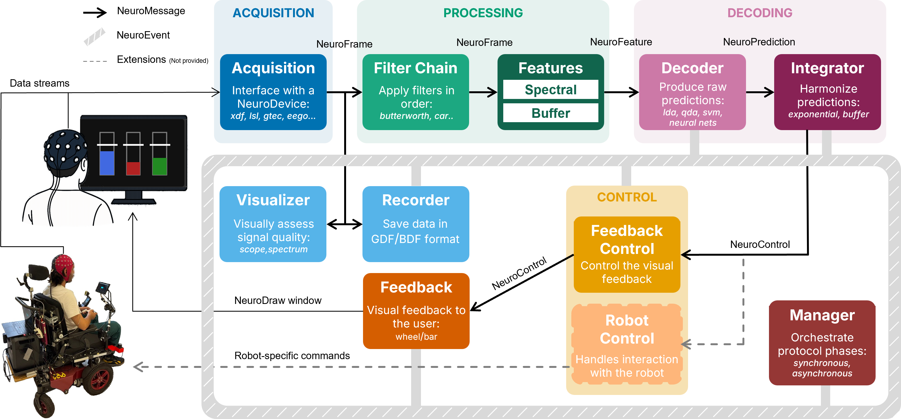
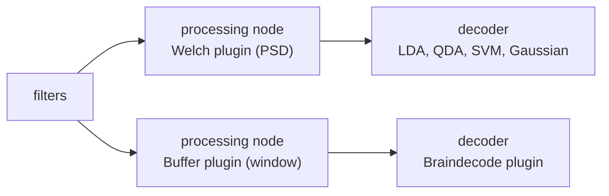

# Architecture

## The loop in one figure

Click the figure to open it at full size. It follows the data around the subject:

- **The signal chain** is the top row. The amplifier's *data streams* enter the **acquisition** and travel as `NeuroFrame` through the **filter chain**
  and the **features** stage (spectral or buffer: it depends on the decoder, see below) to become a `NeuroFeature`. The **decoder** turns it into raw
  predictions and the **integrator** harmonises them into a `NeuroPrediction`. Every solid arrow is a *NeuroMessage*: one topic, one message type.
- **Control** takes the `NeuroPrediction` of the integrator, knows the thresholds, decides the outcome of a trial and sends a `NeuroControl` (the values
  and the thresholds in force) to the **feedback**, which draws it in a window for the subject. This closes the loop: the subject sees the feedback and adapts.
- **The manager** orchestrates the phases of the protocol (synchronous: the trials of a calibration or an evaluation; asynchronous: no trials) and
  writes them as events.
- **The event bus** is the hatched frame in the lower part of the figure (`/neuroevent`, *NeuroEvent*): the manager, control and the feedback talk
  through it, and the **recorder** stores it next to the signal. The **visualizer** and the recorder also listen to the data streams.
- **The dashed boxes** are *extensions, not provided*: the *Robot Control* is **your** code, a second control plugin that also takes the
  `NeuroPrediction` and drives a robot (see the [tutorial](../tutorials/robot-control/index.md)). It sends *robot-specific commands*, not messages of the stack.

Two things the figure leaves out, because they are not messages: the **reset** that control asks the integrator for is a ROS service call (the only
ones besides start, stop and quit of the acquisition; there are no ROS actions), and **parameters**: every node reads its own, and what several nodes
share (`classes`, `rest_mode`, the ids of the events, the initial `thresholds`) is one global `/**` section of the parameter file that each of them
loads. See [Shared parameters](shared-parameters.md). The plugins of every box are in [Plugins](plugins.md).

- The [control](../packages/control/index.md) layer has one parent class, `Control`, whose input is always a `NeuroPrediction`;
  [`ros2neuro_control_feedback`](../packages/control/feedback.md) is the plugin of the stack ([`ros2neuro::control::Feedback`](../packages/control/feedback.md)).
- The [manager](../packages/manager/index.md) and control share only the event bus `/neuroevent` (and the global parameters).
  The feedback reads that bus too.

ROS2neuro is a chain of ROS 2 nodes. Each node subscribes to the output of the previous one, does one job and
publishes its result. A few nodes (recorder, visualizer) sit beside the chain and only listen.

## The layers

| Layer | Package(s) | Job | Output |
|---|---|---|---|
| Acquisition | [`ros2neuro_acquisition`](../packages/acquisition/index.md) + one backend plugin | read samples from a device or a file | `NeuroFrame`, `NeuroFrameInfo` |
| Filters | [`ros2neuro_filters`](../packages/filters/index.md) + filter plugins | clean the signal with a configurable chain | `NeuroFrame` |
| Processing | [`ros2neuro_processing`](../packages/processing/index.md) + one plugin: [`Welch`](../packages/processing/spectral.md) (spectral package), [`Buffer`](../packages/processing/buffer.md), [`Fbcsp`](../packages/processing/fbcsp.md): the decoder decides | turn the filtered frames into the feature the decoder reads (a PSD, or a window of the signal) | `NeuroFeature` |
| Decoder | [`ros2neuro_decoder`](../packages/decoder/index.md) + one model plugin | classify a feature | `NeuroPrediction` |
| Integrator | [`ros2neuro_integrator`](../packages/integrator/index.md) + one plugin | smooth the predictions over time | `NeuroPrediction` (`TYPE_SCORES`) |
| Control | [`ros2neuro_control`](../packages/control/index.md) + one control plugin ([`control_feedback`](../packages/control/feedback.md)) | know the thresholds: drive the feedback, decide the outcome, reset the integrator | `NeuroControl` (flow), `NeuroEvent` (Hit / Miss / Timeout) |
| Manager | [`ros2neuro_manager`](../packages/manager/index.md) + one protocol plugin | run the trials of calibration and evaluation: write their events | `NeuroEvent` |
| Feedback | [`ros2neuro_feedback`](../packages/feedback/index.md) + one drawing plugin | show the state to the subject | a window |
| Recorder | [`ros2neuro_recorder`](../packages/recorder/index.md) + one format plugin | write data and events to a file | GDF / BDF |
| Visualizer | [`ros2neuro_visualizer`](../packages/visualizer.md) | scope of the signals | a window |

[`ros2neuro_msgs`](../packages/msgs-data.md#ros2neuro_msgs) defines the messages exchanged between all of them, [`ros2neuro_data`](../packages/msgs-data.md#ros2neuro_data) holds the in-memory C++
types used inside plugins before converting to messages.

### The processing stage depends on the decoder

Most layers have one job and, when there are several implementations, a plugin selects one. **Processing** is different: it
is the stage that prepares the data *for the decoder*, so what runs depends on the decoder. There are two chains in the stack:

- the **classic decoders** read a power spectrum: the processing is the Welch PSD (the `Welch` plugin of [`ros2neuro_processing_spectral`](../packages/processing/spectral.md));
- the **deep-learning decoders** read a window of the filtered signal: the processing is the buffer
  (the `Buffer` plugin of [`ros2neuro_processing_buffer`](../packages/processing/buffer.md)).

The spectral code is also used by the visualizer, which computes its spectrum itself. Processing is a **plugin family** like the
others: [`ros2neuro_processing`](../packages/processing/index.md) defines the `Processing` interface and one node, `processing_node`; every processing is a plugin that reads a
`NeuroFrame` (or a group of them, one per topic, grouped by stamp, or a `NeuroFeature`) and publishes a `NeuroFeature`, so new ones (a Hilbert envelope, Riemannian features...) can be added by anyone. See [Processing](../packages/processing/index.md).

## Three ideas that explain the design

**1. Everything is a node, everything is replaceable.**
Nodes are connected only by topics, so any stage can be swapped, started on another machine, replayed from a
file or observed with `ros2 topic echo`.

**2. Behaviour comes from plugins.**
A generic node (for example the acquisition node) knows how to talk ROS but not how to talk to a specific
amplifier. The amplifier driver is a plugin selected by a parameter. See [Plugins](plugins.md).

**3. The protocol is separate from the signal chain.**
The signal chain ends at the integrator, which knows nothing about trials or cues. The **manager** runs the
trials, **control** knows the thresholds and drives the feedback, and the **feedback** is passive: it only draws what
control says. The manager and control talk through the event bus. See [Protocols](protocols.md).

## Closing the loop

The loop of a BCI task is:

1. the subject produces brain activity, the amplifier samples it;
2. the chain acquisition → filters → processing → decoder → integrator turns it into class probabilities;
3. control normalises them, decides the outcome of the trial and publishes the values (and the thresholds) for the feedback, while the manager runs the trials;
4. the feedback shows them, with the phases it hears on the event bus, and the subject adapts.

Two side channels complete the picture: the manager and control write **events** (`/neuroevent`) that the recorder
stores next to the signal, and control can ask the integrator to **reset** through a ROS service.

## Running without hardware

Replacing the amplifier with a GDF file ([`ros2neuro::acquisition::XDFDevice`](../packages/acquisition/xdf.md)) or the dummy generator
([`ros2neuro::acquisition::DummyDevice`](../packages/acquisition/dummy.md)) leaves the rest of the chain untouched. The
[`ros2neuro_devel_test`](../reproducibility/packages/index.md) launchers use this to start a full pipeline, from the
file to the wheel or the bars, on a laptop. The first tutorial,
[Hardware-free pipeline](../tutorials/hardware-free-pipeline/index.md), walks through it.

---

**Next:** [Plugins](plugins.md) · [back to the Concepts menu](index.md)
