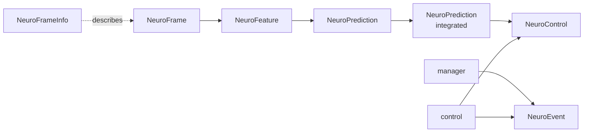

# Messages and data types

All messages live in the [`ros2neuro_msgs`](../packages/msgs-data.md#ros2neuro_msgs) package. They are the contract between every node of the stack.



## Overview

Click a message name to jump to its description.

| Message | Role | Produced by | Consumed by |
|---|---|---|---|
| [`NeuroFrame`](#neuroframe) | one synchronous chunk of analog and trigger samples | acquisition, filters | filters, processing, recorder, visualizer |
| [`NeuroFrameInfo`](#neuroframeinfo) | static description of the stream (rate, channels, labels) | acquisition | recorder, visualizer |
| [`NeuroFeature`](#neurofeature) | processed data of any dimensionality (PSD, spectrogram, a window of the signal...) | processing (spectral or buffer, see [Processing](../packages/processing/index.md)) | decoder |
| [`NeuroPrediction`](#neuroprediction) | one value per class: decoder output, and integrated values (`TYPE_SCORES`) | decoder, integrator | integrator, control |
| [`NeuroControl`](#neurocontrol) | normalised control values plus discrete actions: the flow of the feedback | control | feedback |
| [`NeuroEvent`](#neuroevent) | sparse marker (trial start, cue, outcome...) | manager, control (outcomes only), feedback | recorder, integrator, manager, control, feedback |

Helper messages, embedded in the ones above:

| Message | Embedded in | Describes |
|---|---|---|
| [`NeuroSensor`](#neurosensor) | `NeuroFrame` | an analog block (EEG, EMG, EOG...) |
| [`NeuroTrigger`](#neurotrigger) | `NeuroFrame` | a digital block (trigger lines, markers) |
| [`NeuroSensorInfo`](#neurosensorinfo) | `NeuroFrameInfo` | the metadata of an analog block |
| [`NeuroTriggerInfo`](#neurotriggerinfo) | `NeuroFrameInfo` | the metadata of a digital block |
| [`NeuroAxis`](#neuroaxis) | `NeuroFeature` | the meaning of one dimension of a feature |

## Who publishes and who reads

The same messages, with the **node** that publishes each one, the **topic** it uses by default, and the nodes that read it.
Topic names are the defaults; each node can change them with a parameter, see [Topics and services](topics.md).

| Message | Published by (node → default topic) | Read by (node ← default topic) |
|---|---|---|
| [`NeuroFrame`](#neuroframe) | `acquisition` → `/acquisition/neurodata`; `filter_chain` → `/filter_chain/filtered` | `filter_chain` ← `/neurodata`; `fft_node`, `welch_node`, `spectrogram_node` ← `/neurodata`; `processing_buffer` ← `/neurodata_filtered`; `recorder` ← `/neurodata`; `neuroviz` ← `/acquisition/neurodata` |
| [`NeuroFrameInfo`](#neuroframeinfo) | `acquisition` → `/acquisition/neurodata_info` (`transient_local`) | `recorder` ← `/neurodata_info`; `neuroviz` ← `/acquisition/neurodata_info` |
| [`NeuroFeature`](#neurofeature) | `fft_node` → `~/fft`; `welch_node` → `~/psd`; `spectrogram_node` → `~/spectrogram`; `processing_buffer` → `/features` | `decoder` ← `/features`; [`ros2neuro_decoder_py`](../packages/decoder/python.md) ← `/features` |
| [`NeuroPrediction`](#neuroprediction) | `decoder` → `~/prediction`; [`ros2neuro_decoder_py`](../packages/decoder/python.md) → `~/prediction`; `integrator` → `~/control` (the [`ros2neuro_devel_test`](../packages/devel-test.md) configuration sets `output_topic: /integrated/raw`) | `integrator` ← `/prediction`; `control` ← `/integrated/raw` |
| [`NeuroControl`](#neurocontrol) | `control` → `/control_feedback/probabilities` | `feedback` ← `/control_feedback/probabilities` (the values and the thresholds) |
| [`NeuroEvent`](#neuroevent) | `manager` → `/neuroevent` (the phases of the trials and the end of the outcome); `control` → `/neuroevent` (the end of the continuous feedback, Hit / Miss / Timeout); `feedback` → `/neuroevent` (only with `publish_display_events: true`) | `recorder` ← `/neuroevent`; `integrator` ← `/neuroevent` (only for `integrator.reset_event`); `manager` ← `/neuroevent` (the end of the outcome); `control` ← `/neuroevent` (cue, CFeedback); `feedback` ← `/neuroevent` (the phases and the outcome: fixation, cue, boom) |

The helper messages (`NeuroSensor`, `NeuroTrigger`, `NeuroSensorInfo`, `NeuroTriggerInfo`, `NeuroAxis`) are never published on their own:
they travel inside the message that embeds them, so they are published and read by the same nodes as that message.

### Other messages and services used by the nodes

Besides its own messages, the stack uses a few standard ones:

| Type | Used for | Provided or published by | Used by |
|---|---|---|---|
| `std_srvs/Empty` (service) | start, stop and quit the device: `~/start`, `~/stop`, `~/quit` | `acquisition` | whoever controls the acquisition |
| `std_srvs/Empty` (service) | reset the integrator to the neutral state (`1/K`): `/reset` | `integrator` | called by `control` (the `Feedback` plugin, protocol `control`) |
| `std_msgs/Empty` (`transient_local`) | the protocol has ended: `/protocol_ended` | `manager` (the `Synchronous` plugin) | whoever waits for the end of the session |
| `std_msgs/Header` | `header` of every `Neuro*` message (stamp and frame) | every publisher | every subscriber |

### Types inside the messages

Some messages carry a `type` constant that says what the data are. Who sets it:

| Message | Constant | Values | Set by |
|---|---|---|---|
| `NeuroFeature.type` | `TYPE_TIME_SERIES` | 1 | `processing_buffer` (window of the signal) |
| | `TYPE_SPECTRUM` | 2 | `fft_node`, `welch_node` |
| | `TYPE_TIME_FREQUENCY` | 3 | `spectrogram_node` |
| | `TYPE_CONNECTIVITY`, `TYPE_VECTOR`, `TYPE_MATRIX`, `TYPE_MISC`, `TYPE_UNKNOWN` | 4, 5, 6, 255, 0 | free: a new processing node chooses it |
| `NeuroPrediction.type` | `TYPE_UNSPECIFIED`, `TYPE_SCORES`, `TYPE_PROBABILITIES`, `TYPE_LOGITS`, `TYPE_REGRESSION` | 0, 1, 2, 3, 4 | the decoder: from the `output_type` parameter or from the model manifest; [`ros2neuro_decoder_py`](../packages/decoder/python.md) publishes `TYPE_PROBABILITIES` |
| `NeuroSensorInfo.type` | `TYPE_UNKNOWN`, `TYPE_EEG`, `TYPE_EMG`, `TYPE_EOG`, `TYPE_ECG`, `TYPE_GSR`, `TYPE_RESP`, `TYPE_MISC` | 0, 1, 2, 3, 4, 5, 6, 255 | the acquisition plugin, for each analog block (the plugins of the stack declare `TYPE_EEG`, the dummy also `TYPE_EMG`) |
| `NeuroTriggerInfo.encoding` | `ENCODING_STATE_PER_SAMPLE`, `ENCODING_CODE_PER_SAMPLE`, `ENCODING_BITMASK_PER_SAMPLE` | 0, 1, 2 | always `ENCODING_CODE_PER_SAMPLE` today: `ros2neuro_data` (`to_msg_info`) sets it for every digital block |

---

## NeuroFrame

**`NeuroFrame`** is the atomic chunk coming from a device. It carries `NeuroSensor[]` (analog, `float32`) and
`NeuroTrigger[]` (digital, `int32`) that were acquired at the same time.

```text
std_msgs/Header header      # stamp = acquisition time of the FIRST sample
string          device_id
uint32          samples     # samples per channel in this chunk
float32         samplerate  # Hz
NeuroSensor[]   sensors
NeuroTrigger[]  triggers
```

The time of sample `k` is `header.stamp + k / samplerate`.

### Data layout: sample-major

Every flattened data array is **sample-major**: all channels of sample 0, then all channels of sample 1, and so on.

```text
index = sample * channels + channel
[s0c0, s0c1, ..., s0c(C-1),  s1c0, s1c1, ..., s(S-1)c(C-1)]
```

The size of `data` must be `samples * channels`. All publishers and consumers must respect this.

### NeuroSensor

**`NeuroSensor`** is one analog block of a frame.

| Field | Meaning |
|---|---|
| `name` | logical stream name (`EEG`, `EMG`, `EOG`...) |
| `channels` | number of channels |
| `labels` | channel names (optional, `labels.size() == channels`) |
| `data` | `float32[]`, sample-major |

Labels travel with the runtime data, so a processing node can read channel names without subscribing to the
metadata topic.

### NeuroTrigger

**`NeuroTrigger`** is one digital block of a frame (trigger lines, event codes).

| Field | Meaning |
|---|---|
| `name` | logical block name |
| `channels` | number of digital channels |
| `labels` | channel names (optional, `labels.size() == channels`) |
| `data` | `int32[]`, sample-major |

---

## NeuroFrameInfo

**`NeuroFrameInfo`** is the slow metadata of a stream: its rate, its blocks, its channels. It should be published
with **`transient_local`** QoS so that late subscribers still receive it.

```text
std_msgs/Header     header
string              device_id
float32             samplerate
NeuroSensorInfo[]   sensors
NeuroTriggerInfo[]  triggers
```

### NeuroSensorInfo

**`NeuroSensorInfo`** describes one analog block: `name`, `type`, `channels`, `unit`, `transducer`,
`hardware_filter`, `min_value`, `max_value`, `labels`. The `type` constant is one of `TYPE_EEG` (1), `TYPE_EMG` (2),
`TYPE_EOG` (3), `TYPE_ECG` (4), `TYPE_GSR` (5), `TYPE_RESP` (6), `TYPE_MISC` (255), `TYPE_UNKNOWN` (0).

### NeuroTriggerInfo

**`NeuroTriggerInfo`** describes one digital block. It has the same descriptive fields as `NeuroSensorInfo`
(`min_value` and `max_value` are integers) plus an `encoding` that says how to read `data`:
`ENCODING_STATE_PER_SAMPLE` (0, state of the digital line), `ENCODING_CODE_PER_SAMPLE` (1, one event code per sample),
`ENCODING_BITMASK_PER_SAMPLE` (2, bitmask of lines).

---

## NeuroFeature

**`NeuroFeature`** is a generic N-dimensional tensor, the output of every processing node. It is the only contract between
the [processing](../packages/processing/index.md) stage and the decoder: there is no base class for processing, so a new
processing (a Hilbert envelope, a covariance matrix...) just publishes a `NeuroFeature` with the type, `shape` and `axes` that
the decoder expects.

```text
std_msgs/Header header      # stamp = END of the analysis window
string          name        # e.g. psd
uint8           type        # TYPE_SPECTRUM, TYPE_TIME_FREQUENCY, ...
float32         window_length  # seconds
uint32[]        shape
float32[]       data        # flattened, row-major (last dimension fastest)
NeuroAxis[]     axes        # one per dimension of shape
string          unit
string          description
```

| Type constant | Value | Typical content |
|---|---|---|
| `TYPE_TIME_SERIES` | 1 | a window of the signal (the buffer node), a power trajectory |
| `TYPE_SPECTRUM` | 2 | PSD (FFT, Welch) |
| `TYPE_TIME_FREQUENCY` | 3 | spectrogram |
| `TYPE_CONNECTIVITY` | 4 | coherence, PLV |
| `TYPE_VECTOR` | 5 | feature vector |
| `TYPE_MATRIX` | 6 | generic matrix |
| `TYPE_MISC` | 255 | anything else |

Rules: `axes.size() == shape.size()`, `data.size()` is the product of `shape`, and when an axis has `labels` or
`values` their size equals the corresponding `shape` entry.

!!! warning "Check shape and axes before relying on the order"
    The FFT and Welch nodes publish `shape = [channels, frequency]`, with the axes named `channels` and `frequency` in this order
    and the data channel-major (`index = channel * n_frequencies + frequency`): for 16 channels and 23 frequencies, `shape [16, 23]`.
    The spectrogram node publishes `[time, frequency, channel]`, and the buffer node `[samples, channels]`. The order differs
    from node to node, so always read `shape` and `axes` instead of assuming one.

### NeuroAxis

**`NeuroAxis`** describes one dimension of a feature: `name` (`channels`, `frequency`, `time`...), `unit` (`Hz`,
`s`), `labels` (for discrete axes, such as channel names) and `values` (numeric coordinates, such as frequency bins).

---

## NeuroPrediction

**`NeuroPrediction`** is the output of a decoder: one value per class.

```text
std_msgs/Header header
string          decoder      # name of the decoder
string[]        fields       # one entry per class
float32[]       values       # same size as fields
uint8           type         # TYPE_PROBABILITIES, TYPE_SCORES, TYPE_LOGITS, TYPE_REGRESSION, TYPE_UNSPECIFIED
```

`fields[i]` names the class of `values[i]`. A class name can be a catalog name (`BOTH_HANDS`) or the code as a
string (`773`), see [Protocols](protocols.md).

---

## NeuroControl

**`NeuroControl`** is the control signal that a control plugin publishes, for example the flow that [`ros2neuro_control_feedback`](../packages/control/feedback.md) sends to the feedback (the integrator publishes a `NeuroPrediction`).

```text
std_msgs/Header header
string          source      # node that produced it
string[]        fields      # continuous dimensions (class probabilities, scores...)
float32[]       values      # same size as fields
string[]        actions     # discrete actions
int32[]         commands    # same size as actions
```

Continuous values go in `fields`/`values`, discrete information in `actions`/`commands`. The flow of
[`ros2neuro_control_feedback`](../packages/control/feedback.md) carries the class values and then the thresholds in force (`threshold:<code>` in `fields`), and a progressive
counter `seq` in `actions`/`commands`. Its `header` is **the header of the `NeuroPrediction` it was made from**, so the flow (and any
other `NeuroControl` made from the same prediction, such as the commands of a robot) can be paired with it by `header.stamp`. The phases of
the trials and the outcome are not in the flow: they travel on the event bus as `NeuroEvent`.

---

## NeuroEvent

**`NeuroEvent`** is a sparse marker: a trial that starts, a cue, an outcome.

```text
std_msgs/Header header
int32           event_id
float64         onset
int32           family_id
string          description
```

`event_id` identifies the event (see the [event codes](protocols.md#event-codes)). `onset` is the onset in
seconds in the timeline of the publisher; recorders typically use a time relative to the start of the
recording. The [XDF recorder](../packages/recorder/xdf.md) does not use `onset`: it places the event by `header.stamp`, relative to
the first recorded frame, and keys event types on the pair (`event_id`, `family_id`).

---

## QoS

| Message | Recommended QoS |
|---|---|
| [`NeuroFrame`](#neuroframe) | sensor-data profile, low latency |
| [`NeuroFrameInfo`](#neuroframeinfo) | reliable + `transient_local` |
| [`NeuroFeature`](#neurofeature) | reliable |
| [`NeuroEvent`](#neuroevent) | reliable |

---

## In-memory types: ros2neuro_data

Plugins do not build ROS messages by hand. The [`ros2neuro_data`](../packages/msgs-data.md#ros2neuro_data) library provides C++ structs that mirror the
messages (`NeuroFrame`, `NeuroSensor`, `NeuroTrigger`, `NeuroFeature`, `NeuroAxis`, and the template
`NeuroSignal<T>` shared by sensors and triggers), plus validation (`NeuroDataValidate.h`) and conversion
(`NeuroDataConvert.h`) helpers. A device fills a `ros2neuro::data::NeuroFrame`, the frame is validated and
converted to the ROS message, then published. See [Messages and data library](../packages/msgs-data.md).
