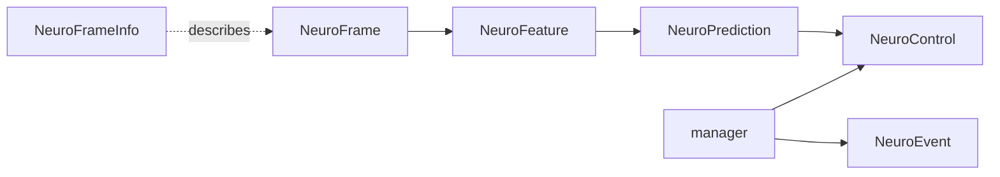

# Messages and data types

All messages live in the `ros2neuro_msgs` package. They are the contract between every node of the stack.



## Overview

Click a message name to jump to its description.

| Message | Role | Produced by | Consumed by |
|---|---|---|---|
| [`NeuroFrame`](#neuroframe) | one synchronous chunk of analog and trigger samples | acquisition, filters | filters, processing, recorder, visualizer |
| [`NeuroFrameInfo`](#neuroframeinfo) | static description of the stream (rate, channels, labels) | acquisition | recorder, visualizer |
| [`NeuroFeature`](#neurofeature) | processed data of any dimensionality (PSD, spectrogram...) | processing | decoder |
| [`NeuroPrediction`](#neuroprediction) | decoder output, one value per class | decoder | integrator |
| [`NeuroControl`](#neurocontrol) | integrated or normalised control values plus discrete actions | integrator, manager | manager, feedback |
| [`NeuroEvent`](#neuroevent) | sparse marker (trial start, cue, outcome...) | manager, feedback | recorder, integrator |

Helper messages, embedded in the ones above:

| Message | Embedded in | Describes |
|---|---|---|
| [`NeuroSensor`](#neurosensor) | `NeuroFrame` | an analog block (EEG, EMG, EOG...) |
| [`NeuroTrigger`](#neurotrigger) | `NeuroFrame` | a digital block (trigger lines, markers) |
| [`NeuroSensorInfo`](#neurosensorinfo) | `NeuroFrameInfo` | the metadata of an analog block |
| [`NeuroTriggerInfo`](#neurotriggerinfo) | `NeuroFrameInfo` | the metadata of a digital block |
| [`NeuroAxis`](#neuroaxis) | `NeuroFeature` | the meaning of one dimension of a feature |

---

## NeuroFrame

**`NeuroFrame`** is the atomic chunk coming from a device. It carries `NeuroSensor[]` (analog, `float32`) and
`NeuroTrigger[]` (digital, `int32`) that were acquired at the same time.

```text
std_msgs/Header header      # stamp = acquisition time of the FIRST sample
string          device_id
uint32          samples     # samples per channel in this chunk
float32         samplerate  # Hz
NeuroSensor[]   sensors
NeuroTrigger[]  triggers
```

The time of sample `k` is `header.stamp + k / samplerate`.

### Data layout: sample-major

Every flattened data array is **sample-major**: all channels of sample 0, then all channels of sample 1, and so on.

```text
index = sample * channels + channel
[s0c0, s0c1, ..., s0c(C-1),  s1c0, s1c1, ..., s(S-1)c(C-1)]
```

The size of `data` must be `samples * channels`. All publishers and consumers must respect this.

### NeuroSensor

**`NeuroSensor`** is one analog block of a frame.

| Field | Meaning |
|---|---|
| `name` | logical stream name (`EEG`, `EMG`, `EOG`...) |
| `channels` | number of channels |
| `labels` | channel names (optional, `labels.size() == channels`) |
| `data` | `float32[]`, sample-major |

Labels travel with the runtime data, so a processing node can read channel names without subscribing to the
metadata topic.

### NeuroTrigger

**`NeuroTrigger`** is one digital block of a frame (trigger lines, event codes).

| Field | Meaning |
|---|---|
| `name` | logical block name |
| `channels` | number of digital channels |
| `labels` | channel names (optional, `labels.size() == channels`) |
| `data` | `int32[]`, sample-major |

---

## NeuroFrameInfo

**`NeuroFrameInfo`** is the slow metadata of a stream: its rate, its blocks, its channels. It should be published
with **`transient_local`** QoS so that late subscribers still receive it.

```text
std_msgs/Header     header
string              device_id
float32             samplerate
NeuroSensorInfo[]   sensors
NeuroTriggerInfo[]  triggers
```

### NeuroSensorInfo

**`NeuroSensorInfo`** describes one analog block: `name`, `type`, `channels`, `unit`, `transducer`,
`hardware_filter`, `min_value`, `max_value`, `labels`. The `type` constant is one of `TYPE_EEG` (1), `TYPE_EMG` (2),
`TYPE_EOG` (3), `TYPE_ECG` (4), `TYPE_GSR` (5), `TYPE_RESP` (6), `TYPE_MISC` (255), `TYPE_UNKNOWN` (0).

### NeuroTriggerInfo

**`NeuroTriggerInfo`** describes one digital block. It has the same descriptive fields as `NeuroSensorInfo`
(`min_value` and `max_value` are integers) plus an `encoding` that says how to read `data`:
`ENCODING_STATE_PER_SAMPLE` (0, state of the digital line), `ENCODING_CODE_PER_SAMPLE` (1, one event code per sample),
`ENCODING_BITMASK_PER_SAMPLE` (2, bitmask of lines).

---

## NeuroFeature

**`NeuroFeature`** is a generic N-dimensional tensor, the output of every processing node.

```text
std_msgs/Header header      # stamp = END of the analysis window
string          name        # e.g. psd
uint8           type        # TYPE_SPECTRUM, TYPE_TIME_FREQUENCY, ...
float32         window_length  # seconds
uint32[]        shape
float32[]       data        # flattened, row-major (last dimension fastest)
NeuroAxis[]     axes        # one per dimension of shape
string          unit
string          description
```

| Type constant | Value | Typical content |
|---|---|---|
| `TYPE_TIME_SERIES` | 1 | power trajectory |
| `TYPE_SPECTRUM` | 2 | PSD (FFT, Welch) |
| `TYPE_TIME_FREQUENCY` | 3 | spectrogram |
| `TYPE_CONNECTIVITY` | 4 | coherence, PLV |
| `TYPE_VECTOR` | 5 | feature vector |
| `TYPE_MATRIX` | 6 | generic matrix |
| `TYPE_MISC` | 255 | anything else |

Rules: `axes.size() == shape.size()`, `data.size()` is the product of `shape`, and when an axis has `labels` or
`values` their size equals the corresponding `shape` entry.

!!! warning "Check shape and axes before relying on the order"
    The documented order for FFT and Welch is `[frequency, channel]`, but a Welch node launched in the test
    pipeline has been observed publishing `shape [16, 23]` with axes `channels, frequency`. Always read `shape`
    and `axes` instead of assuming a fixed order.

### NeuroAxis

**`NeuroAxis`** describes one dimension of a feature: `name` (`channels`, `frequency`, `time`...), `unit` (`Hz`,
`s`), `labels` (for discrete axes, such as channel names) and `values` (numeric coordinates, such as frequency bins).

---

## NeuroPrediction

**`NeuroPrediction`** is the output of a decoder: one value per class.

```text
std_msgs/Header header
string          decoder      # name of the decoder
string[]        fields       # one entry per class
float32[]       values       # same size as fields
uint8           type         # TYPE_PROBABILITIES, TYPE_SCORES, TYPE_LOGITS, TYPE_REGRESSION, TYPE_UNSPECIFIED
```

`fields[i]` names the class of `values[i]`. A class name can be a catalog name (`BOTH_HANDS`) or the code as a
string (`773`), see [Protocols](protocols.md).

---

## NeuroControl

**`NeuroControl`** is used twice: as output of the integrator and as the flow that the manager sends to the
feedback.

```text
std_msgs/Header header
string          source      # node that produced it
string[]        fields      # continuous dimensions (class probabilities, scores...)
float32[]       values      # same size as fields
string[]        actions     # discrete actions
int32[]         commands    # same size as actions
```

Continuous values go in `fields`/`values`, discrete information in `actions`/`commands`. The manager uses
`actions`/`commands` to carry a progressive counter `seq`, the current phase (`event`) or the trial outcome
(`outcome`).

---

## NeuroEvent

**`NeuroEvent`** is a sparse marker: a trial that starts, a cue, an outcome, a blink.

```text
std_msgs/Header header
int32           event_id
float64         onset
int32           family_id
string          description
```

`event_id` identifies the event (see the [event codes](protocols.md#event-codes)). `onset` is the onset in
seconds in the timeline of the publisher; recorders typically use a time relative to the start of the
recording. The recorder keys event types on the pair (`event_id`, `family_id`).

---

## QoS

| Message | Recommended QoS |
|---|---|
| [`NeuroFrame`](#neuroframe) | sensor-data profile, low latency |
| [`NeuroFrameInfo`](#neuroframeinfo) | reliable + `transient_local` |
| [`NeuroFeature`](#neurofeature) | reliable |
| [`NeuroEvent`](#neuroevent) | reliable |

---

## In-memory types: ros2neuro_data

Plugins do not build ROS messages by hand. The `ros2neuro_data` library provides C++ structs that mirror the
messages (`NeuroFrame`, `NeuroSensor`, `NeuroTrigger`, `NeuroFeature`, `NeuroAxis`, and the template
`NeuroSignal<T>` shared by sensors and triggers), plus validation (`NeuroDataValidate.h`) and conversion
(`NeuroDataConvert.h`) helpers. A device fills a `ros2neuro::data::NeuroFrame`, the frame is validated and
converted to the ROS message, then published. See [Messages and data library](../packages/msgs-data.md).
