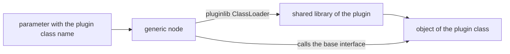

# Plugins

ROS2neuro uses [`pluginlib`](https://docs.ros.org/en/rolling/Tutorials/Beginner-Client-Libraries/Pluginlib.html)
for everything that has more than one implementation. A *base package* defines an interface and a generic node,
and each *plugin package* provides one implementation, compiled into a shared library that the node loads at
startup.

## How it works



1. The user selects the implementation with a **parameter** holding the pluginlib class name.
2. The generic node asks the `ClassLoader` for that class.
3. The loader finds it through the `plugins.xml` files exported by the installed packages, loads the library
   and creates the object.
4. From then on the node only calls the methods of the base interface.

Adding a backend never requires changing the generic node.

## The plugin families

| Base package | Base class | How to select it | Plugin packages |
|---|---|---|---|
| [`ros2neuro_acquisition`](../packages/acquisition/index.md) | [`ros2neuro::acquisition::NeuroDevice`](../packages/acquisition/index.md) | `acquisition.plugin` | [`acquisition_dummy`](../packages/acquisition/dummy.md), [`acquisition_lsl`](../packages/acquisition/lsl.md), [`acquisition_eegdev`](../packages/acquisition/eegdev.md), [`acquisition_antneuro`](../packages/acquisition/antneuro.md), [`acquisition_gusbamp`](../packages/acquisition/gusbamp.md), [`acquisition_xdf`](../packages/acquisition/xdf.md) |
| [`ros2neuro_filters`](../packages/filters/index.md) | [`ros2neuro::filters::Filter<float>`](../packages/filters/index.md) | `filters.chain` list, `filters.<name>.class` | [`filters_dc`](../packages/filters/dc.md), [`filters_butterworth`](../packages/filters/butterworth.md), [`filters_car`](../packages/filters/car.md), [`filters_laplacian`](../packages/filters/laplacian.md), [`filters_hann`](../packages/filters/hann.md), [`filters_hamming`](../packages/filters/hamming.md), [`filters_blackman`](../packages/filters/blackman.md), [`filters_flattop`](../packages/filters/flattop.md) |
| [`ros2neuro_decoder`](../packages/decoder/index.md) | [`ros2neuro::decoder::Decoder`](../packages/decoder/index.md) | `type` field of the model `manifest.yaml` | [`decoder_lda`](../packages/decoder/lda.md), [`decoder_qda`](../packages/decoder/qda.md), [`decoder_svm`](../packages/decoder/svm.md), [`decoder_gaussian`](../packages/decoder/gaussian.md) |
| [`ros2neuro_integrator`](../packages/integrator/index.md) | [`ros2neuro::integrator::Integrator`](../packages/integrator/index.md) | `integrator.type` | [`integrator_exponential`](../packages/integrator/exponential.md), [`integrator_buffer`](../packages/integrator/buffer.md) |
| [`ros2neuro_recorder`](../packages/recorder/index.md) | [`ros2neuro::recorder::NeuroRecorder`](../packages/recorder/index.md) | `plugin` | [`recorder_xdf`](../packages/recorder/xdf.md) |
| [`ros2neuro_manager`](../packages/manager/index.md) | [`ros2neuro::manager::ManagerPlugin`](../packages/manager/index.md) | `plugin` | [`manager_synchronous`](../packages/manager/synchronous.md) (`Training`), [`manager_asynchronous`](../packages/manager/asynchronous.md) (`Control`) |
| [`ros2neuro_feedback`](../packages/feedback/index.md) | [`ros2neuro::feedback::FeedbackPlugin`](../packages/feedback/index.md) | `plugin` | [`feedback_wheel`](../packages/feedback/wheel.md) (`Wheel`), [`feedback_bar`](../packages/feedback/bar.md) (`Bar`) |

!!! note "Not everything is a plugin"
    The **processing** stage has no plugin family and no base class: the Welch node and the buffer node are ordinary
    nodes, and you choose one by starting it in the launch file. A new processing is a new node that publishes a
    `NeuroFeature`. See [Processing](../packages/processing/index.md).

Selecting a plugin in a launch parameter file:

```yaml
/acquisition:
  ros__parameters:
    acquisition.plugin: ros2neuro::acquisition::XDFDevice

/integrator:
  ros__parameters:
    integrator.type: ros2neuro::integrator::Exponential
```

## Anatomy of a plugin package

Every plugin package has the same layout:

```text
ros2neuro_filters_dc/
├── CMakeLists.txt
├── package.xml
├── plugins.xml          # declares the class(es) for pluginlib
├── include/             # public headers
├── src/                 # implementation
└── test/                # gtest, and sometimes a MATLAB comparison script
```

### `plugins.xml`

Declares, for each class, its name, its C++ type and the base class it implements:

```xml
<library path="ros2neuro_filters_dc">
  <class
      name="ros2neuro_filters_dc/DcFloat"
      type="ros2neuro::filters::DcFloat"
      base_class_type="ros2neuro::filters::Filter&lt;float&gt;">
    <description>DC offset removal filter.</description>
  </class>
</library>
```

- `path` is the name of the shared library built by the package.
- `name` is the class name users write in parameters. When `name` is omitted, `type` is used.
- `base_class_type` must match the base class the generic node loads (note the escaped `<` and `>`).

### Registering the class

In the `.cpp` file, at global scope:

```cpp
#include <pluginlib/class_list_macros.hpp>
PLUGINLIB_EXPORT_CLASS(ros2neuro::filters::DcFloat, ros2neuro::filters::Filter<float>)
```

### `CMakeLists.txt`

The library is built as a shared library, and the description file is exported to the base package:

```cmake
pluginlib_export_plugin_description_file(ros2neuro_filters plugins.xml)
```

Each family uses its own base package name in this call ([`ros2neuro_acquisition`](../packages/acquisition/index.md), [`ros2neuro_decoder`](../packages/decoder/index.md),
[`ros2neuro_integrator`](../packages/integrator/index.md), [`ros2neuro_recorder`](../packages/recorder/index.md), [`ros2neuro_manager`](../packages/manager/index.md), [`ros2neuro_feedback`](../packages/feedback/index.md)).

## Practical notes

- A plugin that holds a `shared_ptr` to its node must be released before the node exits, otherwise the class
  loader prints a warning. The manager and feedback nodes call `release_plugin()` for this.
- If a plugin class is not found, check that its package is installed, that the workspace is sourced
  (`source install/setup.bash`) and that the class name in the parameter matches `plugins.xml` exactly.
- [`ros2neuro_devel_test`](../packages/devel-test.md) shows complete parameter files that select a plugin for every node.

See the tutorials [Writing a filter plugin](../tutorials/filter-plugin/index.md) and
[Writing an integrator plugin](../tutorials/integrator-plugin/index.md) for a complete, compilable example.
