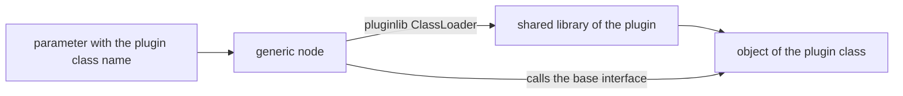

# Plugins

ROS2neuro uses [`pluginlib`](https://docs.ros.org/en/rolling/Tutorials/Beginner-Client-Libraries/Pluginlib.html)
for everything that has more than one implementation. A *base package* defines an interface and a generic node,
and each *plugin package* provides one implementation, compiled into a shared library that the node loads at
startup.

## How it works



1. The user selects the implementation with a **parameter** holding the pluginlib class name.
2. The generic node asks the `ClassLoader` for that class.
3. The loader finds it through the `plugins.xml` files exported by the installed packages, loads the library
   and creates the object.
4. From then on the node only calls the methods of the base interface.

Adding a backend never requires changing the generic node.

## The plugin families

| Base package | Base class | How to select it | Plugin packages |
|---|---|---|---|
| `ros2neuro_acquisition` | `ros2neuro::acquisition::NeuroDevice` | `acquisition.plugin` | `acquisition_dummy`, `acquisition_lsl`, `acquisition_eegdev`, `acquisition_antneuro`, `acquisition_gusbamp`, `acquisition_xdf` |
| `ros2neuro_filters` | `ros2neuro::filters::Filter<float>` | `filters.chain` list, `filters.<name>.class` | `filters_dc`, `filters_butterworth`, `filters_car`, `filters_laplacian`, `filters_hann`, `filters_hamming`, `filters_blackman`, `filters_flattop` |
| `ros2neuro_decoder` | `ros2neuro::decoder::Decoder` | `type` field of the model `manifest.yaml` | `decoder_lda`, `decoder_qda`, `decoder_svm`, `decoder_gaussian` |
| `ros2neuro_integrator` | `ros2neuro::integrator::Integrator` | `integrator.type` | `integrator_exponential`, `integrator_buffer` |
| `ros2neuro_recorder` | `ros2neuro::recorder::NeuroRecorder` | `plugin` | `recorder_xdf` |
| `ros2neuro_manager` | `ros2neuro::manager::ManagerPlugin` | `plugin` | `manager_synchronous` (`Training`), `manager_asynchronous` (`Control`) |
| `ros2neuro_feedback` | `ros2neuro::feedback::FeedbackPlugin` | `plugin` | `feedback_wheel` (`Wheel`), `feedback_bar` (`Bar`) |

Selecting a plugin in a launch parameter file:

```yaml
/acquisition:
  ros__parameters:
    acquisition.plugin: ros2neuro::acquisition::XDFDevice

/integrator:
  ros__parameters:
    integrator.type: ros2neuro::integrator::Exponential
```

## Anatomy of a plugin package

Every plugin package has the same layout:

```text
ros2neuro_filters_dc/
├── CMakeLists.txt
├── package.xml
├── plugins.xml          # declares the class(es) for pluginlib
├── include/             # public headers
├── src/                 # implementation
└── test/                # gtest, and sometimes a MATLAB comparison script
```

### `plugins.xml`

Declares, for each class, its name, its C++ type and the base class it implements:

```xml
<library path="ros2neuro_filters_dc">
  <class
      name="ros2neuro_filters_dc/DcFloat"
      type="ros2neuro::filters::DcFloat"
      base_class_type="ros2neuro::filters::Filter&lt;float&gt;">
    <description>DC offset removal filter.</description>
  </class>
</library>
```

- `path` is the name of the shared library built by the package.
- `name` is the class name users write in parameters. When `name` is omitted, `type` is used.
- `base_class_type` must match the base class the generic node loads (note the escaped `<` and `>`).

### Registering the class

In the `.cpp` file, at global scope:

```cpp
#include <pluginlib/class_list_macros.hpp>
PLUGINLIB_EXPORT_CLASS(ros2neuro::filters::DcFloat, ros2neuro::filters::Filter<float>)
```

### `CMakeLists.txt`

The library is built as a shared library, and the description file is exported to the base package:

```cmake
pluginlib_export_plugin_description_file(ros2neuro_filters plugins.xml)
```

Each family uses its own base package name in this call (`ros2neuro_acquisition`, `ros2neuro_decoder`,
`ros2neuro_integrator`, `ros2neuro_recorder`, `ros2neuro_manager`, `ros2neuro_feedback`).

## Practical notes

- A plugin that holds a `shared_ptr` to its node must be released before the node exits, otherwise the class
  loader prints a warning. The manager and feedback nodes call `release_plugin()` for this.
- If a plugin class is not found, check that its package is installed, that the workspace is sourced
  (`source install/setup.bash`) and that the class name in the parameter matches `plugins.xml` exactly.
- `ros2neuro_devel_test` shows complete parameter files that select a plugin for every node.

See the tutorials [Writing a filter plugin](../tutorials/filter-plugin/index.md) and
[Writing an integrator plugin](../tutorials/integrator-plugin/index.md) for a complete, compilable example.
