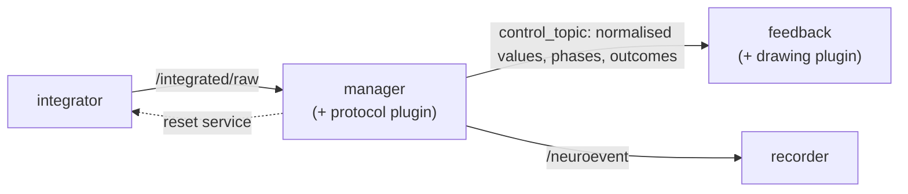
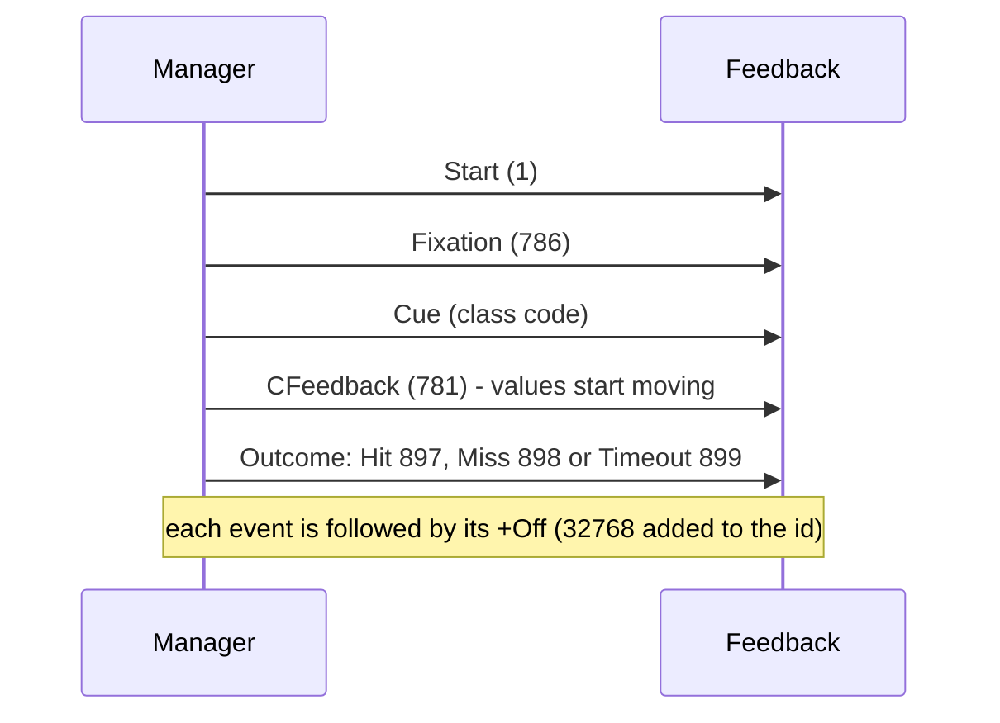

# Protocols: manager and feedback

The signal chain ends with the integrator, which outputs class values but knows nothing about an experiment.
The **protocol layer** adds the experiment on top of it:



| Node | Package | Plugins | Role |
|---|---|---|---|
| Manager | [`ros2neuro_manager`](../packages/manager/index.md) | `Training` ([`manager_synchronous`](../packages/manager/synchronous.md)), `Control` ([`manager_asynchronous`](../packages/manager/asynchronous.md)) | owns the protocol, the only publisher of events |
| Feedback | [`ros2neuro_feedback`](../packages/feedback/index.md) | `Wheel` ([`feedback_wheel`](../packages/feedback/wheel.md)), `Bar` ([`feedback_bar`](../packages/feedback/bar.md)) | **passive**: draws what the manager says |

The feedback never reads `/neuroevent` and never decides anything: it reads only the manager's control topic.

## The two protocols

The trials of `Training` follow the **cueing paradigm** of Posner (M. I. Posner, "Orienting of attention", *Quarterly Journal of Experimental Psychology*, 32(1), 3-25, 1980, [doi:10.1080/00335558008248231](https://doi.org/10.1080/00335558008248231)): a fixation, a cue that tells the subject what to do, then the feedback. The asynchronous protocol (`Control`) has no cues.

| Plugin | Protocol | What happens |
|---|---|---|
| `Training` with `modality: calibration` | calibration | a sequence of trials with cues; an autopilot drives the feedback, the classifier is not read |
| `Training` with `modality: evaluation` | evaluation | the same trials, but the real classifier output drives the feedback and each trial gets an outcome |
| `Control` | free control | continuous control; when a class reaches its threshold the manager asks the integrator for a reset. No trials, no cues |

### Trial sequence (calibration and evaluation)



Each event leaves the manager twice with the same timestamp: first on `/neuroevent` (so it is recorded), then on
the flow to the feedback.

## Event codes

| Event | id | Meaning |
|---|---|---|
| Start | 1 | trial starts |
| CFeedback | 781 | continuous feedback starts |
| Fixation | 786 | fixation cross |
| Hit | 897 | target class reached |
| Miss | 898 | another class reached |
| Timeout | 899 | time over, nobody reached a threshold |
| Blink | 1024 | blink marker |
| Off | +32768 | added to the id of the event it closes |
| Shown | +16384 | added to the id of what the feedback has displayed |

The **cue** of a class is an event whose id is the class code.

## Classes and codes

`classes` is the list of class codes of the protocol; its **order is the feedback layout** (which bar is which,
which class is on the left of the wheel).

- Class codes are free: any integer in 1..16383 that is not an event id (1, 781, 786, 897, 898, 899, 1024).
  The codes 769, 770, 771, 773 are only the project's conventions; 501 works as well.
- The **rest** (code **783**) is the only special code. It always has trials and cues and is always yellow.
- Colors never depend on the code: the feedback colors a class by its **position** in `classes`.
- The catalog gives names to the codes the project knows, for logs and for the `fields` of the integrator:

| Code | Name |
|---|---|
| 769 / 770 | `LEFT_HAND` / `RIGHT_HAND` |
| 771 / 773 | `BOTH_FEET` / `BOTH_HANDS` |
| 783 | `REST` |
| 730 / 731 | `BOTTOM_LEFT` / `BOTTOM_RIGHT` |
| 750 / 751 | `MI_LEFT` / `MI_RIGHT` |

## The shared layout

Three parameters are declared **once** and loaded by both the manager and the feedback, so that both build the
same layout:

| Parameter | Meaning |
|---|---|
| `classes` | class codes, order = feedback layout |
| `rest_mode` | `none` (default), `timeout` or `class` |
| `thresholds` | one threshold per class that has a classifier output, in the order of the output classes |

From them:

- `protocol_classes` = `classes` (the rest included: it has trials and cues);
- `output_classes` = the classes with a classifier output (`classes` minus 783, unless `rest_mode: class`);
- `K` = number of output classes; `thresholds` must have exactly K values in `(0, 1]`.

### Rest modes

| `rest_mode` | The rest is... |
|---|---|
| `none` | not said; behaves like `timeout`. This is what a **calibration** needs |
| `timeout` | a trial with a cue and no classifier output. In an evaluation it is a **Hit** if no threshold is touched for `rest_timeout` seconds |
| `class` | a normal class with its own output and threshold (needs 783 in `classes`) |

An **evaluation** or a **control** with 783 in `classes` must set `rest_mode` to `timeout` or `class`; the plugin
refuses to start otherwise. With `timeout`, an evaluation also requires `rest_timeout` (seconds).

```yaml
/**:
  ros__parameters:
    classes: [773, 771, 783]
    rest_mode: timeout
    thresholds: [0.7, 0.7]
```

## From integrator values to the flow

Each `NeuroControl` from the integrator goes through the same steps:

1. **Map `fields` to classes.** A `fields[i]` that is an integer string is that code; otherwise it is looked up
   by name in the catalog (upper case, spaces and `-` become `_`). The order of the integrator outputs does not
   matter.
2. **`input_fields`** (manager only): if the model publishes other codes than `classes` (the model says 773/771
   but the experiment calls the classes 501/502), `input_fields: [773, 771]` gives the model code of each class,
   in the order of `classes`.
3. **Normalise**: `v_i / sum`. The integrator publishes accumulators, not probabilities, so only the normalised
   vector is ever used. A non-positive sum gives the uniform vector `1/K`.
4. **Publish** on `control_topic` (default `/manager_control/probabilities`) as a `NeuroControl` whose `fields` are
   the class codes as strings, `values` the normalised vector and `actions`/`commands` carry `seq` plus, when
   relevant, the phase (`event`) or the trial result (`outcome`).

Invalid messages are dropped with a throttled error, and the protocol keeps running.

## Reset

A reset is a **service call** (`std_srvs/Empty`), not a topic.

- The integrator creates the service `reset`, which is `/reset` at the root namespace. The manager's default is
  `/integrator/reset`, so launch files pass `reset_service:=/reset`.
- Every reset makes the integrator publish a message whose values are all `1/K`.
- In **control**, the manager calls the service when a class reaches its threshold. Until the neutral message
  arrives it neither forwards values nor decides anything. If the message does not arrive within **1 s**, the
  pipeline is broken: the manager logs an error and shuts down with exit code 1.
- In **training**, the integrator resets itself on the event configured in `integrator.reset_event`
  (781, CFeedback); the manager does not request it.

## The feedback

The feedback core rebuilds the same layout and delegates the drawing to a plugin. It runs in one of two modes:
`control` (values only) or `training` (values plus fixation, cue and boom).

- **Wheel**: exactly two classes with an output. A line moves on a ring; threshold markers show the targets.
- **Bar**: one bar per classifier output, each with its own color and a white threshold line.

Both are drawn with [neurodraw](../packages/feedback/neurodraw.md). See the package pages for the colors and the
behaviour of the rest.

## Where to look next

- [Manager](../packages/manager/index.md) and its plugins
  [synchronous](../packages/manager/synchronous.md) and [asynchronous](../packages/manager/asynchronous.md)
- [Feedback](../packages/feedback/index.md), [wheel](../packages/feedback/wheel.md), [bar](../packages/feedback/bar.md)
- [`ros2neuro_devel_test`](../packages/devel-test.md): ready launchers for calibration, evaluation and control
