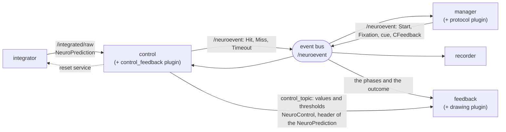

# Protocols: control, manager and feedback

The signal chain ends with the integrator, which outputs class values but knows nothing about an experiment.
Three nodes add the experiment on top of it:



| Node | Package | Plugins | Role |
|---|---|---|---|
| Control | [`ros2neuro_control`](../packages/control/index.md) | `Feedback` ([`control_feedback`](../packages/control/feedback.md)) | knows the **thresholds**: drives the feedback, decides the outcome, resets the integrator |
| Manager | [`ros2neuro_manager`](../packages/manager/index.md) | `Synchronous` ([`manager_synchronous`](../packages/manager/synchronous.md)), `Asynchronous` ([`manager_asynchronous`](../packages/manager/asynchronous.md)) | runs the **trials**: when each phase happens |
| Feedback | [`ros2neuro_feedback`](../packages/feedback/index.md) | `Wheel` ([`feedback_wheel`](../packages/feedback/wheel.md)), `Bar` ([`feedback_bar`](../packages/feedback/bar.md)) | **passive**: draws what the bus and control say |

The feedback never decides anything: it hears the event bus (the phases the manager writes and the outcome control writes) and the flow
of control (the values and the thresholds) and draws them. The two nodes that take decisions share the work through the event bus:

- the **manager** writes the start of the phases of a trial (Start, Fixation, cue, CFeedback, and the `+Off` of the first three), hears
  the outcome, closes it after the boom and goes on with the next trial;
- **control** is the node that knows the thresholds, so it decides the trial: it writes the end of the continuous feedback
  (CFeedback+Off) and the outcome (Hit / Miss / Timeout). It hears the cue (the class of the trial) and CFeedback (the continuous
  feedback starts), and publishes the **flow**: the values and the thresholds, with the header of the `NeuroPrediction` they come from.

**Nobody asks anybody for anything.** Each node reads its own parameters. What several nodes share (`classes`, `rest_mode`, the ids of the
events, the thresholds) is the same parameter in each of them, written once for every node with a `/**` section of the parameter file (see
[Who holds what](#who-holds-what-the-same-parameters-for-every-node) and [Shared parameters](shared-parameters.md)).

## The three protocols

The trials of calibration and evaluation follow the **cueing paradigm** of Posner (M. I. Posner, "Orienting of attention", *Quarterly Journal of Experimental Psychology*, 32(1), 3-25, 1980, [doi:10.1080/00335558008248231](https://doi.org/10.1080/00335558008248231)): a fixation, a cue that tells the subject what to do, then the feedback. Free control has no cues.

`protocol` is a parameter of the `Feedback` plugin of control:

| `protocol` | Manager plugin | What control does |
|---|---|---|
| `calibration` | `Synchronous` | an **autopilot** drives the feedback during the continuous feedback, the classifier is not read; the outcome is a Hit |
| `evaluation` | `Synchronous` | the **real values** of the integrator drive the feedback; Hit / Miss on the first threshold touched, Timeout when the time is over |
| `control` | `Asynchronous` (writes nothing) | free control: every value is forwarded; when a class reaches its threshold control resets the integrator. No trials, no cues |

### Trial sequence (calibration and evaluation)

```mermaid
sequenceDiagram
    participant M as Manager
    participant B as Event bus
    participant C as Control (Feedback)
    participant F as Feedback
    M->>B: Start (1), Fixation (786), cue (class code)
    B->>C: cue: the class of the trial
    M->>B: CFeedback (781)
    B->>C: the continuous feedback starts
    C->>F: values and thresholds (autopilot or real) on the flow
    B->>F: Fixation, cue, the outcome (the feedback hears the bus)
    C->>B: CFeedback+Off, then the outcome: Hit 897, Miss 898 or Timeout 899
    B->>M: the outcome ends the feedback
    M->>B: after the boom, the end of the outcome (+Off), then the next trial (Start...)
    Note over M,F: +Off is 32768 added to the id; the feedback hears the bus and the flow
```

The manager waits `duration.begin` ms before the first trial, shuffles the order of the classes, and stops with an error if the
outcome does not arrive within `duration.outcome_wait`. The length of the continuous feedback (a random time in
`duration.feedback_min..feedback_max` for the autopilot, `duration.timeout` in an evaluation) are parameters of **control**; the boom
is the manager's own.

## Event codes

| Event | id | Meaning |
|---|---|---|
| Start | 1 | trial starts |
| CFeedback | 781 | continuous feedback starts |
| Fixation | 786 | fixation cross |
| Hit | 897 | target class reached |
| Miss | 898 | another class reached |
| Timeout | 899 | time over, nobody reached a threshold |
| Off | +32768 | added to the id of the event it closes |
| Shown | +16384 | added to the id of what the feedback has displayed |

The **cue** of a class is an event whose id is the class code. The manager writes the phases and the end of the outcome; control writes the end of the continuous feedback, Hit, Miss and Timeout.

## Classes and codes

`classes` is the list of class codes of the protocol; its **order is the feedback layout** (which bar is which,
which class is on the left of the wheel).

- Class codes are free: any integer in 1..16383 that is not an event id (1, 781, 786, 897, 898, 899).
  The codes 769, 770, 771, 773 are only the project's conventions; 501 works as well.
- The **rest** (code **783**) is the only special code. It always has trials and cues and is always yellow.
- Colors never depend on the code: the feedback colors a class by its **position** in `classes`.
- The catalog gives names to the codes the project knows, for logs and for the `fields` of the integrator:

| Code | Name |
|---|---|
| 769 / 770 | `LEFT_HAND` / `RIGHT_HAND` |
| 771 / 773 | `BOTH_FEET` / `BOTH_HANDS` |
| 783 | `REST` |
| 730 / 731 | `BOTTOM_LEFT` / `BOTTOM_RIGHT` |
| 750 / 751 | `MI_LEFT` / `MI_RIGHT` |

## Who holds what: the same parameters for every node

Every node reads **its own parameters**; none asks another node (there is no code shared between the three nodes either). What several
of them need is the same parameter in each, with the same value, written once for every node in a `/**` section of the parameter
file that all of them load:

| Parameter | Meaning | Read by |
|---|---|---|
| `classes` | class codes, order = feedback layout | manager, control, feedback |
| `rest_mode` | `none` (default), `timeout` or `class` | manager, control, feedback |
| `event.start`, `event.fixation`, `event.cfeedback`, `event.hit`, `event.miss`, `event.timeout`, `event.off`, `event.shown` | the ids of the events (defaults 1, 786, 781, 897, 898, 899, 32768, 16384) | manager, control, feedback |
| `thresholds` | one per class that has a classifier output, in the order of the output classes, each in `(0, 1]` | control, feedback (the initial markers) |

The durations of the trials (`duration.*`) are the manager's; the ones of the continuous feedback (`duration.feedback_min`,
`duration.feedback_max`, `duration.timeout`, `rest_timeout`) are control's.

The **thresholds** can be changed while running, in every protocol:

```bash
ros2 param set /control thresholds "[0.8, 0.8]"      # control uses them at once; its next flow message carries them and the feedback moves its markers
```

From the classes and the `rest_mode`, control and the feedback each build their own layout:

- `protocol_classes` = `classes` (the rest included: it has trials and cues);
- `output_classes` = the classes with a classifier output (`classes` minus 783, unless `rest_mode: class`);
- `K` = number of output classes; `thresholds` must have exactly K values.

### Rest modes

| `rest_mode` | The rest is... |
|---|---|
| `none` | not said; behaves like `timeout`. This is what a **calibration** needs |
| `timeout` | a trial with a cue and no classifier output. In an evaluation it is a **Hit** if no threshold is touched for `rest_timeout` seconds |
| `class` | a normal class with its own output and threshold (needs 783 in `classes`) |

An **evaluation** or a **control** with 783 in `classes` must set `rest_mode` to `timeout` or `class`; the plugin
refuses to start otherwise. With `timeout`, an evaluation also requires `rest_timeout` (seconds).

```yaml
/**:
  ros__parameters:
    classes: [773, 771, 783]
    rest_mode: timeout
    thresholds: [0.7, 0.7]
```

## From integrator values to the flow

Control ([`ros2neuro_control_feedback`](../packages/control/feedback.md)) takes every `NeuroPrediction` from the integrator through the same steps:

1. **Map `fields` to classes.** A `fields[i]` that is an integer string is that code; otherwise it is looked up
   by name in the catalog (upper case, spaces and `-` become `_`). The order of the integrator outputs does not
   matter.
2. **`input_fields`**: if the model publishes other codes than `classes` (the model says 773/771
   but the experiment calls the classes 501/502), `input_fields: [773, 771]` gives the model code of each class,
   in the order of `classes`.
3. **Normalise**: `v_i / sum`. The integrator publishes accumulators or smoothed scores, not necessarily probabilities,
   so only the normalised vector is ever used. A non-positive sum gives the uniform vector `1/K`.
4. **Publish** on `control_topic` (default `/control_feedback/probabilities`) as a `NeuroControl`:
   - `header`: **the header of the `NeuroPrediction` it comes from** (same stamp, same `frame_id`), so everything made from the
     same prediction can be paired by it (the flow, the commands of a robot: see the tutorial
     [Controlling a robot in step with the feedback](../tutorials/robot-control/index.md));
   - `fields` / `values`: the class codes as strings and the normalised vector, then `threshold:<code>` and the thresholds in force
     (the feedback follows a change at run time);
   - `actions` / `commands`: the counter `seq`.
   The phases of the trials and the outcome are not in the flow: they travel on the event bus.

Invalid messages are dropped with a throttled error, and the protocol keeps running.

## Reset

A reset is a **service call** (`std_srvs/Empty`), not a topic.

- The integrator creates the service `reset`, which is `/reset` at the root namespace; it is the default of the control node.
- Every reset makes the integrator publish its reset state (`1/K` for the exponential integrator; `init_val` for the buffer one).
- In **control**, the control node calls the service when a class reaches its threshold. Until the integrator has answered the
  service and a value made from data of after the request arrives (by `header.stamp`), it neither forwards values nor decides
  anything. If no such value arrives within **1 s**, the pipeline is broken: it logs an error and shuts down with exit code 1.
- In **calibration and evaluation**, the integrator resets itself on the event configured in `integrator.reset_event`
  (781, CFeedback); control does not request it. In evaluation, control ignores the values stamped before the CFeedback (the state
  of before the reset): only the values made after it decide the trial.

## The feedback

The feedback core builds the same layout from its own parameters and delegates the drawing to a plugin. It draws the values and the
thresholds of the flow of control, and the fixation, the cue and the boom when the manager and control write them on the event bus: in a
control there are no trials, no events, and only the values are drawn.

- **Wheel**: exactly two classes with an output. A line moves on a ring; threshold markers show the targets.
- **Bar**: one bar per classifier output, each with its own color and a white threshold line.

Both are drawn with [neurodraw](../packages/feedback/neurodraw.md). See the package pages for the colors and the
behaviour of the rest.

## Where to look next

- [Control](../packages/control/index.md) and its plugin [control_feedback](../packages/control/feedback.md)
- [Manager](../packages/manager/index.md) and its plugins
  [synchronous](../packages/manager/synchronous.md) and [asynchronous](../packages/manager/asynchronous.md)
- [Feedback](../packages/feedback/index.md), [wheel](../packages/feedback/wheel.md), [bar](../packages/feedback/bar.md)
- [`ros2neuro_devel_test`](../reproducibility/packages/index.md): ready launchers for calibration, evaluation and control

---

**Next:** [Shared parameters](shared-parameters.md) · [back to the Concepts menu](index.md)
