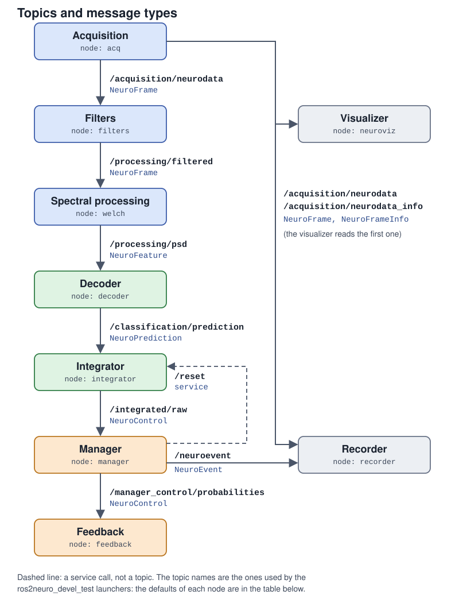

# Topics and services

The names below are the **defaults** of each node. Launch files remap them, so the real names depend on the
node name you give: a node called `acquisition` publishes `~/neurodata` as `/acquisition/neurodata`.



The diagram uses the topic names of the `ros2neuro_devel_test` launchers. Click a message type in the tables below to read its description.

## Topics

| Node | Direction | Default topic | Type | Purpose |
|---|---|---|---|---|
| acquisition | publishes | `~/neurodata` | [`NeuroFrame`](messages.md#neuroframe) | raw samples |
| acquisition | publishes | `~/neurodata_info` | [`NeuroFrameInfo`](messages.md#neuroframeinfo) | stream metadata (`transient_local`) |
| filter chain | subscribes | `/neurodata` | [`NeuroFrame`](messages.md#neuroframe) | signal to filter |
| filter chain | publishes | `~/filtered` | [`NeuroFrame`](messages.md#neuroframe) | filtered signal |
| FFT / Welch / spectrogram | subscribes | `/neurodata` | [`NeuroFrame`](messages.md#neuroframe) | signal to analyse |
| FFT | publishes | `~/fft` | [`NeuroFeature`](messages.md#neurofeature) | spectrum |
| Welch | publishes | `~/psd` | [`NeuroFeature`](messages.md#neurofeature) | power spectral density |
| spectrogram | publishes | `~/spectrogram` | [`NeuroFeature`](messages.md#neurofeature) | time-frequency map |
| decoder | subscribes | `/features` | [`NeuroFeature`](messages.md#neurofeature) | feature to classify |
| decoder | publishes | `~/prediction` | [`NeuroPrediction`](messages.md#neuroprediction) | class values |
| integrator | subscribes | `/prediction` (`input_topic`) | [`NeuroPrediction`](messages.md#neuroprediction) | decoder output |
| integrator | publishes | `~/control` (`output_topic`) | [`NeuroControl`](messages.md#neurocontrol) | integrated values |
| integrator | subscribes | `/neuroevent` (`event_topic`) | [`NeuroEvent`](messages.md#neuroevent) | optional reset on an event |
| manager | subscribes | `/integrated/raw` (`integrated_topic`) | [`NeuroControl`](messages.md#neurocontrol) | integrator output |
| manager | publishes | `/manager_control/probabilities` (`control_topic`) | [`NeuroControl`](messages.md#neurocontrol) | flow for the feedback |
| manager | publishes | `/neuroevent` (`event_topic`) | [`NeuroEvent`](messages.md#neuroevent) | trial events |
| manager (Training plugin) | publishes | `/protocol_ended` | `std_msgs/Empty` | end of the protocol (`transient_local`) |
| feedback | subscribes | `/manager_control/probabilities` (`control_topic`) | [`NeuroControl`](messages.md#neurocontrol) | what to draw |
| feedback | publishes | `/neuroevent` | [`NeuroEvent`](messages.md#neuroevent) | display events, only with `publish_display_events` |
| recorder | subscribes | `/neurodata`, `/neurodata_info`, `/neuroevent` | [`NeuroFrame`](messages.md#neuroframe), [`NeuroFrameInfo`](messages.md#neuroframeinfo), [`NeuroEvent`](messages.md#neuroevent) | what to write |
| visualizer | subscribes | `/acquisition/neurodata` (selectable) | [`NeuroFrame`](messages.md#neuroframe) | scope |

!!! note "Defaults vs launch files"
    The integrator defaults (`/prediction`, `~/control`) differ from the topics used in the test launchers
    (`/classification/prediction`, `/integrated/raw`), which set them through parameters. Always check
    `ros2 topic list` and `ros2 node info` on a running system.

## Services

| Node | Service | Type | Purpose |
|---|---|---|---|
| acquisition | `~/start`, `~/stop`, `~/quit` | `std_srvs/Empty` | control the device |
| integrator | `reset` (relative name, so `/reset`) | `std_srvs/Empty` | reset the integrated values to 1/K |
| manager | client of the integrator reset (`reset_service`, default `/integrator/reset`) | `std_srvs/Empty` | ask for a reset |

The launchers pass `reset_service:=/reset`.

## Useful commands

```bash
ros2 topic list -t                      # topics and their types
ros2 topic hz /acquisition/neurodata    # frame rate
ros2 topic echo /neuroevent             # watch the events
ros2 node info /manager                 # publishers, subscribers, services of a node
ros2 param list /filters                # parameters of a node
```
