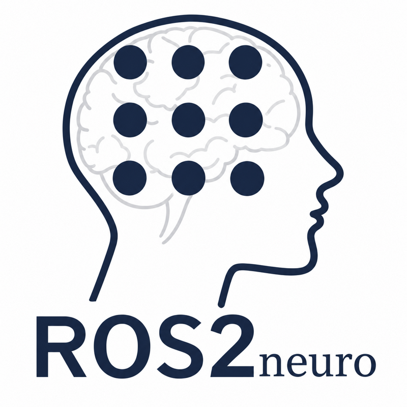

{ .home-logo }

# ROS2neuro

**ROS2neuro** is a modular C++ framework for real-time neurophysiological signal acquisition, processing,
decoding and closed-loop Brain-Computer Interface (BCI) applications, built on **ROS 2**.

Every stage of the pipeline is a ROS 2 node whose behaviour is chosen at launch time by loading a **plugin**:
the amplifier, the filters, the decoder, the integrator, the recorder, the protocol and the feedback are all
interchangeable pieces that talk through a small set of messages.

## Where to start

-   **[Concepts](concepts/architecture.md)**

    How ROS2neuro is organised: the architecture, the messages and their data types, the topics, the plugin
    mechanism and the protocol layer (manager and feedback).

-   **[Packages](packages/index.md)**

    One page per package and per plugin: what it does, which topics and parameters it has and how to use it.

-   **[Tutorials](tutorials/index.md)**

    Step-by-step guides with code that compiles: run a pipeline without hardware, write a filter or an
    integrator plugin, raise an event when a channel power crosses a threshold, check the EOG.

## The stack in one paragraph

Data flows from the hardware (or a GDF file) through the **acquisition**, the **filters** and the
**processing** (a Welch spectrum for the classic classifiers, a window of the signal for the deep-learning ones), is
classified by a **decoder** and smoothed by an **integrator**. A **manager**
runs the protocol (calibration, evaluation or free control), emits the events and tells a passive
**feedback** what to draw. A **recorder** writes everything to GDF/BDF and a **visualizer** shows the signals.

## Conventions used in this documentation

- Package names are written as in the workspace ([`ros2neuro_filters`](packages/filters/index.md)), plugin classes with their full
  pluginlib name ([`ros2neuro::acquisition::XDFDevice`](packages/acquisition/xdf.md)).
- Commands assume a sourced ROS 2 environment (`source /opt/ros/<distro>/setup.bash`) and the workspace installed (`source install/setup.bash`).
- Parameters are shown in YAML (`ros__parameters`), the way they are normally passed to a node.
