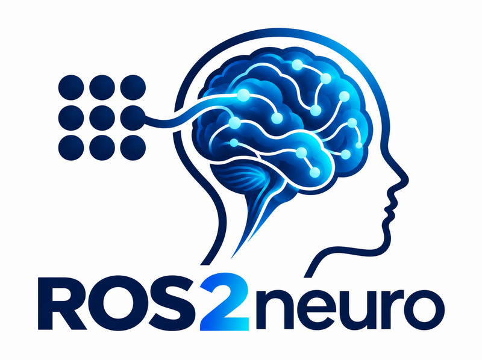
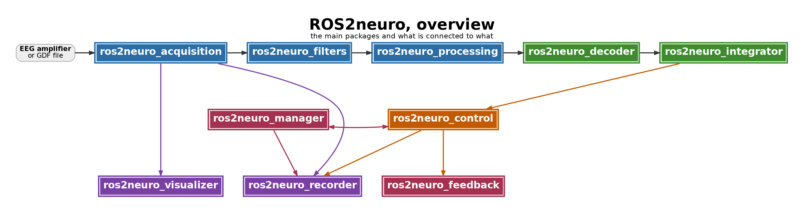
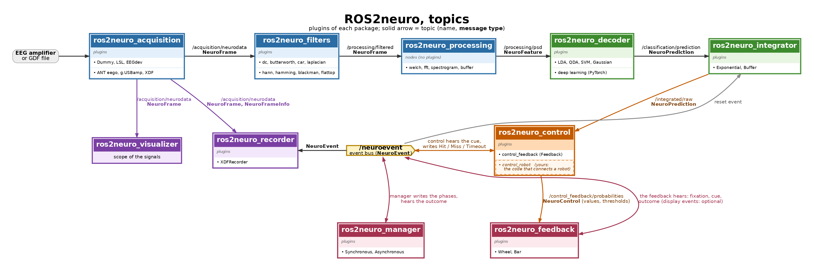
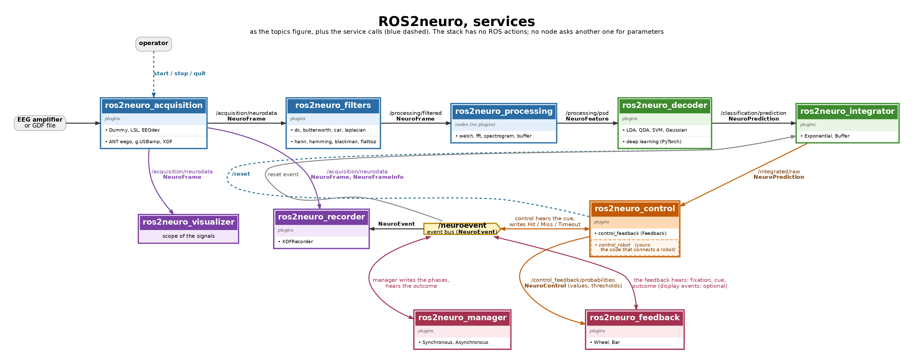
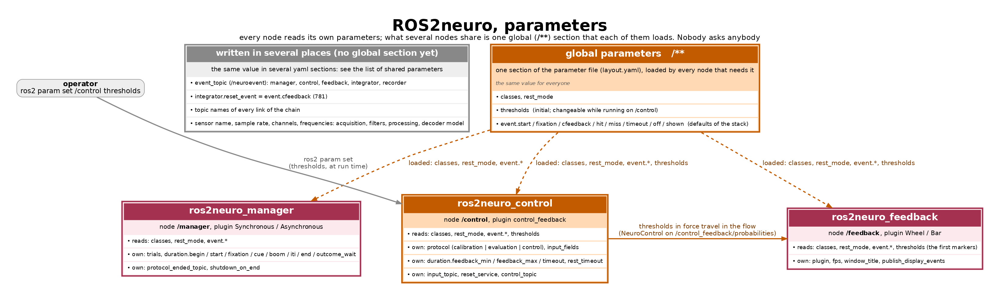

{ .home-logo }

# ROS2neuro

**ROS2neuro** is a modular C++ framework for real-time neurophysiological signal acquisition, processing,
decoding and closed-loop Brain-Computer Interface (BCI) applications, built on **ROS 2**.

Every stage of the pipeline is a ROS 2 node whose behaviour is chosen at launch time by loading a **plugin**:
the amplifier, the filters, the decoder, the integrator, the recorder, the protocol and the feedback are all
interchangeable pieces that talk through a small set of messages.

## The system in four figures

The same system, with more detail each time. Click a figure to open it at full size; the same figures, with a guide to read them, are in
[Architecture](concepts/architecture.md).

### 1. Overview: what is connected to what

The signal chain (acquisition, filters, processing, decoder, integrator) turns the amplifier signal into class probabilities. **Control**
decides what to do with them, the **manager** runs the trials of an experiment and the **feedback** shows the result; the recorder and
the visualizer only listen.

### 2. Topics and plugins: what travels and who can be swapped

Every package that has plugins lists them (the amplifier, the filters, the decoder, the integrator, the protocol, the drawing...), and every
arrow says which **topic** and which **message** it carries. The event bus `/neuroevent` links the manager, control, the feedback and the
recorder. The dashed plugin in [`ros2neuro_control`](packages/control/index.md) is where **your** code goes to connect a robot.

### 3. Services: the few calls between nodes

Only two kinds of service call exist: starting and stopping the acquisition, and the integrator **reset** that control asks for. There are no
ROS actions, and no node asks another one for parameters.

### 4. Parameters: own and global

Every node reads **its own parameters**. What several nodes share (`classes`, `rest_mode`, the ids of the events, the thresholds) is one
global `/**` section of the parameter file that each of them loads: see [Shared parameters](concepts/shared-parameters.md).

!!! info "Which BCIs"
    ROS2neuro has been tested with motor imagery (MI). It should work for any BCI paradigm: the processing stage has no
    fixed implementation, so other paradigms, such as the exogenous SSVEP or P300, can be supported by writing your own processing node:
    see [Processing](packages/processing/index.md).

!!! info "Tested on ROS 2 Jazzy"
    All of ROS2neuro was built and tested on **ROS 2 Jazzy** (Ubuntu 24.04), and the Debian packages are built for it:
    see [Installation](installation.md). The commands in this documentation use `jazzy`; other releases have not been tested.

## Where to start

-   **[Concepts](concepts/architecture.md)**

    How ROS2neuro is organised: the architecture, the messages and their data types, the topics, the plugin
    mechanism and the protocol layer (control, manager and feedback).

-   **[Packages](packages/index.md)**

    One page per package and per plugin: what it does, which topics and parameters it has and how to use it.

-   **[Tutorials](tutorials/index.md)**

    Step-by-step guides with code that compiles: run a pipeline without hardware, write a filter or an
    integrator plugin, raise an event when a channel power crosses a threshold, check the EOG.

## The stack in one paragraph

Data flows from the hardware (or a GDF file) through the **acquisition**, the **filters** and the
**processing** (a Welch spectrum for the classic classifiers, a window of the signal for the deep-learning ones), is
classified by a **decoder** and smoothed by an **integrator**. **Control** knows the
thresholds: it drives a passive **feedback**, decides the outcome of the trials and resets the integrator. A **manager**
runs the trials of a calibration or an evaluation and writes their events. A **recorder** writes everything to GDF/BDF and a **visualizer** shows the signals.

## Conventions used in this documentation

- Package names are written as in the workspace ([`ros2neuro_filters`](packages/filters/index.md)), plugin classes with their full
  pluginlib name ([`ros2neuro::acquisition::XDFDevice`](packages/acquisition/xdf.md)).
- Commands assume a sourced ROS 2 environment (`source /opt/ros/jazzy/setup.bash`) and ROS2neuro installed, from apt or from a workspace (`source install/setup.bash`): see [Installation](installation.md).
- Parameters are shown in YAML (`ros__parameters`), the way they are normally passed to a node.
