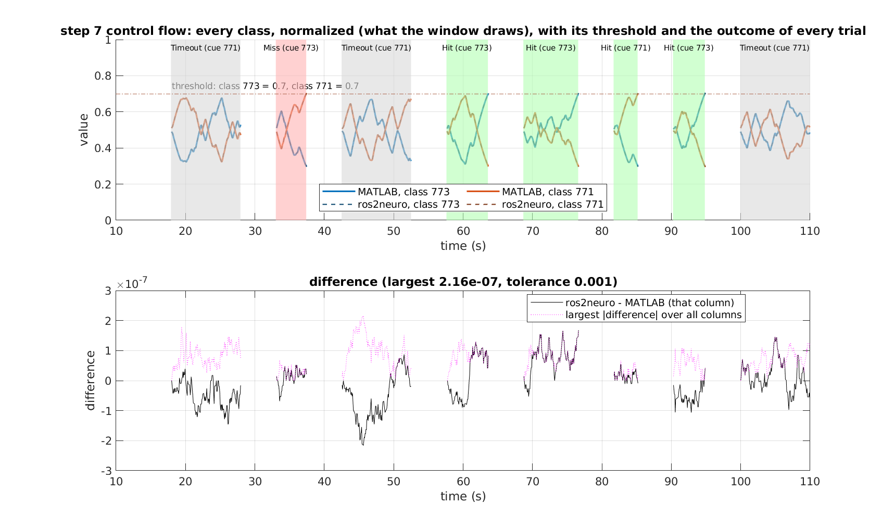

# Tests of every stage

!!! info ""
    Package: [`ros2neuro_devel_test`](https://github.com/ros2neuro/ros2neuro_devel_test) · part of [Packages](index.md)
Tests of every stage of the stack, without hardware: each one replays a **GDF file** through the nodes of one stage, saves what ROS 2 computed as CSV, and a MATLAB file redoes the stage from the samples of the same GDF and compares. PASS / FAIL for every line; the check errors if one fails. The package also holds the three complete pipelines that show the feedback (wheel, 2 bars, 4 bars), the data and the models the tests use, and the MATLAB functions that redo every stage.

<!-- at-a-glance -->
| | |
|---|---|
| **Layer** | Tools |
| **Kind** | Python launchers, test data and models, MATLAB checks, and one small node (`src/topic_csv_recorder.py`) |
| **Reads** | a GDF file of `data/` (replayed by the XDF acquisition plugin) |
| **Publishes** | the pipeline of the stage under test, up to the feedback window in `pipeline/` and `feedback/` |
| **Run** | `ros2 launch ~/ros2neuro_ws/src/ros2neuro_devel_test/decoder/qda/decoder_qda.launch.py` (container), then `check_decoder_qda` in MATLAB (folder of the test) |
<!-- /at-a-glance -->

<!-- interfaces -->
## Dependencies

- **ROS 2 packages**: none to build
- **At run time**: the packages of the pipeline you launch (acquisition, filters, processing, decoder, integrator, manager, control, feedback), which `package.xml` lists as run-time dependencies
- **On the computer that runs the checks**: MATLAB (R2019b or newer) with the **Signal Processing Toolbox** (`butter`, `filter`, `hann`, ...) and [BIOSIG](https://biosig.sourceforge.net) (`sload`, to read the GDF)

## Messages and topics

Messages used:

- none: launchers, parameter files and the nodes of `src/` that only read topics (`NeuroFrame`, `NeuroFeature`, `NeuroPrediction`, `NeuroControl`, `NeuroEvent`)

<!-- /interfaces -->
## The tests

Every test replays the same **GDF file** (`data/test.gdf`, 16 EEG channels + trigger, 512 Hz, 250 s; `data/test_mi.gdf` for the deep-learning model) through real ros2neuro nodes, and the **check** redoes the same computation offline, from the samples of the file, and compares it with what ROS 2 published. For MATLAB the reference uses the **native functions** (`butter` + `filter`, `pwelch`, `hann` / `hamming` / `blackman` / `flattopwin`, `mean`, `var`, the matrix product): the functions `matlab/r2n_*.m` are ours but thin wrappers around them, released so that anyone can **replay offline what was done online**. Every check prints PASS / FAIL lines, **errors if one fails**, and draws one figure per step: above the signal of MATLAB and the signal of ros2neuro, below their difference, with the time axes linked (zoom one, the other follows). In the figures of the integrator and of the control flow the **threshold** the classes had to reach is drawn, and every trial is a coloured band from CFeedback to its outcome (**green Hit, red Miss, grey Timeout**, with its cue); where the flow does not exist (outside the trials) the line is broken instead of joining the segments.

| Folder | What it tests | Launcher | Check | Figures |
|---|---|---|---|---|
| `acquisition/` | the **XDF acquisition** plugin: it publishes the GDF exactly (every sample, 32 per frame, 16 frames/s) and the manager's 6 trials (events, durations, outcomes) | `acquisition` | `check_acquisition` (MATLAB) | signal, difference, timing; tables of signal, events and trials |
| `filters/single_filter/` | **every filter** alone: dc, hp, lp, car, laplacian, hann, hamming, blackman, flattop (nine nodes on the same frames) | `filters_single` | `check_filters_single` | one per filter |
| `filters/chain/` | three chains: hp-lp, hp-lp-laplacian, and every filter together | `filters_chain` | `check_filters_chains` | one per chain |
| `processing/welch/` `fft/` `spectrogram/` `buffer/` `fbcsp/` | **every processing plugin** on the raw frames (`fbcsp`: nine band chains, then the plugin) | `processing_<plugin>` | `check_processing_<plugin>` | one per plugin |
| `decoder/qda/` `lda/` `gaussian/` `fbcsp_lda/` `shallow/` | **some decoders**, each on its own feature: QDA, LDA, Matlab SMR Gaussian classifier, LDA (scikit-learn) on FBCSP, ShallowNet (deep learning) | `decoder_<decoder>` | `check_decoder_<decoder>` (+ `check_decoder_shallow.py` for the network, + `check_decoder_fbcsp_laplacian.py`) | probabilities |
| `integrator/exponential/` `buffer/` | **whole pipelines** ending in each integrator: raw, Laplacian, band-pass, Welch, QDA, integrator (and the resets, the outcome of every trial) | `integrator_<kind>` | `check_integrator_<kind>` | one per step, all linked |
| `pipeline/qda/` `lda/` `fbcsp/` `dl/` | the **complete pipeline with the feedback window**, four of them: QDA (wheel), LDA (bars), FBCSP + LDA (wheel), ShallowNet (wheel) | `pipeline_<name>` | `check_pipeline_<name>` (MATLAB); `check_pipeline_dl.py` (**Python**: ROS 2 against scipy and PyTorch) | one per step, all linked |
| `feedback/wheel/` `bars2/` `bars4/` | the feedback windows: the **wheel** and the **bars** (2 and 4 classes), **to be looked at**. This is the test to run on a **new computer after installing**: nothing is saved or checked, if the window moves the install is good | `feedback_<wheel\|bars2\|bars4>` | (none) | the window |

The tests of `acquisition/`, `filters/` and `processing/` run the manager in **calibration** (the autopilot drives the feedback, no classifier needed); the others in **evaluation**. The manager and the control are in every test so that the session has a structure (events) and **ends by itself** when the trials are over: calibration 6 trials, about a minute; evaluation 8 trials, 2-3 minutes. **`pipeline/`** is the folder to read to know exactly what is done online: every step of the chain, with the parameters, is written in its launcher and its check.

## Example: the final figure of a pipeline

The last step of every `pipeline/` check is the **flow that drives the feedback window**: the value of every class over time, drawn as the window draws it. This is the figure of `pipeline/qda/` (the whole chain: raw, Laplacian, band-pass, Welch, QDA, integrator, control), with MATLAB (solid) and ros2neuro (dashed) on top of each other and, below, their difference (at most 2e-7):



How to read it:

* each **coloured band** is one trial, from CFeedback to its outcome, labelled with the outcome and the cue; the blue curve is class 773, the red one class 771, and the dash-dot line is the **threshold** (0.7) that a class has to reach;
* **Hit** (green): the curve of the **cued class** reaches its threshold. Here "Hit (cue 773)": the blue curve climbs to 0.7 and the trial ends there;
* **Miss** (red): the curve of the **other class** reaches its threshold first. Here "Miss (cue 773)": it is the red curve (class 771) that reaches 0.7;
* **Timeout** (grey): **no class reaches a threshold** before the time limit (10 s): both curves stay below 0.7 until the end of the band;
* where the flow does not exist (before CFeedback and after the outcome) the line is broken, because control sends nothing.

So the figure shows, with the real numbers of the run, that the decision of every trial follows the rule of the protocol, and that ros2neuro and MATLAB agree at every point: the outcome of every trial is also recomputed from the integrated values and compared with the one control wrote (a line of the check).

## Run a test

Always the same two steps: **1. launch the stage in the container** (it saves the CSV and ends by itself when the manager has finished its trials), **2. open the matching check in MATLAB, in the same folder, and run it** (it reads the newest run of that folder).

```bash
# 1. in the container (docker/README.md)
distrobox enter ros2neuro
cd ~/ros2neuro_ws && source /opt/ros/jazzy/setup.bash && source install/setup.bash
colcon build --packages-select ros2neuro_devel_test && source install/setup.bash     # only after changing a file of the package
ros2 launch ~/ros2neuro_ws/src/ros2neuro_devel_test/<folder>/<launcher>.launch.py    # see the table; wait until it ends
```
```matlab
% 2. in MATLAB: go to the SAME folder and run the check
cd ~/ros2neuro_ws/src/ros2neuro_devel_test/<folder>
check_<name>
```

| # | Test | 1. Launch (container) | 2. Check | Lasts |
|---|---|---|---|---|
| 1 | acquisition (XDF) | `acquisition/acquisition.launch.py` | MATLAB, in `acquisition/`: `check_acquisition` | ~1 min |
| 2a | every filter alone | `filters/single_filter/filters_single.launch.py` | MATLAB, in `filters/single_filter/`: `check_filters_single` | ~1 min |
| 2b | filter chains | `filters/chain/filters_chain.launch.py` | MATLAB, in `filters/chain/`: `check_filters_chains` | ~1 min |
| 3 | Welch, FFT, Spectrogram, Buffer, Fbcsp | `processing/<plugin>/processing_<plugin>.launch.py` | MATLAB, in `processing/<plugin>/`: `check_processing_<plugin>` | ~1 min each |
| 4 | decoders QDA, LDA, Gaussian | `decoder/<d>/decoder_<d>.launch.py` | MATLAB, in `decoder/<d>/`: `check_decoder_<d>` | ~2 min each |
| 4 | decoder LDA on FBCSP | `decoder/fbcsp_lda/decoder_fbcsp_lda.launch.py` | MATLAB, in `decoder/fbcsp_lda/`: `check_decoder_fbcsp` | ~2 min |
| 4 | decoder ShallowNet | `decoder/shallow/decoder_shallow.launch.py` | MATLAB `check_decoder_shallow`, then in the container `python3 check_decoder_shallow.py` | ~3 min |
| 4 | FBCSP + Laplacian (mi_training yaml) | `decoder/fbcsp_laplacian/decoder_fbcsp_laplacian.launch.py` | in the container, in the folder: `python3 check_decoder_fbcsp_laplacian.py` | ~2 min |
| 5 | whole pipeline to each integrator | `integrator/<kind>/integrator_<kind>.launch.py` | MATLAB, in `integrator/<kind>/`: `check_integrator_<kind>` | ~2.5 min each |
| 6 | pipeline QDA, LDA, FBCSP (with feedback window) | `pipeline/<name>/pipeline_<name>.launch.py` | MATLAB, in `pipeline/<name>/`: `check_pipeline_<name>` | ~3 min each |
| 6 | pipeline deep learning (with feedback window) | `pipeline/dl/pipeline_dl.launch.py` | in the container: `python3 pipeline/dl/check_pipeline_dl.py` | ~3.5 min |
| 7 | feedback: wheel, bars (to be seen; the smoke test after an install) | `feedback/<wheel\|bars2\|bars4>/feedback_<...>.launch.py` | none: look at the window | ~1-2 min |

Details:
* The launcher records the CSV in `<folder>/runs/run_<date>/` (`latest.txt` names the newest). The CSV and the figures are not pushed: whoever has `data/test.gdf` regenerates them and sees that everything matches. `check_x(gdf_file, run_folder)` checks another run or file.
* **Every launcher is self-contained**: the constants at the top (`GDF`, `RUNS`, `ACQUISITION`, `PROTOCOL`, `LAYOUT`, `DELAY`, `SETTLE`) and the nodes with their parameters are all in the `.launch.py`; edit them there. To replay another GDF change `GDF` and run `check_x('/path/other.gdf')`. In `feedback/` change `PROTOCOL` (calibration | evaluation | control) and `INTEGRATOR` (exponential | buffer).
* **How a session starts**: the recorder and the nodes of the stage start first; `DELAY` seconds later (15 s) the acquisition starts **switched off** (`acquisition.autostart: false`); `SETTLE` seconds after that (8 s) it is started with a service call (`ros2 service call /acquisition/start`), together with the manager and the control. So every node is listening and gets **frame 0** (an acquisition that publishes while it is still discovering the other nodes made them miss the first frames), and MATLAB reproduces the filters from sample 0. A node that still starts late is handled: the check starts from the first frame it received and says how many it missed.
* **Do not run two tests at once** (same topic names, and the load makes nodes miss frames); if you must, use a different `ROS_DOMAIN_ID` for each.
* The feedback window needs a display (`DISPLAY`); if it flickers, put `LIBGL_ALWAYS_SOFTWARE=1` in front of the command.
* MATLAB needs the Signal Processing Toolbox and BIOSIG (`sload`): the checks look for it in `BIOSIG_PATH` or `~/Local/Matlab/biosig`. The Python checks need `torch`, `braindecode`, `scipy` and `matplotlib` (the container has them).
* **Reading a check**: open the `.m` and read it from the top: setup, the GDF and the CSV that are read, what MATLAB recomputes (one block per step), the comparison with its tolerance, the figures, the verdict. There are no helper functions to look up.
* **Tolerances**: filters, in ULP of float32 at the largest input sample (4-16 depending on the filter); later steps (Welch, decoder, integrator), absolute (1e-3), because the rounding of the filters is amplified by the `ln` of the power; a step fed with the **ROS 2** input of the stage before (the integrator alone, a decoder on the ROS PSD) is exact to 4 ULP.

## After installing ros2neuro on a new computer

Run the feedback test: it starts the whole chain and opens the window.
```bash
ros2 launch ros2neuro_devel_test feedback_wheel.launch.py     # the wheel (2 classes)
ros2 launch ros2neuro_devel_test feedback_bars4.launch.py     # the bars with 4 classes
```
If the window opens and moves through the trials, the packages, the models, the display and the OpenGL driver work. It records nothing, so it works from the apt install too.

## Layout

```
data/            test.gdf, test_mi.gdf (the only thing the tests share, with models/: decoder models and the scripts that make them)
matlab/          r2n_*.m: one MATLAB function per stage (see its README)
src/             topic_csv_recorder.py (the recorder node)
acquisition/ filters/ processing/ decoder/ integrator/ pipeline/ feedback/     one folder per test: launcher, config/ (EVERY yaml the test needs: acquisition, layout, protocol, ...), check_*.m (self-contained: no helper functions, read it top to bottom), runs/ (the CSV)
```

## How a test is built

* **Every launcher** (`<name>.launch.py`) starts the recorder and the stage under test first, then (after 6 s, `DELAY`) the acquisition (XDF plugin, replay of the GDF, 16 frames/s of 32 samples), the manager and the control (a protocol; they shut the launch down when they end).
* **The recorder** (`src/topic_csv_recorder.py`, parameter `streams`, one item `"name=type:/topic[:every=N][:max=M]"` per file) writes one CSV per stream: a frame stream has **one row per sample**, a feature, a prediction, the flow and the events one row per message; floats are float32 with 9 digits. Every row carries the **header stamp**, which is how MATLAB pairs a message with its frame.
* **MATLAB**: each stage is checked **on its own**, from what ROS 2 published for the stage before, because a rounding of a few ULP of an input is amplified by the `ln` of a power. The filters use the native functions of MATLAB, so the check does not depend on how ROS 2 designs its own.
* **Tolerances** are in ULP of float32 at the largest value: 4 for a single filter, 8 for the DC and chains, 4 for a feature or prediction, 0 where nothing is computed.

## The models of the decoder tests

| Model | Where | Made by |
|---|---|---|
| QDA (3 PSD features, split of the signal on FC3 @ 12 Hz): not a motor-imagery classifier | `data/models/qda_psd/` | made earlier |
| LDA on the PSD (40 features, Fisher selection), TEST model | `data/models/lda_psd/` | `data/models/make_test_models.py` (mi_training, the 20 trials of `data/test.gdf`) |
| Gaussian (BOTH_HANDS / BOTH_FEET) | `data/models/gaussian/` | the Matlab SMR Gaussian classifier converted to `.r2nd` (`.smr.mat` is the original) |
| Gaussian with 4 classes (769, 770, 771, 773), FICTITIOUS: shows the 4 bars | `data/models/gaussian_4class/` | made up |
| LDA on FBCSP: 9 bands 4-40 Hz, 6 components, LDA on 8 selected features, classes 769 / 770, trained on real calibration runs | `data/models/fbcsp_lda/`, a copy of `mi_training/models/fbcsp` (`lda_weights.yaml`: the numbers for MATLAB, made by `data/models/export_lda_weights.py`) | mi_training |
| ShallowNet (braindecode ShallowFBCSPNet) | `ros2neuro_decoder_braindecode/extra/eegnet_mi_bhbf/` | trained with mi_training |

The test models are trained on a handful of trials: **their accuracy means nothing**, they are there to show that ROS 2 and MATLAB give the same probabilities. `test_mi.gdf` (channels FZ, FC1, ... CP4) is for ShallowNet; the others use `test.gdf` (Fz, FC3, ... CP4).

## Known issues the tests show

* **Trigger channel** (`check_acquisition`, line `KNOWN`): the GDF has a trigger channel that is all 0; the acquisition publishes -2147483648 for every sample (`XDFDevice` converts the float trigger channel of this GDF to int32 wrongly). The EEG is exact. It is a KNOWN line, not a failure; when it is fixed the line becomes PASS.
* **The deep network cannot be redone with the `r2n` functions**: MATLAB checks the filter, the 512-sample window the network reads and the session; the network is checked in Python against PyTorch / braindecode.
* **Found and fixed by these tests**: `ros2neuro_decoder` did not know `NeuroFeature::TYPE_MATRIX` in the `input.type` of a manifest, so the scikit-learn decoder could not load an FBCSP model in the real node (`DecoderManifest.cpp`).
* `filter_chain_node` declares `input_topic` and `output_topic` twice: `-p input_topic:=...` crashes it. The launchers remap the topics instead.

## What was removed

The launchers that used to be here (`gaussian_*`, `qda_*`, `eegnet_*`, `sklearn_*`, the `*_rest` and `qda_custom_codes` variants, `gaussian_4class_matlab`, `timing_check`), `mi_loop.launch.xml` (the ANT Neuro loop) and `check_evaluation.m` with its recorded example: the tests above replace them (`feedback/` has the complete pipelines, `decoder/` and `integrator/` the checks of the middle of the chain).
