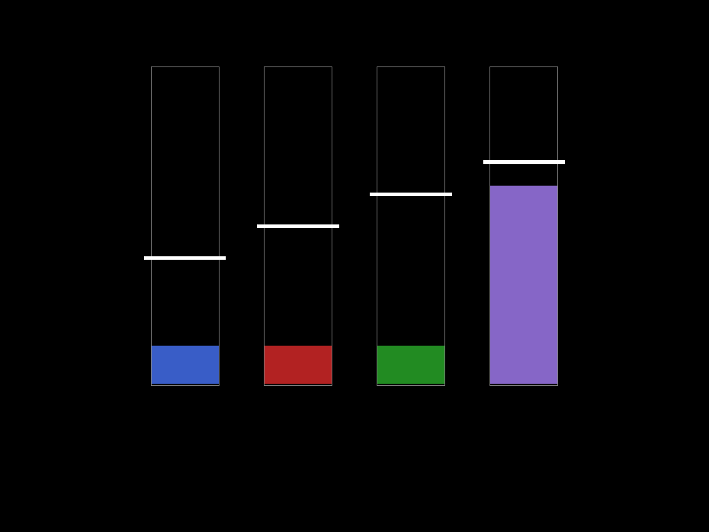

# Feedback

!!! info ""
    Package: [`ros2neuro_feedback`](https://github.com/ros2neuro/ros2neuro_feedback)

The feedback is the window the subject looks at during a BCI session. It is **passive**: it makes no decisions. It
reads only the manager's control topic and draws what it finds there. The drawing itself is a **plugin that you must
select** with the parameter `plugin`, and the plugins are drawn with the [neurodraw](neurodraw.md) library.

It rebuilds the same layout as the manager from the same parameters (`classes`, `rest_mode`, `thresholds`), so
declare them once and load them in both nodes (see [Protocols](../../concepts/protocols.md)).

## Available plugins

| Plugin | pluginlib class | Drawing |
|---|---|---|
| [Wheel](wheel.md) | `ros2neuro::feedback::Wheel` | a ring with a moving line, for exactly two classes |
| [Bar](bar.md) | `ros2neuro::feedback::Bar` | one bar per classifier output (any number of classes), each with its own threshold line |

| Wheel (two classes) | Bars (here four classes) |
|---|---|
| [{ .screenshot }](wheel.md) | [{ .screenshot }](bar.md) |

## neurodraw: the drawing library (required)

!!! important "A required dependency"
    Both plugins, `ros2neuro_feedback_wheel` and `ros2neuro_feedback_bar`, are built **on top of
    [neurodraw](neurodraw.md)**. Without it they do not compile, and without them there is no feedback window. It is
    the only part of the stack that needs SDL2 and OpenGL.

neurodraw is a small C++ library for 2D graphics (shapes, text, images, a threaded rendering engine, animations)
based on SDL2, OpenGL, SDL2_ttf and SDL2_image. It is **not a ROS package**: it is a plain CMake library, which the
two plugins find with `find_package(neurodraw CONFIG REQUIRED)`. The feedback core and the manager know nothing
about it: only the drawing plugins do, which is why a new drawing (for example with another graphics library) can be
added without touching the rest.

**Install it before building the feedback plugins:**

```bash
# 1. system libraries (Ubuntu)
sudo apt-get install libsdl2-dev libsdl2-image-dev libsdl2-ttf-dev

# 2. the library itself
git clone https://github.com/neurorobotics-iaslab/neurodraw.git
cd neurodraw
cmake -S . -B build
cmake --build build
sudo cmake --install build              # or: cmake --install build --prefix $HOME/Local
```

With a custom prefix, tell CMake where to find it when you build the workspace:
`colcon build --cmake-args -DCMAKE_PREFIX_PATH=$HOME/Local`.

**Alternative, inside the workspace.** Put the `neurodraw` folder in the `src/` of your ROS2neuro workspace: `colcon`
builds it as a CMake package and installs it before the feedback plugins, which declare it in their `package.xml`
(`<depend>neurodraw</depend>`). Only the three SDL2 libraries of step 1 are needed.

```bash
colcon build --packages-up-to ros2neuro_feedback_bar
```

The full description of the library (shapes, the engine, examples) is in the [neurodraw page](neurodraw.md).

## The node: `feedback_node`

The package provides one executable, `feedback_node`. It subscribes to the control topic, rebuilds the layout,
loads the plugin and runs the drawing loop at `fps` frames per second.

| Parameter | Default | Meaning |
|---|---|---|
| `plugin` | (required) | pluginlib class of the drawing, `ros2neuro::feedback::Wheel` or `ros2neuro::feedback::Bar` |
| `mode` | `control` | `control` (values only) or `training` (values plus fixation, cue and boom) |
| `classes` | `[773, 771]` | class codes, **order = layout** (shared with the manager) |
| `rest_mode` | `none` | `none`, `timeout` or `class` (shared with the manager) |
| `thresholds` | `[0.8, 0.8]` | one per class with an output (shared with the manager) |
| `control_topic` | `/manager_control/probabilities` | the **only** topic it reads |
| `event_topic` | `/neuroevent` | used only with `publish_display_events` |
| `fps` | `60` | frames per second of the window |
| `publish_display_events` | `false` | after drawing, publish `Shown + id` events for the cue and the boom, and the matching `Off` |
| `latency_log_period_s` | `5.0` | seconds between the "latency stamp to draw" log lines, `0` disables them |
| `window_title` | `ros2neuro feedback` | title of the window |

Behaviour worth knowing:

- Before the first message the neutral vector (`1/K` for every class) is drawn.
- The cue is the last class event. A rest in `timeout` that ends as a Hit is marked by the plugin, and on a Miss the
  boom shows the class that went over its threshold. A Timeout gives a neutral grey boom.
- Gaps in the sequence counter `seq` of the flow are logged.
- Close the window with ESC: it ends the node.

## Minimal example

```yaml
/feedback:
  ros__parameters:
    plugin: ros2neuro::feedback::Bar
    mode: training
    control_topic: /manager_control/probabilities
    fps: 60.0
    window_title: "Bars"
```

The feedback is started together with the manager. See [`ros2neuro_devel_test`](../devel-test.md) for complete
launch files, and the [hardware-free tutorial](../../tutorials/hardware-free-pipeline/index.md) to see them run.

## Writing a new drawing

Derive from `ros2neuro::feedback::FeedbackPlugin` (`set_values`, cue, fixation, boom) and export it against
`ros2neuro_feedback` with `pluginlib_export_plugin_description_file(ros2neuro_feedback plugins.xml)`. Keep the
geometry in a pure, testable header, as `ros2neuro_feedback_bar` does with `bar_geometry.hpp`.
