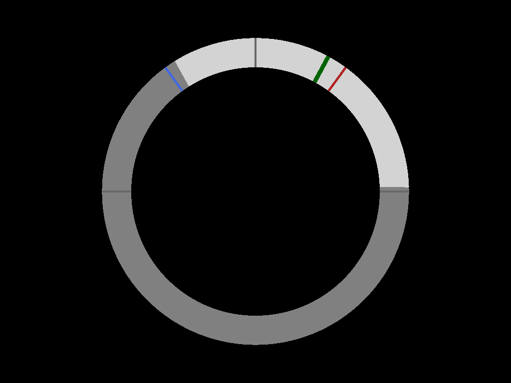
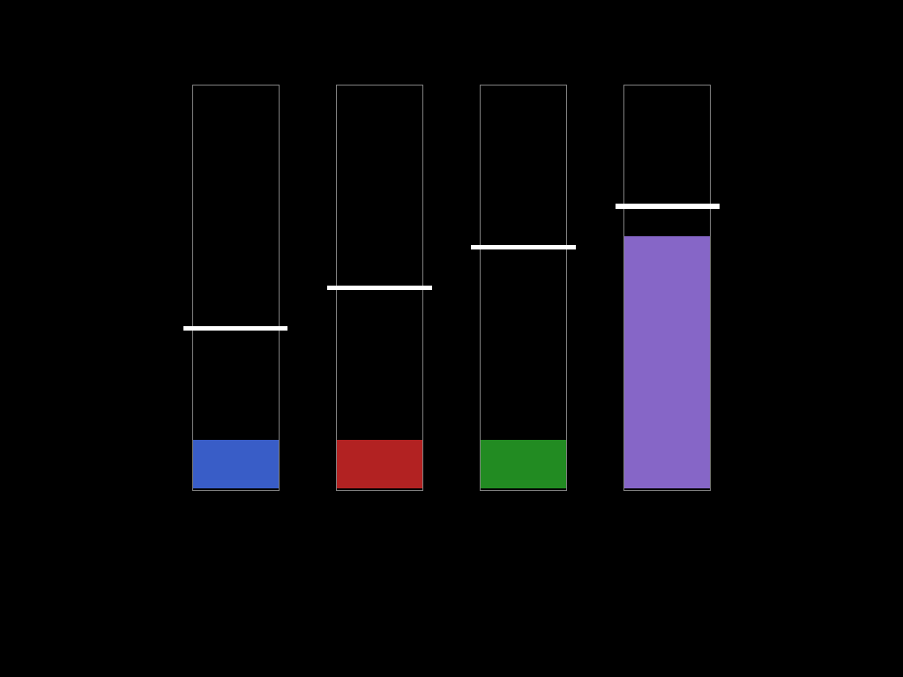

# Feedback

!!! info ""
    Package: [`ros2neuro_feedback`](https://github.com/ros2neuro/ros2neuro_feedback)

The feedback is the window the subject looks at during a BCI session. It is **passive**: it makes no decisions. It hears two things
and draws what it is told. The drawing itself is a **plugin that you must select** with the parameter `plugin`, and the plugins are
drawn with the [neurodraw](neurodraw.md) library.

| It reads | What it gives |
|---|---|
| the event bus `/neuroevent` | the phases that the [manager](../manager/index.md) writes (fixation, cue, ...) and the outcome (Hit / Miss / Timeout) that [control](../control/feedback.md) writes: they decide what is shown |
| the flow of [`ros2neuro_control_feedback`](../control/feedback.md) (a `NeuroControl`) | the values and the thresholds in force. Its header is the one of the `NeuroPrediction` it comes from, so the feedback is in step with the predictions |

Every parameter is its own: the `classes`, the `rest_mode`, the ids of the events (`event.*`) and the initial `thresholds` are the same
values that the manager and control use, written once for every node (see [Shared parameters](../../concepts/shared-parameters.md)).
The thresholds are one per class (the bars); the [wheel](wheel.md) accepts any number of them, drawn as positions on its axis, and what they do is decided by control.

**Nobody is asked for anything.** When the thresholds are changed while running (`ros2 param set /control thresholds ...`) control puts the
new ones in the flow and the markers follow. A control has no trials, so no events: only the values are drawn.

## What is in this menu

| Page | What you find |
|---|---|
| [Base class: `ros2neuro_feedback`](base.md) | the node, its topics and parameters, the plugin interface and how to write a new plugin |
| [Available plugins](#available-plugins) | the plugins of the family, each with its own page |

## Available plugins

| Plugin | pluginlib class | Drawing |
|---|---|---|
| [Wheel](wheel.md) | [`ros2neuro::feedback::Wheel`](wheel.md) | a ring with a moving line, for exactly two classes |
| [Bar](bar.md) | [`ros2neuro::feedback::Bar`](bar.md) | one bar per classifier output (any number of classes), each with its own threshold line |

| Wheel (two classes) | Bars (here four classes) |
|---|---|
| [{ .screenshot }](wheel.md) | [{ .screenshot }](bar.md) |

## neurodraw: the drawing library (required)

!!! important "A required dependency"
    Both plugins, [`ros2neuro_feedback_wheel`](wheel.md) and [`ros2neuro_feedback_bar`](bar.md), are built **on top of
    [neurodraw](neurodraw.md)**. Without it they do not compile, and without them there is no feedback window. It is
    the only part of the stack that needs SDL2 and OpenGL.

neurodraw is a small C++ library for 2D graphics (shapes, text, images, a threaded rendering engine, animations)
based on SDL2, OpenGL, SDL2_ttf and SDL2_image. It is **not a ROS package**: it is a plain CMake library, which the
two plugins find with `find_package(neurodraw CONFIG REQUIRED)`. The feedback core and the manager know nothing
about it: only the drawing plugins do, which is why a new drawing (for example with another graphics library) can be
added without touching the rest.

**Install it before building the feedback plugins:**

```bash
# 1. system libraries (Ubuntu)
sudo apt-get install libsdl2-dev libsdl2-image-dev libsdl2-ttf-dev

# 2. the library itself
git clone https://github.com/neurorobotics-iaslab/neurodraw.git
cd neurodraw
cmake -S . -B build
cmake --build build
sudo cmake --install build              # or: cmake --install build --prefix $HOME/Local
```

With a custom prefix, tell CMake where to find it when you build the workspace:
`colcon build --cmake-args -DCMAKE_PREFIX_PATH=$HOME/Local`.

**Alternative, inside the workspace.** Put the [`neurodraw`](neurodraw.md) folder in the `src/` of your ROS2neuro workspace: `colcon`
builds it as a CMake package and installs it before the feedback plugins, which declare it in their `package.xml`
(`<depend>neurodraw</depend>`). Only the three SDL2 libraries of step 1 are needed.

```bash
colcon build --packages-up-to ros2neuro_feedback_bar
```

The full description of the library (shapes, the engine, examples) is in the [neurodraw page](neurodraw.md).
