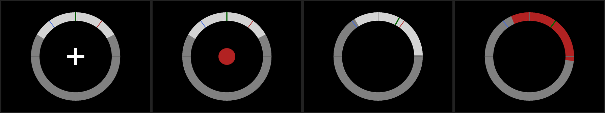
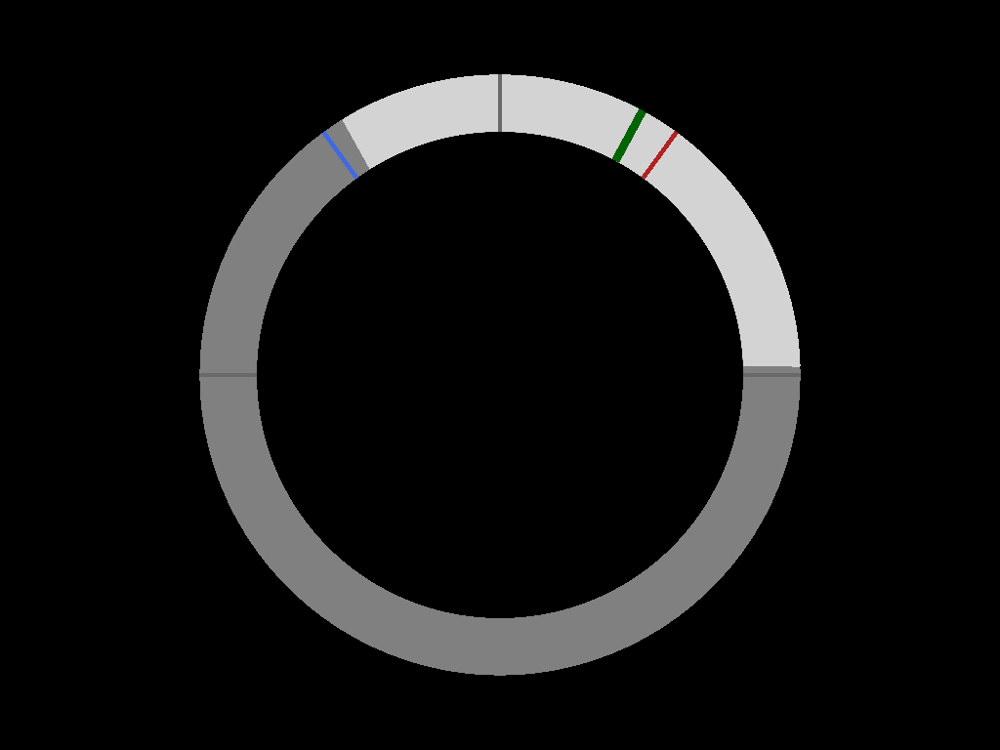

# Wheel feedback

!!! info ""
    Package: [`ros2neuro_feedback_wheel`](https://github.com/ros2neuro/ros2neuro_feedback_wheel) · pluginlib class: `ros2neuro::feedback::Wheel` · part of [Feedback](index.md)

| | |
|---|---|
| **Layer** | Feedback |
| **Kind** | Plugin of [`ros2neuro_feedback`](index.md) (pluginlib class `ros2neuro::feedback::Wheel`) |
| **Reads** | the control flow of the manager, through the feedback node |
| **Publishes** | a window |
| **Run** | in the feedback YAML: `plugin: ros2neuro::feedback::Wheel` |
| **Depends on** | [`neurodraw`](neurodraw.md) |

Plugin `ros2neuro::feedback::Wheel` (neurodraw) for [`ros2neuro_feedback`](index.md): the wheel (ring, arc, moving line,
cross, cue circle, threshold markers), driven by the feedback core.

The wheel shows **two classes** on a ring. The position of the line says how much the classifier favours one class
over the other: towards the left for the first class, towards the right for the second.

{ .screenshot }

*From left to right, a trial of a calibration: the fixation cross, the cue (a circle with the colour of the target
class), the feedback and the outcome.*

{ .screenshot style="max-width: 560px;" }

What you see in the window:

| Element | Meaning |
|---|---|
| the **ring** | the range of the classifier output, from the first class (left) to the second (right) |
| the **two coloured ticks** | the thresholds of the two classes, in their colours (the first class is blue, the second red) |
| the **green line** | the current value of the classifier, which moves along the ring |
| the **cross** | the fixation, at the start of a trial |
| the **circle** | the cue: it has the colour of the class the subject must reach |
| the **coloured arc** | when a threshold is reached the arc fills with the colour of that class (the outcome) |

* Two active classes (`K == 2`): `output_classes[0]` on the left, `[1]` on the right; the position is the normalized
  value of the first. A rest is allowed only with `rest_mode=timeout`; `rest_mode=class` (K=3) is rejected.
* Threshold markers: first class at `th0`, second at `1 - th1` (with `[0.8, 0.8]`: 0.8 and 0.2); the one closest to 0 is
  red, the one closest to 1 blue.
* Colors as in the existing wheel: first class blue, second red; **the rest is always yellow**; timeout boom neutral grey.
  **Rest** (yellow): with `rest_mode=timeout` it has a cue (yellow circle) and nothing else on the wheel; when it ends as a Hit
  (no threshold touched for `rest_timeout` seconds) the **arc turns yellow**, like the arc takes the color of the class
  reached on any hit (no extra dots). With `rest_mode=class` the rest is a normal class, one of the two sides (e.g.
  `classes:=[783, 773]`), that only colors when it reaches its threshold; its **threshold marker is yellow** too (the other side
  keeps blue / red).
* Parameter `angle_range` (180). Blink indicator not ported (the feedback reads only the flow).

Tests: `colcon test --packages-select ros2neuro_feedback_wheel` (geometry, no window).

<!-- interfaces -->
## Dependencies

- **ROS 2 packages** (build and run): `pluginlib`, `rclcpp`, [`ros2neuro_feedback`](index.md), [`ros2neuro_manager`](../manager/index.md), [`neurodraw`](neurodraw.md)
- **External libraries**:
    - [`neurodraw`](neurodraw.md): the drawing library: SDL2 and OpenGL

## Messages and topics

Default node name: `feedback` (the node of [`ros2neuro_feedback`](index.md)).

Messages used:

- `NeuroControl`: read through the feedback node

## Example configuration

From the Gaussian pipeline of [`ros2neuro_devel_test`](../devel-test.md) (`config/feedback_wheel.yaml`); the layout (`classes`, `rest_mode`, `thresholds`) is loaded from the same file as the manager:

```yaml
# Feedback (wheel). The layout (classes, rest_mode, thresholds) comes from layout.yaml; `mode` (training | control)
# is set by the launcher from the protocol.
/feedback:
    ros__parameters:
        plugin: ros2neuro::feedback::Wheel
        control_topic: /manager_control/probabilities    # the ONLY thing the feedback reads
        event_topic: /neuroevent                         # only used by publish_display_events
        fps: 60.0
        window_title: "Gaussian - wheel"
        publish_display_events: false
        latency_log_period_s: 0.0                        # seconds between the "Latency stamp->draw" log lines; 0 = off
        angle_range: 180.0                               # wheel only
```
<!-- /interfaces -->
