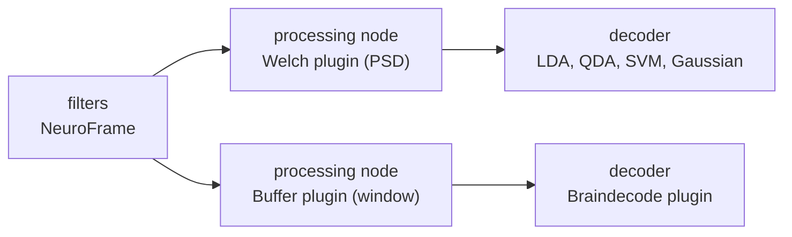

# Processing

!!! info ""
    Package: [`ros2neuro_processing`](https://github.com/ros2neuro/ros2neuro_processing) · plugins: [`ros2neuro_processing_spectral`](https://github.com/ros2neuro/ros2neuro_processing_spectral) · [`ros2neuro_processing_buffer`](https://github.com/ros2neuro/ros2neuro_processing_buffer) · [`ros2neuro_processing_fbcsp`](https://github.com/ros2neuro/ros2neuro_processing_fbcsp) · part of [Packages](../index.md)

Processing is the stage between the [filters](../filters/index.md) and the [decoder](../decoder/index.md). It takes the
filtered signal, a `NeuroFrame` (or a group of them, or, for a plugin that chains on another processing, a `NeuroFeature`), and turns it into a
**`NeuroFeature`**: the kind of data the decoder knows how to read. The package `ros2neuro_processing` provides the
`Processing` plugin interface and `processing_node`.

!!! important "Select one plugin"
    Set `processing.plugin` to one of the classes below. What runs here depends on what the decoder expects, so the stack
    has several processing plugins and leaves room for new ones.

## Available plugins

| Plugin | pluginlib class | Reads | Publishes |
|---|---|---|---|
| [Welch](spectral.md) | [`ros2neuro::processing::Welch`](spectral.md) | `NeuroFrame` | `TYPE_SPECTRUM`, the PSD `[channels, frequency]` |
| [FFT](spectral.md) | [`ros2neuro::processing::FFT`](spectral.md) | `NeuroFrame` | `TYPE_SPECTRUM`, the amplitude spectrum |
| [Spectrogram](spectral.md) | [`ros2neuro::processing::Spectrogram`](spectral.md) | `NeuroFrame` | `TYPE_TIME_FREQUENCY`, `[time, frequency, channel]` |
| [Buffer](buffer.md) | [`ros2neuro::processing::Buffer`](buffer.md) | `NeuroFrame` | `TYPE_TIME_SERIES`, a window `[samples, channels]` |
| [Fbcsp](fbcsp.md) | [`ros2neuro::processing::Fbcsp`](fbcsp.md) | a group of `NeuroFrame`, one per band | `TYPE_MATRIX`, `[band, component]` |

The first three are in [`ros2neuro_processing_spectral`](spectral.md), the others in [`ros2neuro_processing_buffer`](buffer.md) and [`ros2neuro_processing_fbcsp`](fbcsp.md).

## Node behaviour

- The plugin declares what it reads with `input_kind()` (`Frame`, `Feature` or `FrameSet`). After the plugin is configured, the node creates the
  subscription(s) of that kind: **one**, on `input_topic` (default `/neurodata` for a plugin that reads `NeuroFrame`; **required** for one that reads
  `NeuroFeature`), or, for a `FrameSet` plugin, one per topic of `input_topics`; and one publisher of `NeuroFeature` on `output_topic`
  (default `/features`). No unused subscriber exists.
- `input_topic` equal to `output_topic` is refused (the node would read its own output); for a `FrameSet` plugin the same goes for any of
  `input_topics`, and a topic listed twice is refused too. `input_topics` given to a plugin that reads one topic is an error, as is a number
  of topics different from what the plugin reads.
- **Groups of frames (`FrameSet`).** The frames that have the same `header.stamp` make a group. The frames may arrive in any order, also
  from different topics; when the group is complete the plugin gets it (`process_frames`) with the frames in the order of `input_topics`.
  When a group is complete, the incomplete groups older than it are dropped with a warning (a frame was lost and will not be waited
  for); at most 64 incomplete groups wait, the oldest is dropped beyond that; a second frame with the same stamp on the same topic is dropped.
  It needs unique stamps kept all along the way: `filter_chain_node` copies the header of its input and every acquisition plugin stamps each frame
  with the clock of the node (read in the code of ANT, dummy, eegdev, gUSBamp, LSL and XDF; only XDF was run with this). The plugin can also refuse the topics it is given (`check_input_topics`, on the
  resolved names): the node then stops at start with the reason.
- `process_frame` / `process_feature` return `true` when there is a feature to publish and `false` while the plugin is still accumulating
  (a buffer that is not full). A message that cannot be processed (missing sensor, wrong number of channels) is dropped with a warning
  throttled to one every 2 s.
- A plugin that does not support a kind of input refuses it by default ("not supported"); the node never calls it, because it only
  subscribes to the kind the plugin declared.
- A wrong configuration (no plugin, unknown class, a parameter the plugin refuses, a parameter with the wrong type such as `512.0` where an integer is read) stops the node with exit code 1. A parameter that is simply absent keeps its default.
- Plugin parameters go under `processing.params.*`; `processing.name` is the name used for the plugin's logger.
- The **name of the node** decides the section of the parameter file: a launch file that runs `processing_node` with `name="welch"` reads the
  `/welch` section.

## Two chains, one stage



| Decoder | What it needs as input | Processing plugin | `NeuroFeature` it publishes | Launcher that shows it |
|---|---|---|---|---|
| **classic**: LDA, QDA, SVM, Gaussian | the power spectral density, at the frequencies and channels the model was trained on | [`Welch`](spectral.md) (spectral package) | `TYPE_SPECTRUM`, the PSD | `decoder/qda`, `decoder/lda`, `decoder/gaussian`... |
| **deep learning**: a `braindecode` model ([`Braindecode`](../decoder/braindecode.md) decoder plugin) | a window of the filtered signal | [`Buffer`](buffer.md) (buffer package) | `TYPE_TIME_SERIES`, shape `[samples, channels]` | `decoder/shallow`... |
| **scikit-learn** on FBCSP features | the log-variance of the CSP components of a bank of bands | [`Fbcsp`](fbcsp.md) (fbcsp package), after one filter chain per band | `TYPE_MATRIX`, `[band, component]` | models of `mi_training` |

So the processing **is** part of the BCI loop, but its content is chosen by the decoder: spectral features for the
classic classifiers, raw windows for the neural networks. The `Sklearn` decoder is flexible (it reads a spectrum, a window or FBCSP features, according to its manifest), which is why there is no single rule: the
decoder's manifest says what it expects, and you start the processing that provides it.

## The spectral package has two roles

[`ros2neuro_processing_spectral`](spectral.md) is used in two different ways:

1. **As plugins in the loop.** `Welch` runs between the filters and the decoder of every classic pipeline. The package also
   provides `FFT` and `Spectrogram`; the launchers of the stack use only Welch.
2. **As a library, inside the visualizer.** The C++ cores of the package (`WelchCore`, `FFTCore`) are a
   dependency of [`ros2neuro_visualizer`](../visualizer.md): its *Spectrum* tab computes the spectrum itself from the frames,
   with no node running. This is the code behind the Welch spectrum of the
   [visualizer tutorial](../../tutorials/visualizer/index.md).

## Configuring two plugins

The tests of [`ros2neuro_devel_test`](../devel-test.md) show them in use (`processing/` has one per plugin, `decoder/` the decoders on their output).

**Welch**, from the Gaussian pipeline (`data/config/psd_pipeline.yaml`): a PSD, as natural logarithm (ln), at 4, 6, ... 48 Hz, the input
contract of the decoder's manifest.

```yaml
/welch:
  ros__parameters:
    processing.plugin: ros2neuro::processing::Welch
    processing.params.feature: psd
    processing.params.sensor: EEG
    processing.params.samplerate: 512
    processing.params.wlength: 256
    processing.params.wtype: hamming
    processing.params.overlap: 128
    processing.params.buffer: 512
    processing.params.frequencies: "4:2:48"
    processing.params.log: true
```

```xml
<node pkg="ros2neuro_processing" exec="processing_node" name="welch" output="screen">
    <param from="$(var config)/pipeline.yaml" allow_substs="true"/>
    <remap from="/neurodata" to="/processing/filtered"/>      <!-- the filtered signal -->
    <remap from="/features" to="/processing/psd"/>            <!-- the decoder reads this -->
</node>
```

**Buffer**, from the EEGNet (deep learning) pipeline (`decoder/shallow/config/shallow_pipeline.yaml`): a window of 512 samples, one
second at 512 Hz, which is what the model takes.

```yaml
/buffer:
  ros__parameters:
    processing.plugin: ros2neuro::processing::Buffer
    processing.params.sensor: EEG
    processing.params.buffer: 512
```

```xml
<node pkg="ros2neuro_processing" exec="processing_node" name="buffer" output="screen">
    <param from="$(var config)/pipeline.yaml" allow_substs="true"/>
    <remap from="/neurodata" to="/processing/filtered"/>
    <remap from="/features" to="/processing/buffered_features"/>
</node>
```

The buffer publishes a `NeuroFeature` named `buffered_<sensor>`, of type `TYPE_TIME_SERIES`, shape `[samples, channels]`,
whose `window_length` is `samples / samplerate`.

### Things that bite

| Symptom | Cause |
|---|---|
| the processing node receives nothing | its input has a different name from the filter output: **remap** `/neurodata` (or set `input_topic`) |
| the node ignores its parameters | the YAML section is the **name of the node**: the launch file needs `name="welch"` for the `/welch` section |
| the buffer finds no sensor | `sensor` defaults to `eeg`; the stream block is usually called `EEG`: set it |
| the node stops at start | a plugin parameter is wrong (unknown `wtype`, `wlength` < 2, ...), or `input_topic` is missing for a `NeuroFeature` plugin: read the error message |
| the `Fbcsp` node stops at start, listing a topic | the topic of band *k* must end with `band_<lo>_<hi>` of the band *k* of `bands` (`band_8_12`, `band_8p5_12`), and `input_topics` must follow the order of `bands`: see [FBCSP](fbcsp.md) |
| a `FrameSet` plugin publishes nothing | a frame does not arrive on one topic, or the stamps of the frames are not the same (a device that does not stamp every frame, a node on the way that changes the header): the group never completes; look for the "incomplete group(s) dropped" warning |
| the old parameter names are ignored | `welch.wlength`, `sample_rate`, `sensor_name`, `buffer_samples`, ... do not exist any more: use `processing.params.<name>` (see each plugin page) |
| the decoder refuses the feature | its manifest declares the feature name, type and axes it expects; the processing must publish exactly that |
| the PSD has the axes in the "wrong" order | `Welch` and `FFT` publish `[channels, frequency]`, not `[frequency, channel]`; `Spectrogram` `[time, frequency, channel]` and `Buffer` `[samples, channels]`: always read `shape` and `axes` (see the [warning on `NeuroFeature`](../../concepts/messages.md#neurofeature)) |

## Writing your own processing

**Anyone can add a processing** by writing a plugin of `ros2neuro_processing`, reusing what comes before it: the
filtering is already done, and the plugin starts from the clean `NeuroFrame`. The processing of a BCI depends
on the paradigm, so the stack does not impose one: the only contract is the `NeuroFeature` that comes out. Each group can use the
filters that already exist, combine them with its own code, or ignore them.

!!! info "Any kind of BCI"
    ROS2neuro has been tested with **motor imagery (MI)**, an endogenous BCI. Nothing in the architecture is specific to it:
    it **should work for any BCI paradigm**, endogenous or exogenous. An **exogenous** BCI (for example one based on SSVEP or P300)
    can use the same chain (acquisition, filters, decoder, integrator, manager, feedback): only the processing changes, and it is a plugin you
    write yourself, publishing a `NeuroFeature` that your decoder declares as input. The `NeuroFrame` also carries the digital
    triggers (`NeuroTrigger`) next to the signals, which is where the stimulus markers of such paradigms arrive. Paradigms
    other than MI have **not been tested** yet.

Two examples of what could be built (they
**do not exist in the stack today**; they are given only to show the idea):

- **The Hilbert transform.** The analytic signal of the filtered channels gives the **envelope** (the instantaneous power in a
  band) and the **phase**. The output would be a `TYPE_TIME_SERIES` feature, for a decoder that works on band power over time.
- **Riemannian geometry.** The **covariance matrix** of the filtered signal over a window, possibly projected to the
  tangent space, is a classic feature for motor imagery. The output would be a matrix (`TYPE_MATRIX`, or `TYPE_CONNECTIVITY`)
  with the channels on both axes, for a decoder built for it.

The recipe is the same for any of them:

1. derive from `ros2neuro::processing::Processing`, return `InputKind::Frame` from `input_kind()` and implement `process_frame`
   (the host node subscribes to the `NeuroFrame` for you; the data are [sample-major](../../concepts/messages.md#data-layout-sample-major):
   `index = sample * channels + channel`, and the channel labels travel with them);
2. accumulate the samples you need, compute, and fill a `NeuroFeature` with the right `type`, `shape` and `axes` and the header of
   the input; return `false` while there is nothing to publish yet;
3. export the class with `PLUGINLIB_EXPORT_CLASS` and `pluginlib_export_plugin_description_file(ros2neuro_processing plugins.xml)`;
4. set `processing.plugin` to your class in the launch file, in place of `Welch` or `Buffer`;
5. make the decoder's manifest declare that feature as its input.

A plugin that reads a `NeuroFeature` instead (for example one that post-processes a PSD) returns `InputKind::Feature` and implements
`process_feature`; its `input_topic` is then required.

A plugin that needs several streams at once (like the FBCSP, one per band) returns `InputKind::FrameSet`, says how many with
`input_count()`, optionally checks the topics it is given with `check_input_topics()`, and implements `process_frames`; the node takes
`input_topics` and does the grouping by stamp (see above).

The tutorial [Raising an event when a channel power crosses a threshold](../../tutorials/power-threshold-event/index.md) shows
a complete node that reads a `NeuroFrame` and publishes a message (it is a stand-alone node, not a processing plugin).

## Where next

- [Spectral processing](spectral.md), [Buffer](buffer.md) and [FBCSP](fbcsp.md): the three plugin packages in detail
- [Decoder](../decoder/index.md): the input contract (`manifest.yaml`) that processing has to satisfy
- [Architecture](../../concepts/architecture.md): where processing sits in the whole stack
