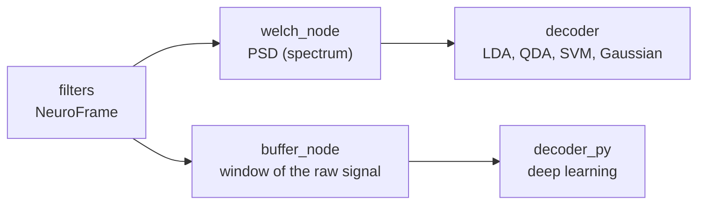

# Processing

!!! info ""
    Packages: [`ros2neuro_processing_spectral`](https://github.com/ros2neuro/ros2neuro_processing_spectral) · [`ros2neuro_processing_buffer`](https://github.com/ros2neuro/ros2neuro_processing_buffer) · part of [Packages](../index.md)

Processing is the stage between the [filters](../filters/index.md) and the [decoder](../decoder/index.md). It takes the
filtered signal, a `NeuroFrame`, and turns it into a **`NeuroFeature`**: the kind of data the decoder knows how to read.

Unlike the other stages, processing is **not a single thing**. What runs here depends on what the decoder expects, so the
stack has no "processing node" and no base class: it has the processing nodes that the decoders it ships need, and it
leaves room for new ones.

## Two chains, one stage



| Decoder | What it needs as input | Processing node | `NeuroFeature` it publishes | Launcher that shows it |
|---|---|---|---|---|
| **classic**: LDA, QDA, SVM, Gaussian | the power spectral density, at the frequencies and channels the model was trained on | [`welch_node`](spectral.md) (spectral package) | `TYPE_SPECTRUM`, the PSD | `gaussian_bars`, `qda_bars`, `mi_loop`... |
| **deep learning**: a `braindecode` model in the Python decoder | a window of the filtered signal | [`buffer_node`](buffer.md) (buffer package) | `TYPE_TIME_SERIES`, shape `[samples, channels]` | `eegnet_bars`, `eegnet_wheel`... |

So the processing **is** part of the BCI loop, but its content is chosen by the decoder: spectral features for the
classic classifiers, raw windows for the neural networks. The Python decoder is flexible (its scikit-learn decoder reads
"a `[samples, channels]` window from the buffer or the features of a PSD"), which is why there is no single rule: the
decoder's manifest says what it expects, and you start the processing that provides it.

## The spectral package has two roles

[`ros2neuro_processing_spectral`](spectral.md) is used in two different ways:

1. **As nodes in the loop.** `welch_node` runs between the filters and the decoder of every classic pipeline. The package also
   provides `fft_node` and `spectrogram_node`; the launchers of the stack use only Welch.
2. **As a library, inside the visualizer.** The C++ processors of the package (`WelchProcessor`, `FFTProcessor`) are a
   dependency of [`ros2neuro_visualizer`](../visualizer.md): its *Spectrum* tab computes the spectrum itself from the frames,
   with no node running. This is the code behind the Welch spectrum of the
   [visualizer tutorial](../../tutorials/visualizer/index.md).

## They are nodes, not plugins

The filters, the decoders or the integrators are chosen through a **plugin** (a class selected by a parameter). Processing
is not: there is no `Processing` interface to implement, and nothing to select in a parameter. Each processing is an
ordinary node that subscribes to a `NeuroFrame` and publishes a `NeuroFeature`, and **choosing the processing means
starting that node** in the launch file.

This is on purpose. What a decoder needs varies too much to fit one interface (a spectrum, a window, a covariance
matrix...), so the only contract between this stage and the next is the **message**: a `NeuroFeature`, which is a generic
tensor described by its `shape` and its `axes`.

## Configuring the two nodes

The two pipelines of [`ros2neuro_devel_test`](../devel-test.md) show them in use.

**Welch**, from the Gaussian pipeline (`launch/gaussian/config/pipeline.yaml`): a PSD in dB/Hz at 4, 6, ... 48 Hz, the input
contract of the decoder's manifest.

```yaml
/welch:
  ros__parameters:
    welch.feature: psd
    welch.sensor: EEG
    welch.samplerate: 512
    welch.wlength: 256
    welch.wtype: hamming
    welch.overlap: 128
    welch.buffer: 512
    welch.frequencies: "4:2:48"
    welch.log: true
```

```xml
<node pkg="ros2neuro_processing_spectral" exec="welch_node" name="welch" output="screen">
    <param from="$(var config)/pipeline.yaml" allow_substs="true"/>
    <remap from="/neurodata" to="/processing/filtered"/>      <!-- the filtered signal -->
    <remap from="~/psd" to="/processing/psd"/>                <!-- the decoder reads this -->
</node>
```

**Buffer**, from the EEGNet (deep learning) pipeline (`launch/eegnet/config/pipeline.yaml`): a window of 512 samples, one
second at 512 Hz, which is what the model takes.

```yaml
/buffer:
  ros__parameters:
    sensor_name: EEG
    buffer_samples: 512
```

```xml
<node pkg="ros2neuro_processing_buffer" exec="buffer_node" name="buffer" output="screen">
    <param from="$(var config)/pipeline.yaml" allow_substs="true"/>
    <remap from="/neurodata_filtered" to="/processing/filtered"/>
    <remap from="/features" to="/processing/buffered_features"/>
</node>
```

The buffer publishes a `NeuroFeature` named `buffered_<sensor>`, of type `TYPE_TIME_SERIES`, shape `[samples, channels]`,
whose `window_length` is `samples / samplerate`.

### Things that bite

| Symptom | Cause |
|---|---|
| the processing node receives nothing | its input has a different name from the filter output: **remap** it (`/neurodata`, or `/neurodata_filtered` for the buffer) |
| the buffer finds no sensor | `sensor_name` defaults to `eeg`; the stream block is usually called `EEG`: set it |
| the decoder refuses the feature | its manifest declares the feature name, type and axes it expects; the processing must publish exactly that |
| the PSD has the axes in the "wrong" order | the Welch and FFT nodes publish `[channels, frequency]`, not `[frequency, channel]`; the spectrogram `[time, frequency, channel]` and the buffer `[samples, channels]`: always read `shape` and `axes` (see the [warning on `NeuroFeature`](../../concepts/messages.md#neurofeature)) |

## Writing your own processing

Because there is no parent class, **anyone can add a processing** by writing a node, reusing what comes before it: the
filtering is already done, and the node starts from the clean `NeuroFrame`. This is deliberate: the processing of a BCI depends
on the paradigm, so the stack does not impose one. Each group can use the filters that already exist, combine them with its own
code, or ignore them.

!!! info "Any kind of BCI"
    ROS2neuro has been tested with **motor imagery (MI)**, an endogenous BCI. Nothing in the architecture is specific to it:
    it **should work for any BCI paradigm**, endogenous or exogenous. An **exogenous** BCI (for example one based on SSVEP or P300)
    can use the same chain (acquisition, filters, decoder, integrator, manager, feedback): only the processing changes, and it is a node you
    write yourself, publishing a `NeuroFeature` that your decoder declares as input. The `NeuroFrame` also carries the digital
    triggers (`NeuroTrigger`) next to the signals, which is where the stimulus markers of such paradigms arrive. Paradigms
    other than MI have **not been tested** yet.

Two examples of what could be built (they
**do not exist in the stack today**; they are given only to show the idea):

- **The Hilbert transform.** The analytic signal of the filtered channels gives the **envelope** (the instantaneous power in a
  band) and the **phase**. The output would be a `TYPE_TIME_SERIES` feature, for a decoder that works on band power over time.
- **Riemannian geometry.** The **covariance matrix** of the filtered signal over a window, possibly projected to the
  tangent space, is a classic feature for motor imagery. The output would be a matrix (`TYPE_MATRIX`, or `TYPE_CONNECTIVITY`)
  with the channels on both axes, for a decoder built for it.

The recipe is the same for any of them:

1. subscribe to the filtered `NeuroFrame` (the data are [sample-major](../../concepts/messages.md#data-layout-sample-major):
   `index = sample * channels + channel`, and the channel labels travel with them);
2. accumulate the samples you need, compute, and publish a `NeuroFeature` with the right `type`, `shape` and `axes`;
3. start your node in the launch file in place of `welch_node` or `buffer_node`;
4. make the decoder's manifest declare that feature as its input.

The tutorial [Raising an event when a channel power crosses a threshold](../../tutorials/power-threshold-event/index.md) shows
a complete node that reads a `NeuroFrame` and publishes a message.

## Where next

- [Spectral processing](spectral.md) and [Buffer](buffer.md): the two packages in detail
- [Decoder](../decoder/index.md): the input contract (`manifest.yaml`) that processing has to satisfy
- [Architecture](../../concepts/architecture.md): where processing sits in the whole stack
