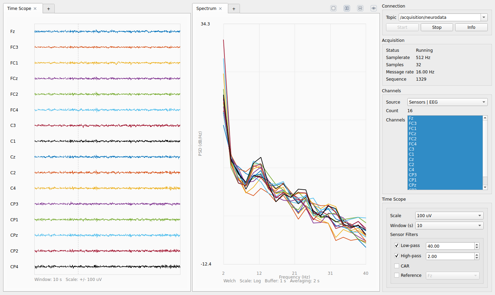

# Visualizer

!!! info ""
    Package: [`ros2neuro_visualizer`](https://github.com/ros2neuro/ros2neuro_visualizer) · part of [Packages](index.md)

Qt-based visualizer for ROS2neuro streams: the oscilloscope of the stack.

The package provides an extensible multi-tab GUI for `ros2neuro_msgs/msg/NeuroFrame` data. It has two kinds of tab,
added with the `+` button: the **Time Scope**, for time-domain inspection of the signal, and the **Spectrum**, which
computes and shows the power spectrum (Welch or FFT). The architecture is intentionally prepared for adding more tabs,
for example feature views (see "Extending the Visualizer" below).

{ .screenshot }

A step-by-step guide with screenshots is in the tutorial
[Looking at the signals with the visualizer](../tutorials/visualizer/index.md).

## Features

- live visualization of `NeuroFrame` topics
- **Time Scope** and **Spectrum** tabs, which can be shown side by side
- automatic topic discovery for `ros2neuro_msgs/msg/NeuroFrame`
- runtime channel labels from `NeuroSensor` and `NeuroTrigger`, with metadata fallback
- multi-tab interface with tab rename and tab close
- dock-like tab rearrangement
- single-pane, left/right and top/bottom layouts
- equalize button for symmetric split layouts
- support for both sensors and triggers
- analog preprocessing for sensors:
  - low-pass
  - high-pass
  - CAR
  - single-channel reference
- digital preprocessing for triggers:
  - bit mask
  - single-bit extraction
  - edge detect

## Package Contents

- `neuroviz`: main Qt executable
- `launch/visualizer.launch.py`: minimal launch file
- `config/visualizer.yaml`: basic configuration placeholder

## Build

```bash
colcon build --packages-select ros2neuro_visualizer
```

## Run

Directly:

```bash
ros2 run ros2neuro_visualizer neuroviz
```

With launch:

```bash
ros2 launch ros2neuro_visualizer visualizer.launch.py
```

## Data Topics

By default the visualizer expects:

- data topic: `/acquisition/neurodata`
- metadata topic: `/acquisition/neurodata_info`

The metadata topic defaults to `data_topic + "_info"`.

The visualizer uses channel labels carried by `NeuroSensor` and `NeuroTrigger`.
If a runtime block has no valid labels and `NeuroFrameInfo` is available, the
visualizer falls back to metadata labels before generating names such as `EEG 1`,
`EEG 2`, etc.

The metadata topic can be changed from the `Info` dialog while the application is running.

## GUI Overview

The right sidebar is divided into four areas:

- `Connection`
  - topic selection
  - start/stop
  - info dialog
- `Acquisition`
  - running state
  - samplerate
  - samples per frame
  - message rate
  - sequence counter
- `Channels`
  - source selector
  - channel count
  - channel list
- `View`
  - controls specific to the active tab

## Time Scope Tab

The `Time Scope` tab shows the signal in time. It supports:

- configurable time window
- configurable amplitude scale
- channel subset selection
- sensor preprocessing
- trigger preprocessing

### Sensors

For sensor sources, the tab can apply:

- low-pass filter
- high-pass filter
- CAR
- single reference channel

### Triggers

For trigger sources, the tab can apply:

- bit mask
- single-bit extraction
- edge detection (`Off`, `Rising`, `Falling`, `Both`)

Analog filters are not applied to trigger sources.

## Spectrum Tab

The `Spectrum` tab computes the power spectrum of the selected channels from the frames it receives, so no spectral
node has to be running. It uses the same `WelchProcessor` and `FFTProcessor` as [`ros2neuro_processing_spectral`](processing/spectral.md), whose Welch node is the processing stage of the classic
decoders (see [Processing](processing/index.md)).

| Control | Values |
|---|---|
| `Method` | `Welch`, `FFT` |
| `Scale` | `Log`, `Linear` |
| `Buffer (s)` | `0.5`, `1`, `2`, `4`, `8` |
| `Window` | `Hamming`, `Hann`, `Blackman`, `Flattop`, `Rectangular` |
| `Averaging` | `Off`, `2 s`, `4 s`, `8 s`, `All` |
| `Min frequency`, `Max frequency` | the range of the horizontal axis (defaults 0 and 100 Hz) |
| `Reset average` | restarts the averaging |

With `Welch` and the `Log` scale the vertical axis is the PSD in dB/Hz.

## Layout and Tabs

The main view supports:

- `single` layout
- `left/right` split
- `top/bottom` split
- `1:1` equalization of split panes

Tabs can be:

- added with the `+` tab
- renamed with double click
- closed with the close button
- dragged between panes
- dropped to create a split layout

When one side of a split becomes empty, the UI automatically collapses back to a single-pane layout.

## Notes on Rendering

The time-domain renderer is implemented in Qt without `QCustomPlot`.

The current implementation was tuned to preserve the stable visual behavior of the original ROS1 visualizer while keeping the new ROS2 architecture:

- physical ring-buffer style rendering
- bounded rendering density
- multi-channel adaptive decimation
- low overhead painting for dense channel layouts

This is especially important for higher channel counts such as 32 or 64 EEG channels.

## Extending the Visualizer

The code is structured around `VisualizerTab`, so new visualizations can be added as separate tabs instead of extending the time-scope code indefinitely.

Relevant classes:

- `VisualizerTab`
- `TimeSeriesTab` and `SpectrumTab`, the two tabs that exist today
- `MainWindow`
- `DockTabWidget`

A new tab typically needs to:

1. derive from `VisualizerTab`
2. implement:
   - `controls_widget()`
   - `sensor_names()`
   - `channel_labels()`
   - `selected_channels()`
   - `handle_first_frame()`
   - `handle_frame()`
   - optionally `handle_frame_info()`
   - `set_sensor_index()`
   - `set_selected_channels()`
3. be registered in the add-tab menus in `MainWindow`

This keeps tab-specific controls and rendering isolated while the main window continues to handle:

- pane layout
- active tab routing
- global channel selection
- acquisition status
- metadata topic handling

## Current Limitations

- only two visualization tabs exist, `Time Scope` and `Spectrum`
- configuration persistence of GUI state is not implemented yet
- metadata topic override is runtime-only

## Suggested Next Steps

- add more tabs, for example a view of `NeuroFeature` messages
- persist window/layout/tab state
- expose more launch/config parameters
- add more tests around GUI state transitions and docking behavior
