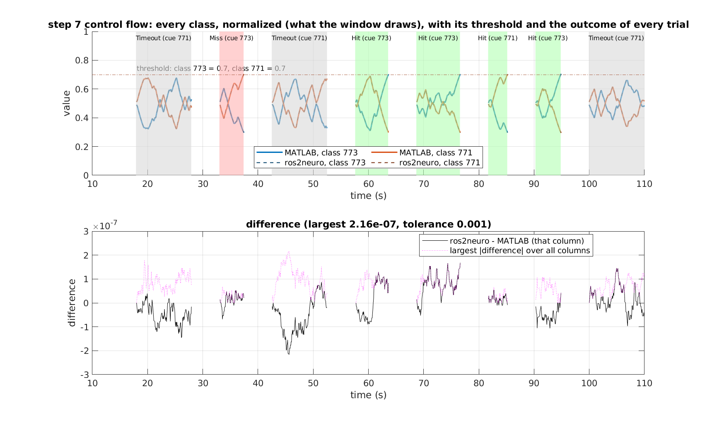

# Reproducibility

Everything ROS2neuro computes online can be **replayed offline**, from the same recording, and compared with what the nodes published. That is how the stack is tested, and it is what you use when you want to **check a result, reproduce a run, or write the analysis of an experiment** with the same numbers the real-time system gave.

| | MATLAB | Python |
|---|---|---|
| What | the `r2n_*` functions: one per stage (filters, Welch / FFT / spectrogram, FBCSP, decoders, integrators), built on the **native MATLAB functions** | the checks that replay the chain with scipy, numpy and **PyTorch / braindecode** (the deep-learning model) |
| Page | [Reproducibility in MATLAB](matlab.md) | [Reproducibility in Python](python.md) |
| Use it for | every model that is not a deep network | the deep-learning decoders, and any step you prefer to replay in Python |

**[Download and use the functions](download.md)**: the MATLAB zip and the Python script, and how to run them on your own data.

## What is tested

The package [`ros2neuro_devel_test`](../packages/devel-test.md) replays a GDF file through the real nodes, saves what they publish and redoes the same computation offline:

* **stage by stage**: acquisition (XDF), every filter, every processing plugin, the decoders, the integrators;
* **whole pipelines**, the ones you would run in an experiment, from the raw samples to the flow that drives the feedback window: QDA, LDA, FBCSP + LDA (MATLAB) and a deep-learning model (Python).

Every check prints PASS / FAIL and draws, for every step, MATLAB (or Python) and ros2neuro on top of each other and their difference, with linked time axes. The figures of the integrator and of the control flow also show the threshold and every trial as a band (green Hit, red Miss, grey Timeout). See [how to run the tests](../packages/devel-test.md#run-a-test).

## Example: the final figure of a pipeline

The last step of every `pipeline/` check is the **flow that drives the feedback window**: the value of every class over time, drawn as the window draws it. This is the figure of `pipeline/qda/` (the whole chain: raw, Laplacian, band-pass, Welch, QDA, integrator, control), with MATLAB (solid) and ros2neuro (dashed) on top of each other and, below, their difference (at most 2e-7):

How to read it:

* each **coloured band** is one trial, from CFeedback to its outcome, labelled with the outcome and the cue; the blue curve is class 773, the red one class 771, and the dash-dot line is the **threshold** (0.7) that a class has to reach;
* **Hit** (green): the curve of the **cued class** reaches its threshold. Here "Hit (cue 773)": the blue curve climbs to 0.7 and the trial ends there;
* **Miss** (red): the curve of the **other class** reaches its threshold first. Here "Miss (cue 773)": it is the red curve (class 771) that reaches 0.7;
* **Timeout** (grey): **no class reaches a threshold** before the time limit (10 s): both curves stay below 0.7 until the end of the band;
* where the flow does not exist (before CFeedback and after the outcome) the line is broken, because control sends nothing.

So the figure shows, with the real numbers of the run, that the decision of every trial follows the rule of the protocol, and that ros2neuro and MATLAB agree at every point: the outcome of every trial is also recomputed from the integrated values and compared with the one control wrote (a line of the check).

## Where the replication of each plugin is

The page of every plugin (filters, processing, decoders, integrators, control) has a **MATLAB replication** section with the code that reproduces it.
