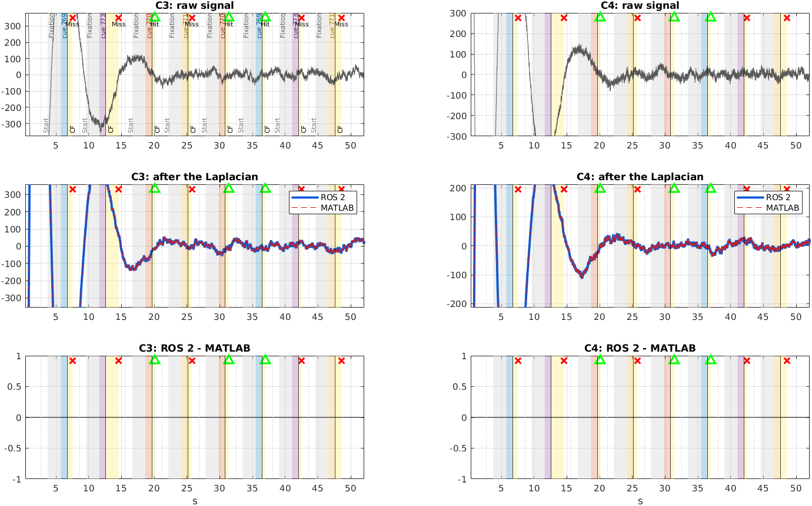
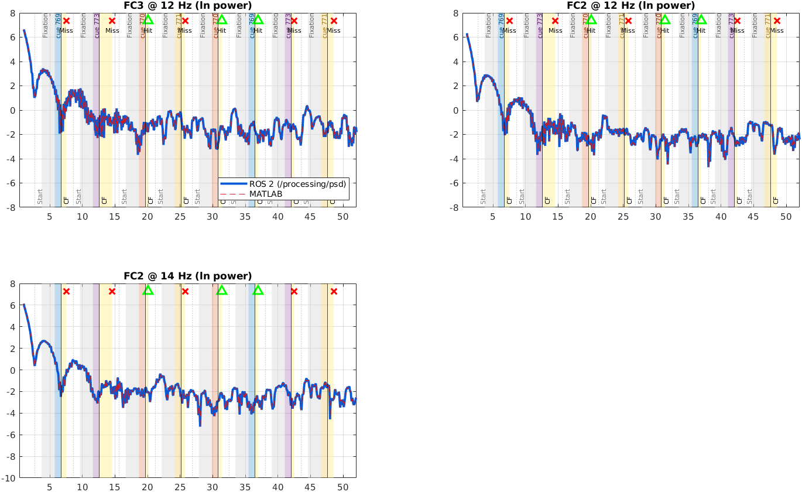
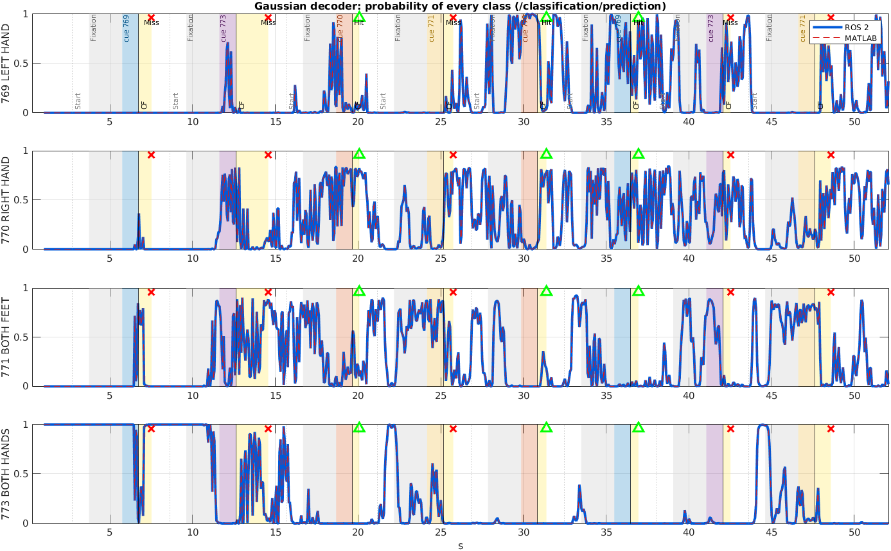
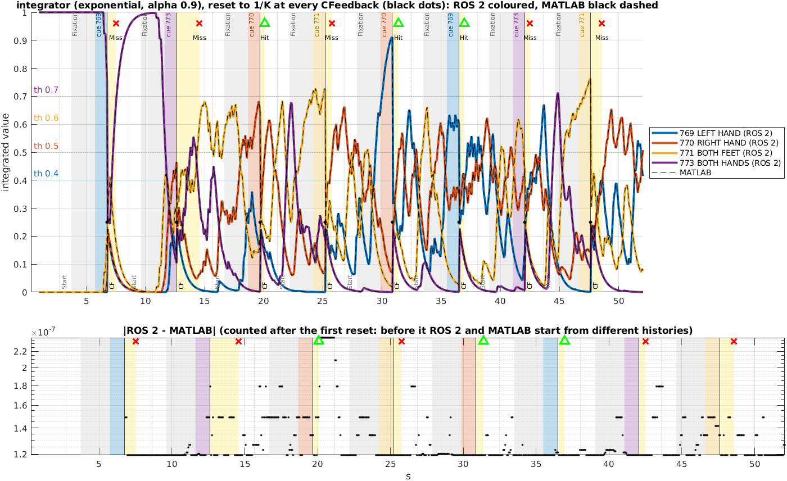

# Reproducibility in MATLAB

Every stage of the chain, from the filters to the integrator, has a **MATLAB twin**: a short function that does the same
computation, in the same float32 arithmetic, and that is **compared with what the real ROS 2 node published**. You can use
the functions in your own analysis and trust that they give the numbers ROS2neuro gives, because the comparison is repeated on
the same data every time you run the check.

!!! success "Download"
    - **[ros2neuro_matlab.zip](ros2neuro_matlab.zip)** (1.5 MB): the `r2n/` functions, `check_functions.m`, `check_evaluation.m` and
      `reference/`, the first 512 samples of the input and of the ROS 2 output of every filter and a test model. Unzipped on its own,
      `check_functions` runs **all 21 checks**, the filters against the real node included.
    - **[ros2neuro_matlab_example.zip](ros2neuro_matlab_example.zip)** (8 MB, data only): one recorded evaluation (GDF, a CSV of every
      topic, the yaml files and the model of the launcher). Unzip it in the same place (both extract into `ros2neuro_matlab/`) and
      `check_evaluation` redoes the whole chain with no ROS 2 installed.

    The same functions are in the `matlab/` folder of [`ros2neuro_devel_test`](https://github.com/ros2neuro/ros2neuro_devel_test/tree/main/matlab),
    and the code of each function is further down this page.

    ```matlab
    cd ros2neuro_matlab
    check_functions      % 21 checks: 21 PASS
    check_evaluation     % with the example: the whole chain, 8 of 8 outcomes
    ```

Everything described here is in one place, the `matlab/` folder of [`ros2neuro_devel_test`](../packages/devel-test.md):

```text
ros2neuro_devel_test/matlab/
├── r2n/                      one function per stage: copy the ones you need
├── check_functions.m         every function against ROS 2 (filters) and on known cases
└── check_evaluation.m        the whole chain on a recorded evaluation (GDF + CSV of every topic)
```

## What was checked, and how close it is

| Stage | ROS 2 package | MATLAB function | Compared with | Largest difference |
|---|---|---|---|---|
| CAR | [`filters_car`](../packages/filters/car.md) | `r2n_car` | the node, 327 680 values | 2 ULP |
| DC | [`filters_dc`](../packages/filters/dc.md) | `r2n_dc` | the node, 327 680 values | 4 ULP |
| Laplacian | [`filters_laplacian`](../packages/filters/laplacian.md) | `r2n_laplacian` | the node, 92 160 values | **0** |
| Hann, Hamming, Blackman, Flattop | [`filters_hann`](../packages/filters/hann.md) and the others | `r2n_window` | the node, 327 680 values each | **0** |
| Butterworth low-pass 40 Hz | [`filters_butterworth`](../packages/filters/butterworth.md) | `r2n_butterworth` | the node, 327 680 values | **0** |
| Butterworth high-pass 1 Hz | [`filters_butterworth`](../packages/filters/butterworth.md) | `r2n_butterworth` | the node, 327 680 values | 0.25 ULP |
| Filter chain `dc > hp > lp > car > hann` | [`ros2neuro_filters`](../packages/filters/index.md) | the five above, one after the other | the node, 327 680 values | 5 ULP |
| Welch PSD (ln) | [`processing_spectral`](../packages/processing/spectral.md) | `r2n_welch` | the whole-chain run, 817 windows | **0** |
| Gaussian decoder | [`decoder_gaussian`](../packages/decoder/gaussian.md) | `r2n_gaussian_read`, `r2n_gaussian_predict` | the whole-chain run, 817 predictions | 1.3e-7 |
| Exponential integrator | [`integrator_exponential`](../packages/integrator/exponential.md) | `r2n_integrator_exponential` | the whole-chain run, 723 frames | 1.2e-7 |
| Hit / Miss / Timeout | [`control_feedback`](../packages/control/feedback.md) | `r2n_threshold_winner` | the whole-chain run, 8 trials | 8 of 8 equal |
| Resets of the integrator | [`integrator`](../packages/integrator/index.md) | `r2n_integrator_exponential` | the whole-chain run | 8 resets; usually at the frame the rule gives, sometimes one frame earlier (see below) |

**ULP** is the distance between two neighbouring float32 numbers. The EEG in the test files is of the order of 10 000 µV, where one
ULP is 0.001 µV: a difference of 2 ULP is the last bit of the number, not a difference of method. The differences of the last three
rows are in the units of the quantity (probabilities and integrated values are between 0 and 1, so 1e-7 is one ULP there).

!!! note "How the tolerance is chosen"
    The check does not use one fixed number. It accepts a few ULP **of the largest input sample** (4 for the single-stage filters,
    8 for the DC and the chain, where the mean and the cascaded stages add rounding). The input sets the scale because the filters add
    values of that size even when what they output is much smaller. A fixed `1e-3` would be right for a signal around 10 000 and
    wrong for any other.

The `matlab/` folder is useful as a regression test too: if you change a plugin and the numbers move, the line of that stage turns to
**FAIL** with the largest difference and where it is.

## Run the checks

You need MATLAB R2019b or newer. **No toolbox**: the Butterworth design is written out, and it matches `butter()` to 1e-12 when
the Signal Processing Toolbox is there (the check verifies it). Reading a GDF (only for the whole chain) needs
[BIOSIG](https://biosig.sourceforge.net).

**1. Every function against ROS 2**

```matlab
cd ros2neuro_devel_test/matlab
check_functions
```

```text
  PASS     r2n_car                          max error 0.00195 (tolerance 0.00391 = 4 ULP of the input 1.249e+04)
  PASS     r2n_dc (32 samples/frame)        max error 0.00391 (tolerance 0.00781 = 8 ULP of the input 1.249e+04)
  PASS     r2n_laplacian (3x3 grid)         max error 0       (tolerance 0.00391 = 4 ULP of the input 1.496e+04)
  ...
  PASS     filter chain dc>hp 1>lp 40>car>hann    max error 0.00478 (tolerance 0.00781 = 8 ULP of the input 1.249e+04)
  PASS     r2n_welch: a 10 Hz sine of 1 uV peaks at 10 Hz
  ...
  21 checks: 21 PASS, 0 FAIL, 0 SKIPPED
```

For the filters it reads the input and the output of the real node that each filter package keeps in its `test/` folder
(`rawdata.csv`, `output_data*.csv`, made by `run_ros_pipeline.sh` of the package); `check_functions('/path/to/src')` points it to another
workspace. The zip carries the first 512 samples of the same files in `reference/`, and uses them when they are there: every filter
is causal or works one frame at a time, so the first samples of the ROS 2 output are exactly the filter of the first samples of the input. A package without those files shows **SKIPPED** and how to make them: nothing passes by default. The other functions
(Welch, Gaussian, integrator, threshold, the `.r2nd` reader, the yaml reader) are also checked on cases whose answer is known by hand;
their comparison with ROS 2 is the next one. The command exits with an error if anything fails, so `matlab -batch check_functions`
can go in a script or a CI job.

**2. The whole chain on a recorded evaluation**

```bash
ros2 launch ros2neuro_devel_test gaussian_4class_matlab.launch.xml     # ~2 minutes, ends by itself
```

```matlab
check_evaluation        % the newest GDF in ../recordings and the newest CSV run in data/ (example/ instead, when it is there)
check_evaluation(gdf, run_folder, launcher_folder)    % any recorded evaluation of a launcher like gaussian_4class
```

The launcher saves a GDF (raw EEG and the events of the protocol) and a CSV of every topic; `ros2neuro_matlab_example.zip` is one of
these runs. `check_evaluation` loads the GDF and **the
same yaml files the launcher used** (nothing is typed in the script), redoes the Laplacian, the Welch PSD, the Gaussian decoder and the
exponential integrator with a reset at every CFeedback, recomputes the outcome of every trial and compares each step with the CSV. The
reference run (the one of the example zip, 8 trials, 52 s):

```text
  8 of 8 outcomes recomputed from the integrated values are the ones of ROS 2
  filters (Laplacian)                           0 (tolerance  0.0308)  PASS
  Welch PSD (ln)                                0 (tolerance   0.001)  PASS
  Gaussian decoder                       1.34e-07 (tolerance   0.001)  PASS
  integrator (after the first reset)     1.19e-07 (tolerance   0.001)  PASS
  resets (frame vs the rule)                    0 (tolerance       1)  PASS  8 resets: 8 at the frame of the rule, 0 one frame off
```

!!! note "The reset can be one frame earlier"
    The rule is that ROS 2 integrates the frame that contains the CFeedback event and resets after it. The events and the values travel on different
    topics and their order is not guaranteed, so now and then the event overtakes the frame and the reset is one frame earlier (once in 40 resets, in 5 runs).
    MATLAB cannot know the order, so the check takes the resets **as ROS 2 made them** (the neutral messages of `integrated.csv`) to verify the arithmetic of the
    integrator, and the line `resets` compares them with the rule: it tells you how many are at the frame of the rule and how many one frame off, and it fails
    if one is more than one frame away.

Every step is fed with the **MATLAB** output of the previous one, so a difference would grow along the chain instead of hiding in it.
It also draws four figures, ROS 2 (colour) against MATLAB (dashed), with Start, Fixation, cue, CFeedback and Hit / Miss / Timeout marked.

=== "Filters (C3 and C4)"
    { .screenshot }

=== "PSD features"
    { .screenshot }

=== "Classification"
    { .screenshot }

=== "Integration"
    { .screenshot }

## Use a function in your own analysis

Put the `r2n/` folder on the path and call the function on a `[samples x channels]` matrix:

```matlab
addpath('ros2neuro_devel_test/matlab/r2n');

x   = single(eeg);                              % your signal, samples x channels
y   = r2n_dc(x, 32);                            % remove the mean of every 32-sample frame, as the DC filter does
y   = r2n_butterworth(y, 'high', 4, 1, 512);    % 4th-order high-pass at 1 Hz, fs 512 Hz
y   = r2n_laplacian(y, '1 2 3; 4 5 6; 7 8 9');  % the layout you give to the Laplacian filter
psd = r2n_welch(double(y(1:512, :)), struct('fs', 512, 'length', 256, 'overlap', 128, 'window', 'hann', 'freqs', 4:2:48));
```

Each function says in its header which ROS 2 plugin it reproduces, what it expects and what it returns, and each one is a
single file with no dependency on the others (except `r2n_gaussian_predict`, that takes what `r2n_gaussian_read` returns), so you can copy just the
ones you need. The yaml reader `r2n_yaml_value(file, key)` reads a parameter from the same file the node loads, which is how
`check_evaluation` avoids typing a number twice.

!!! tip "Why a loop where `mean` or `*` would do"
    The ROS 2 plugins compute in float32 with Eigen, which adds the values one after the other in float32. MATLAB's `mean` and its
    matrix product add in higher precision, so they give a slightly *more exact* answer, and that answer is not the one the node gave. The
    functions add in the same order as the node. That is why the Laplacian and the windows match **exactly** (0) and not "to 1e-3".

## The code of every function

One block per function; each starts with what it reproduces. They are also in the zip.

??? example "r2n_car.m: CAR"
    ```matlab
    --8<-- "files/r2n/r2n_car.m"
    ```

??? example "r2n_dc.m: DC"
    ```matlab
    --8<-- "files/r2n/r2n_dc.m"
    ```

??? example "r2n_laplacian.m: Laplacian"
    ```matlab
    --8<-- "files/r2n/r2n_laplacian.m"
    ```

??? example "r2n_window.m: Hann, Hamming, Blackman, Flattop"
    ```matlab
    --8<-- "files/r2n/r2n_window.m"
    ```

??? example "r2n_butterworth.m: Butterworth"
    ```matlab
    --8<-- "files/r2n/r2n_butterworth.m"
    ```

??? example "r2n_welch.m: Welch PSD"
    ```matlab
    --8<-- "files/r2n/r2n_welch.m"
    ```

??? example "r2n_gaussian_read.m: reads the `.r2nd` of the Gaussian decoder"
    ```matlab
    --8<-- "files/r2n/r2n_gaussian_read.m"
    ```

??? example "r2n_gaussian_predict.m: Gaussian decoder"
    ```matlab
    --8<-- "files/r2n/r2n_gaussian_predict.m"
    ```

??? example "r2n_integrator_exponential.m: exponential integrator"
    ```matlab
    --8<-- "files/r2n/r2n_integrator_exponential.m"
    ```

??? example "r2n_threshold_winner.m: which class touched its threshold"
    ```matlab
    --8<-- "files/r2n/r2n_threshold_winner.m"
    ```

??? example "r2n_yaml_value.m: reads a parameter of a yaml file"
    ```matlab
    --8<-- "files/r2n/r2n_yaml_value.m"
    ```

??? example "check_functions.m: the checks"
    ```matlab
    --8<-- "files/check_functions.m"
    ```

`check_evaluation.m` (the whole chain, about 340 lines) is in the zip and in the repository.

## What is not covered yet

The stages below have no MATLAB function checked against ROS 2. Contributions are welcome: follow the pattern of `r2n_car.m`
(header, one computation, a line in `check_functions.m`).

| Stage | Package |
|---|---|
| LDA, QDA, SVM decoders | [`decoder_lda`](../packages/decoder/lda.md), [`decoder_qda`](../packages/decoder/qda.md), [`decoder_svm`](../packages/decoder/svm.md) |
| Deep-learning decoder | [`decoder_py`](../packages/decoder/python.md) |
| Buffer integrator | [`integrator_buffer`](../packages/integrator/buffer.md) |
| FFT and spectrogram | [`processing_spectral`](../packages/processing/spectral.md) |
| Signal buffer | [`processing_buffer`](../packages/processing/buffer.md) |
| `control_feedback`: calibration autopilot, `rest_mode`, protocol `control` | [`control_feedback`](../packages/control/feedback.md) |

The evaluation protocol is covered (Hit / Miss / Timeout are recomputed from the integrated values), and the rejection of the
integrator is not reproduced.
