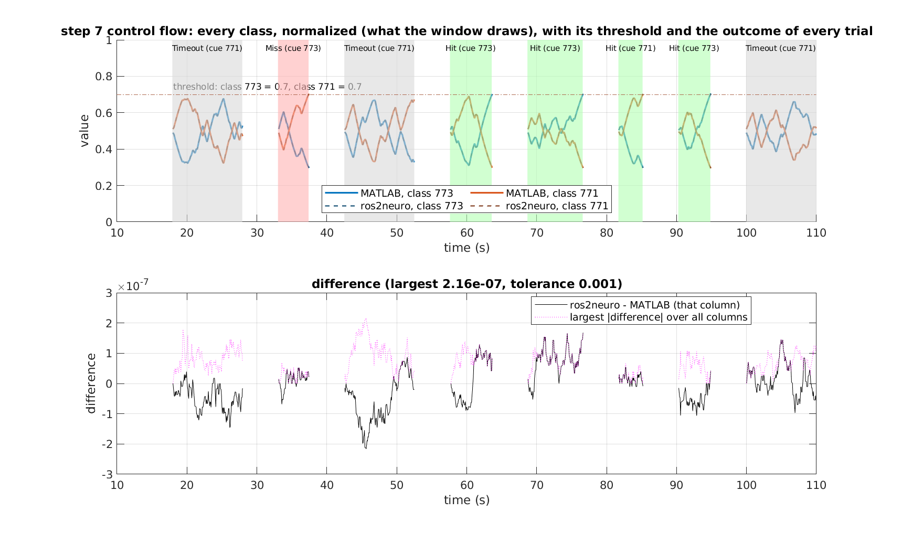

# Pipeline: the complete chain

The package tests check every stage on its own; the **`pipeline/`** tests chain them all. A GDF file is replayed through the real nodes (acquisition, filters, processing, decoder, integrator, manager, control) **with the feedback window open**, and the check redoes **every step** from the raw samples, comparing it with what ROS 2 published: raw, Laplacian, band-pass, feature, decoder probabilities, integrator and, last, the **flow that drives the feedback window**. The folder `pipeline/` is the one to read to know exactly what is done online: every parameter is in its launcher and its check.

## The four pipelines

| Pipeline | Chain | Window | Check | Language |
|---|---|---|---|---|
| `pipeline/qda/` | raw → Laplacian → band-pass → Welch → QDA → integrator → control | wheel | `check_pipeline_qda` | MATLAB |
| `pipeline/lda/` | the same with an LDA | bars | `check_pipeline_lda` | MATLAB |
| `pipeline/fbcsp/` | raw → 9 band-pass chains → FBCSP → LDA (scikit-learn) → integrator → control | wheel | `check_pipeline_fbcsp` | MATLAB |
| `pipeline/dl/` | raw → band-pass 4-14 Hz → Buffer (512 samples) → ShallowNet → integrator → control | wheel | `check_pipeline_dl.py` | Python |

Run one (the session ends by itself) and then its check:

```bash
# in the container
ros2 launch ~/ros2neuro_ws/src/ros2neuro_devel_test/pipeline/qda/pipeline_qda.launch.py
```
```matlab
% in MATLAB, in the folder of the test
cd ros2neuro_devel_test/pipeline/qda
check_pipeline_qda
```

## Example: the final figure of a pipeline

The last step of every `pipeline/` check is the **flow that drives the feedback window**: the value of every class over time, drawn as the window draws it. This is the figure of `pipeline/qda/` (the whole chain: raw, Laplacian, band-pass, Welch, QDA, integrator, control), with MATLAB (solid) and ros2neuro (dashed) on top of each other and, below, their difference (at most 2e-7):



How to read it:

* each **coloured band** is one trial, from CFeedback to its outcome, labelled with the outcome and the cue; the blue curve is class 773, the red one class 771, and the dash-dot line is the **threshold** (0.7) that a class has to reach;
* **Hit** (green): the curve of the **cued class** reaches its threshold. Here "Hit (cue 773)": the blue curve climbs to 0.7 and the trial ends there;
* **Miss** (red): the curve of the **other class** reaches its threshold first. Here "Miss (cue 773)": it is the red curve (class 771) that reaches 0.7;
* **Timeout** (grey): **no class reaches a threshold** before the time limit (10 s): both curves stay below 0.7 until the end of the band;
* where the flow does not exist (before CFeedback and after the outcome) the line is broken, because control sends nothing.

So the figure shows, with the real numbers of the run, that the decision of every trial follows the rule of the protocol, and that ros2neuro and MATLAB agree at every point: the outcome of every trial is also recomputed from the integrated values and compared with the one control wrote (a line of the check).

## How close ROS 2 and the replica are


The `pipeline/` tests chain every step, from the raw samples to the flow that drives the feedback window, and compare each one with ROS 2 (largest difference over about 1 800 messages and 58 000 samples; the filters are in the units of the signal, the later steps in the units of the quantity):

| Step | QDA | LDA | FBCSP + LDA | Tolerance |
|---|---|---|---|---|
| raw | 0 | 0 | 0 | 0 |
| Laplacian | 0.0029 | 0.0029 | | 0.016 |
| band-pass (hp 1 Hz, lp 60 Hz) | 0.00098 | 0.00098 | | 0.031 |
| band chains of FBCSP (8-12 Hz, 16-20 Hz) | | | 0 and 6e-8 | 0.031 |
| Welch PSD (ln) | 2.6e-4 | 2.6e-4 | | 1e-3 |
| FBCSP feature | | | 1.2e-7 | 1e-3 |
| decoder probabilities | 2.6e-5 | 2.5e-5 | 0 | 1e-3 |
| integrator | 1e-6 | 2.5e-6 | 0 | 1e-3 |
| control flow (what the window draws) | 2e-7 | 3e-7 | 2e-7 | 1e-3 |

The deep-learning pipeline is checked in Python (below): band-pass 5e-4, window 3e-4, network 1.4e-6, integrator 5e-7, flow 3e-7. The later steps have an absolute tolerance because the rounding of the filters is amplified by the `ln` of the power; a step fed with the ROS 2 output of the step before (the integrator alone, a decoder on the ROS PSD) agrees to a few ULP.

**ULP** is the distance between two neighbouring float32 numbers. The EEG in the test files is of the order of 10 000 µV, where one
ULP is 0.001 µV: a difference of 2 ULP is the last bit of the number, not a difference of method. The differences of the decoders and
the integrators are in the units of the quantity (probabilities and integrated values are between 0 and 1, so 1e-7 is one ULP there).
The FFT and the spectrogram compute in double, like the node, and round to float32 only at the end: they give the same float32 number.

!!! note "How the tolerance is chosen"
    The check does not use one fixed number. It accepts a few ULP **of the largest input sample** (4 for the single-stage filters,
    8 for the DC and the chain, where the mean and the cascaded stages add rounding). The input sets the scale because the filters add
    values of that size even when what they output is much smaller. A fixed `1e-3` would be right for a signal around 10 000 and
    wrong for any other.

The tests are useful as regression tests too: if you change a plugin and the numbers move, the line of that stage turns to
**FAIL** with the largest difference and where it is.


## Replay the pipeline yourself

Every step of a pipeline is one of the functions of the reproducibility pages; the dropdowns of the two pages explain each one and show its code, and the zips are in [Download](download.md).

=== "MATLAB"

    | Step | Function |
    |---|---|
    | band-pass (hp, lp), FBCSP bands | [`r2n_butterworth`](matlab.md#r2n_butterworth)|
    | Laplacian | [`r2n_laplacian`](matlab.md#r2n_laplacian)|
    | PSD feature | [`r2n_welch`](matlab.md#r2n_welch) (window: [`r2n_spectral_window`](matlab.md#r2n_spectral_window)) |
    | FBCSP feature | [`r2n_fbcsp_weights`](matlab.md#r2n_fbcsp_weights), [`r2n_fbcsp`](matlab.md#r2n_fbcsp) |
    | decoder | [`r2n_qda_read`](matlab.md#r2n_qda_read) + [`r2n_qda_predict`](matlab.md#r2n_qda_predict), [`r2n_linear_read`](matlab.md#r2n_linear_read) + [`r2n_linear_predict`](matlab.md#r2n_linear_predict), [`r2n_sklearn_lda_read`](matlab.md#r2n_sklearn_lda_read) + [`r2n_sklearn_lda_predict`](matlab.md#r2n_sklearn_lda_predict) (probabilities: [`r2n_softmax`](matlab.md#r2n_softmax)) |
    | integrator | [`r2n_integrator_exponential`](matlab.md#r2n_integrator_exponential), [`r2n_integrator_buffer`](matlab.md#r2n_integrator_buffer) |
    | outcome of the trial | [`r2n_threshold_winner`](matlab.md#r2n_threshold_winner) |

    The checks `check_pipeline_qda`, `check_pipeline_lda` and `check_pipeline_fbcsp` are the worked examples: each is one file, readable from the top. See [MATLAB](matlab.md).

=== "Python"

    | Step | Function |
    |---|---|
    | band-pass (hp, lp), FBCSP bands | [`r2n_butterworth`](python.md#r2n_butterworth)|
    | Laplacian | [`r2n_laplacian`](python.md#r2n_laplacian)|
    | PSD feature | [`r2n_welch`](python.md#r2n_welch) (window: [`r2n_spectral_window`](python.md#r2n_spectral_window)) |
    | FBCSP feature | [`r2n_fbcsp_weights`](python.md#r2n_fbcsp_weights), [`r2n_fbcsp`](python.md#r2n_fbcsp) |
    | decoder | [`r2n_qda_read`](python.md#r2n_qda_read) + [`r2n_qda_predict`](python.md#r2n_qda_predict), [`r2n_linear_read`](python.md#r2n_linear_read) + [`r2n_linear_predict`](python.md#r2n_linear_predict), any scikit-learn model: [`r2n_sklearn_load`](python.md#r2n_sklearn_load) + [`r2n_sklearn_predict`](python.md#r2n_sklearn_predict), any deep-learning model: [`r2n_braindecode_load`](python.md#r2n_braindecode_load) + [`r2n_braindecode_predict`](python.md#r2n_braindecode_predict) |
    | integrator | [`r2n_integrator_exponential`](python.md#r2n_integrator_exponential), [`r2n_integrator_buffer`](python.md#r2n_integrator_buffer) |
    | outcome of the trial | [`r2n_threshold_winner`](python.md#r2n_threshold_winner) |

    See [Python](python.md).

## The deep-learning pipeline, in Python

A deep network cannot be redone with the MATLAB functions, so `pipeline/dl/` is checked in Python, with code that is not the plugins': `scipy` for the filter, `braindecode` / PyTorch for the network, `numpy` for the integrator.

| Step | In ROS 2 | In Python |
|---|---|---|
| band-pass | `filter_chain_node` with two Butterworth filters | [`r2n_butterworth`](python.md#r2n_butterworth) (`scipy.signal.butter` + `lfilter`, causal, state kept, double precision) |
| window | `Buffer` plugin | the last 512 samples of the filtered signal |
| network | `decoder_braindecode` (embedded Python) | [`r2n_braindecode_load`](python.md#r2n_braindecode_load) and [`r2n_braindecode_predict`](python.md#r2n_braindecode_predict) (the model of the manifest, `eval()` on CPU, on every window) |
| integrator | `integrator_exponential` | [`r2n_integrator_exponential`](python.md#r2n_integrator_exponential) (`state = alpha * state + (1 - alpha) * p`, reset to 1/K at every CFeedback) |
| control | `control_feedback` | the integrated values divided by their sum |

```bash
# in the container: the session (about 3.5 minutes, with the feedback window), then the check
ros2 launch ~/ros2neuro_ws/src/ros2neuro_devel_test/pipeline/dl/pipeline_dl.launch.py
python3 ~/ros2neuro_ws/src/ros2neuro_devel_test/pipeline/dl/check_pipeline_dl.py
```

It prints PASS / FAIL for every step and draws one figure per step (ROS 2 and Python above, their difference below, with linked time axes). It exits with 1 if a step fails.

??? example "check_pipeline_dl.py"
    ```python
    --8<-- "files/python/check_pipeline_dl.py"
    ```
