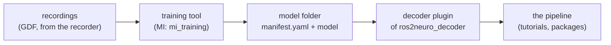

# BCI decoders training

ROS2neuro **runs** decoders; this section is about **making** them. A decoder is a trained model plus the description of what it reads (`manifest.yaml`): the training tools produce that folder, and the [decoder](../packages/decoder/index.md) plugins load it. There is one subsection per paradigm.

## What is in this menu

| Paradigm | Page | State |
|---|---|---|
| **MI**: motor imagery | [MI training](mi/index.md): the `mi_training` tool, how it works and how its models enter the stack | works today; **code not released yet** |
| **P300** | [P300](p300.md) | TODO |
| **SSVEP** | [SSVEP](ssvep.md) | TODO |

The pages of MI:

| Page | What you find |
|---|---|
| [MI training](mi/index.md) | what `mi_training` is, its state, and the path from a recording to a model running in ROS 2 |
| [The training workflow](mi/workflow.md) | the tabs of the graphical trainer, one by one, and what happens to the recordings |
| [Models and outputs](mi/models.md) | machine-learning and deep-learning models, the features, the files it writes and the decoder that loads each one |

## Where it fits

The recordings come from a calibration run with the [manager](../packages/manager/index.md) and the [recorder](../packages/recorder/index.md); the model goes to the [decoder](../packages/decoder/index.md); the same model can be opened offline with the [Python functions](../reproducibility/python.md) to check what the node does.
