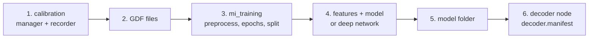

# MI training: `mi_training`

`mi_training` is the tool that trains **motor-imagery** decoders for ROS2neuro. You give it the recordings of a calibration (GDF files with the events of the [manager](../../packages/manager/synchronous.md)), choose how to preprocess them, which model to train, and it writes a **model folder** that the [decoder node](../../packages/decoder/index.md) loads as it is.

!!! warning "State: in development, code not released yet"
    `mi_training` works today and it is the tool used to make the models of the stack, but **its code is not released yet**: we are still working on it. This section explains what it does and how its models are used; the instructions to install it will be added when it is published.

## What it does

* reads continuous recordings (GDF) and **cuts the trials** from the cue and CFeedback events written by the manager;
* applies the same preprocessing the ROS 2 filters apply online (channels, DC, high-pass / low-pass / band-pass, CAR, small Laplacian, resample), with **causal filters only**, so what is trained is what runs online;
* trains **classic machine-learning** models (PSD, CSP or FBCSP features, with feature selection, and LDA, QDA, SVM, logistic regression, random forest, Gaussian) and **deep-learning** models (braindecode / PyTorch, for example ShallowNet);
* splits the data **by trial**, never by window, into train, validation and test, and reports metrics per window, per trial, per run and per day;
* writes the model folder together with the yaml of the ROS 2 nodes that must run before the decoder, and warns about what ROS 2 does not reproduce exactly.

It has a graphical interface (a window with seven tabs) and a script mode for training from the command line.

## From a recording to a model in ROS 2

1. Run a **calibration** ([`protocol: calibration`](../../packages/control/feedback.md), manager [Synchronous](../../packages/manager/synchronous.md)) with the [recorder](../../packages/recorder/xdf.md) on: the file has the signal and the events of every trial.
2. Open the files in `mi_training`, train, look at the metrics (see [the workflow](workflow.md)).
3. Take the output folder and give its `manifest.yaml` to the decoder: `decoder.manifest: /path/to/model/manifest.yaml`. Run the nodes the folder tells you to run before it (see [models and outputs](models.md)).
4. Check the result **offline**, with the same model, using the [Python functions](../../reproducibility/python.md) (`r2n_*_read`, `r2n_sklearn_load`, `r2n_braindecode_load`).

## What is in this menu

| Page | What you find |
|---|---|
| [The training workflow](workflow.md) | the tabs of the interface and what happens at every step, from the recordings to the evaluation |
| [Models and outputs](models.md) | which models and features exist, what the output folder contains and which decoder plugin loads it |
