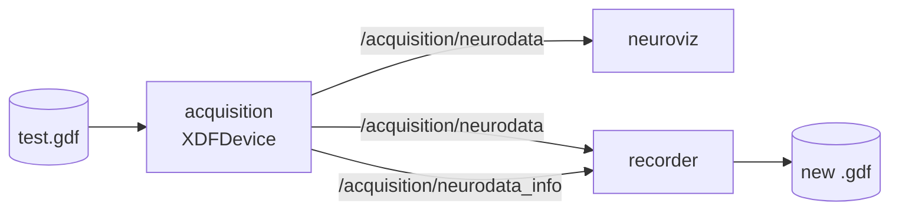

# Acquire, view and record the EEG

Every BCI starts the same way: the signal must **arrive**, you must **see** that it is good, and you often want to **save** it. In ROS2neuro
those are three nodes: the *acquisition*, the *visualizer* and the *recorder*. In this tutorial you write a launch file that starts
them, one node at a time, and check each step.

**Goal.** Replay a recorded EEG as if it came from a live amplifier, watch it in the visualizer, and record it again in a new GDF file.

**You will learn**

- what the acquisition node publishes and how its YAML file is made;
- how to start the visualizer and connect it to a topic;
- how to record a session in a GDF file, and why the recorder needs the names of the topics;
- how a launch file starts several nodes together.

**You need** ROS2neuro [installed](../../installation.md) with `ros2neuro_devel_test` (it has the recorded EEG), the
package `tutorial_signal_chain` of this tutorial (build it as in the [pub/sub tutorial](../publisher-subscriber/index.md#6-build-and-run): `colcon build --paths docs/docs/tutorials/signal-chain/tutorial_signal_chain`)
and a display for the visualizer. No amplifier. About 20 minutes.

!!! note "Why a file and not a device?"
    A recorded GDF replayed by the acquisition behaves exactly like an amplifier: the nodes after it cannot tell the difference. So every
    tutorial runs without hardware, and with a real device you only change the YAML of the acquisition.

## 1. The plan



One node publishes, two listen. This is the rule of ROS2neuro: adding a listener never changes the publisher.

## 2. The acquisition node

The node is `acquisition` of the package `ros2neuro_acquisition`. It is **generic**: the device (an amplifier, a file, a simulator)
is a *plugin* chosen by a parameter. We use the plugin that replays a GDF file:

```yaml title="config/acquisition_gdf.yaml"
--8<-- "signal-chain/tutorial_signal_chain/config/acquisition_gdf.yaml"
```

The parameters, from top to bottom:

| Parameter | Meaning |
|---|---|
| `acquisition.plugin` | the device: `XDFDevice` reads a GDF/BDF file |
| `acquisition.autostart` | start publishing as soon as the node is ready (otherwise call the service `~/start`) |
| `acquisition.framerate` | frames per second: with 512 Hz that is 32 samples per frame |
| `acquisition.loop` | start the file again when it ends (the test file lasts 250 s) |
| `acquisition.sensors.eeg.*` | the name, the unit and the **channel labels** of the EEG block |
| `acquisition.triggers.tri.*` | the same for the digital trigger channel |
| `acquisition.filename` | the GDF to read: it comes from the launch file |

Try the node alone, before writing any launch file:

```bash
ros2 run ros2neuro_acquisition acquisition --ros-args \
  --params-file $(ros2 pkg prefix tutorial_signal_chain)/share/tutorial_signal_chain/config/acquisition_gdf.yaml \
  -p acquisition.filename:=$(ros2 pkg prefix ros2neuro_devel_test)/share/ros2neuro_devel_test/data/test.gdf
```

```text
[acquisition]: Loaded plugin 'ros2neuro::acquisition::XDFDevice'
[acquisition]: Setup complete for 'xdf_file' (frame_rate=16.000000 Hz, sensors=1, triggers=1)
[acquisition]: Started device 'xdf_file'
```

In a second terminal check what it publishes:

```bash
ros2 topic list -t
ros2 topic hz /acquisition/neurodata
```

```text
/acquisition/neurodata [ros2neuro_msgs/msg/NeuroFrame]
/acquisition/neurodata_info [ros2neuro_msgs/msg/NeuroFrameInfo]
average rate: 16.008
```

Two topics: `neurodata` carries the **frames** (32 samples of every channel, 16 times per second) and `neurodata_info` describes the stream
(device, sample rate, channel labels). See [Messages](../../concepts/messages.md). Stop the node with Ctrl+C.

## 3. A launch file for the acquisition

Typing that command is tedious, so we put it in a launch file. A launch file is a Python function that returns the list of nodes to
start. First the acquisition:

```python title="launch/acquisition_viewer.launch.py (part 1)"
--8<-- "signal-chain/tutorial_signal_chain/launch/acquisition_viewer.launch.py:acquisition"
```

`parameters` takes the YAML file and, after it, a dictionary of parameters that **override** the file: here the GDF to replay, which the
user can choose with the launch argument `gdf_file`.

## 4. Add the visualizer

The visualizer is one more node. It needs no parameters: you choose the topic in its window.

```python title="launch/acquisition_viewer.launch.py (part 2)"
--8<-- "signal-chain/tutorial_signal_chain/launch/acquisition_viewer.launch.py:viewer"
```

??? example "The complete launch file"
    ```python
    --8<-- "signal-chain/tutorial_signal_chain/launch/acquisition_viewer.launch.py"
    ```

Run it:

```bash
ros2 launch tutorial_signal_chain acquisition_viewer.launch.py
```

The window of `neuroviz` opens. In the **Topic** box choose `/acquisition/neurodata`, press **Start**, and the sixteen channels
scroll. The panel on the right shows **512 Hz**, **32 samples** per frame and **16 Hz**. The [visualizer tutorial](../visualizer/index.md) explains
every control.

To stop everything press Ctrl+C in the terminal (closing the window stops only the visualizer).

!!! tip "Another file"
    `ros2 launch tutorial_signal_chain acquisition_viewer.launch.py gdf_file:=/path/to/my.gdf` replays any GDF with the same 16 channels. For
    another montage change `labels` (and the number of labels) in the YAML.

## 5. Add the recorder

The recorder writes the frames, and the events, in a GDF (or BDF) file. It is a node with a *plugin* too, `XDFRecorder`:

```python title="launch/acquisition_recorder.launch.py (the recorder)"
--8<-- "signal-chain/tutorial_signal_chain/launch/acquisition_recorder.launch.py:recorder"
```

Look at the three `topic_*` lines. The recorder listens by default to `/neurodata`, `/neurodata_info` and `/neuroevent`, but our acquisition
publishes under its own name, `/acquisition/neurodata`. **If you forget `topic_data` and `topic_info` the recorder waits forever for a stream that
never arrives**: its log says `Waiting for NeuroFrameInfo on '/neurodata_info'`.

`/neuroevent` is the [event bus](../../concepts/protocols.md#event-codes): everything published there (the phases of a trial, a blink) ends in
the file next to the signal. Here nobody writes events, so the file will have none.

```bash
ros2 launch tutorial_signal_chain acquisition_recorder.launch.py output:=/tmp/recordings subject:=sub-01
```

```text
[recorder]: Loaded recorder plugin 'ros2neuro::recorder::XDFRecorder'
[recorder]: Waiting for NeuroFrameInfo on '/acquisition/neurodata_info'
[recorder]: Opened output file '/tmp/recordings/sub-01_task-tutorial_20261124_141137.gdf'
[recorder]: Recorder setup complete (device_id='test.gdf', sensors=1, triggers=1)
```

The file name is made of the `subject`, the `task` and the date and time. Let it run for ten seconds, then stop with Ctrl+C: the file is closed when the node ends (the size you see while it runs is not the final one).

```bash
ls -lh /tmp/recordings
```

```text
-rw------- 1 paolo paolo 561664 Nov 24 14:11 sub-01_task-tutorial_20261124_141137.gdf
```

!!! warning "Stop the recorder with Ctrl+C"
    The file is closed when the recorder shuts down normally. If the process is killed (`kill -9`, power off) the file may be incomplete.

You can open the GDF in MATLAB (BIOSIG, `sload`), in Python (`mne.io.read_raw_gdf`) or **replay it with this same acquisition**, which closes the loop:
what you record today is what you replay tomorrow to test a new filter.

## Troubleshooting

| Symptom | Likely cause |
|---|---|
| the topic list of the visualizer is empty | the acquisition is not running, or ROS 2 is not sourced in that terminal, or another `ROS_DOMAIN_ID` |
| `Waiting for NeuroFrameInfo` forever | the recorder `topic_info` does not match the topic of the acquisition (`ros2 topic list`) |
| no file in the output folder | the folder is not writable; the recorder creates it if it is missing |
| the visualizer shows nothing after Start | choose the topic first (the box is empty at the start), then Start |
| two data streams, a strange rate | a previous launch is still alive: `ros2 node list` shows the same name twice |

## What you learned

- the acquisition is a generic node: a YAML selects the device, and what follows only sees the topics `neurodata` and `neurodata_info`;
- the visualizer and the recorder are listeners, and they can run together;
- a launch file lists the nodes, their parameter files and the **remaps** and overrides each one needs.

Next: [View the signals in the visualizer](../visualizer/index.md).
