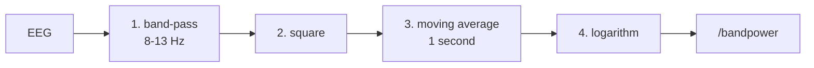
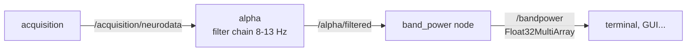

# Compute the band power of a channel

The EEG is a mixture of rhythms: alpha (8 to 13 Hz) grows when you close your eyes, mu and beta (8 to 30 Hz) drop when you imagine a movement.
Most of the BCIs are built on one number: **how much power there is in a band**. In this tutorial you write the node that computes it,
channel by channel, in real time.

**Goal.** Compute the **band power of the alpha band** of every channel and publish it as a stream of numbers, 16 times per second, that you can read in a
terminal and use in the [next tutorial](../feedback-gui/index.md) to move a bar.

**You will learn**

- the four steps of a band power: band-pass, square, average, logarithm, and why each one is there;
- how to keep a moving average with a **ring buffer**;
- how to separate the maths (no ROS, tested on its own) from the node;
- how to read a `NeuroFrame` (sample-major) in a node of yours.

**You need** the [filter chain](../filter-chain/index.md) and the [publisher and subscriber](../publisher-subscriber/index.md) tutorials. About 30 minutes.

!!! note "Not the same as the power-threshold tutorial"
    The [power threshold](../power-threshold-event/index.md) tutorial measures the *variance* of a whole frame and raises an event. Here
    we measure the power **in a frequency band**, over a **sliding window**, and publish its logarithm as a continuous value.

## 1. The idea in four steps



1. **Band-pass.** Keep only the rhythm of interest. This is the filter chain you already know, so the node does not do it.
2. **Square.** A band-passed signal oscillates around zero: its average is zero, whatever its amplitude. Squared, every sample is positive and
   big oscillations count more than small ones: it is the *instantaneous power*.
3. **Moving average.** One sample says nothing; the mean over the last second does. It is the power of that second.
4. **Logarithm.** The power of the EEG varies by orders of magnitude between subjects, channels and sessions, and its distribution is very
   skewed. The logarithm compresses it: it is the usual feature in BCI and the one the decoders of ROS2neuro expect (`ln(power)`).

A check you can do on paper: a sine of amplitude `A` has a mean square of `A²/2`, so its band power is `ln(A²/2)`. The test below does exactly this.

## 2. The plan



```text
tutorial_band_power/
├── CMakeLists.txt
├── package.xml
├── include/tutorial_band_power/BandPower.h    # the maths, no ROS
├── src/band_power_node.cpp                    # the node
├── test/test_band_power.cpp
├── config/                                    # acquisition, alpha band-pass, band power
└── launch/band_power.launch.py
```

As in the other tutorials the maths is in a **header without ROS**, so it can be tested without starting any node; the node is a thin layer around it.

## 3. The maths, step by step

We write a class `BandPower` that holds, for each channel, the squares of the last `window` samples and their sum.

**The state.** One ring buffer of `window` squares per channel, laid out sample-major like the frames, and the running sum of each channel:

```cpp title="include/tutorial_band_power/BandPower.h"
--8<-- "band-power/tutorial_band_power/include/tutorial_band_power/BandPower.h:constructor"
```

**Pushing a sample.** `x` points to one sample of **all the channels**. For every channel we square it (step 2) and update the moving sum (step 3):
the new square enters, the oldest one, which sits in the slot we are about to overwrite, leaves. We never add up the whole window again: each sample costs two operations
whatever the length of the window.

```cpp
--8<-- "band-power/tutorial_band_power/include/tutorial_band_power/BandPower.h:push"
```

**Reading the value.** The mean is `sum / n` and the last step is the logarithm. A tiny `kFloor` avoids `ln(0) = -inf` if the signal is perfectly flat (a
disconnected channel):

```cpp
--8<-- "band-power/tutorial_band_power/include/tutorial_band_power/BandPower.h:value"
```

??? example "The complete header"
    ```cpp
    --8<-- "band-power/tutorial_band_power/include/tutorial_band_power/BandPower.h"
    ```

!!! info "Why `double` inside?"
    The data is `float`, but the running sum adds and subtracts thousands of numbers: in `float` the rounding errors would accumulate. The class
    accumulates in `double` and gives back `float`.

## 4. Test the maths

Before using it on EEG, check it on signals whose answer you know:

```cpp title="test/test_band_power.cpp"
--8<-- "band-power/tutorial_band_power/test/test_band_power.cpp"
```

Constant signal, sine of known amplitude, a window that forgets old data, independent channels, warm-up and silence. They run in a
fraction of a second (`colcon test`, see below).

## 5. The node, step by step

**Parameters.** Two: the name of the block of the frame to analyse and the length of the window:

```cpp
--8<-- "band-power/tutorial_band_power/src/band_power_node.cpp:parameters"
```

**Topics.** It reads frames and publishes a vector of floats, one per channel. The input is `/neurodata` by default and **we remap it** to the output of the band-pass chain:

```cpp
--8<-- "band-power/tutorial_band_power/src/band_power_node.cpp:topics"
```

**In the callback, four steps.** First we find the block of the frame we want:

```cpp
--8<-- "band-power/tutorial_band_power/src/band_power_node.cpp:find"
```

Then we create the `BandPower` at the first frame, because only then do we know the number of channels and the sampling rate, which turns "1 second" into 512 samples:

```cpp
--8<-- "band-power/tutorial_band_power/src/band_power_node.cpp:create"
```

We feed it all the samples of the frame. The data is **sample-major** (`data[s * channels + c]`), so `&data[s * channels]` is exactly "one sample of every channel":

```cpp
--8<-- "band-power/tutorial_band_power/src/band_power_node.cpp:loop"
```

And we publish the band power of every channel, once per frame:

```cpp
--8<-- "band-power/tutorial_band_power/src/band_power_node.cpp:publish"
```

??? example "The complete node"
    ```cpp
    --8<-- "band-power/tutorial_band_power/src/band_power_node.cpp"
    ```

## 6. Build files

```cmake title="CMakeLists.txt"
--8<-- "band-power/tutorial_band_power/CMakeLists.txt"
```

```bash
colcon build --packages-select tutorial_band_power      # or: colcon build --paths path/to/tutorial_band_power
colcon test  --packages-select tutorial_band_power
colcon test-result --verbose
source install/setup.bash
```

## 7. Run it

The band-pass is a filter chain of two Butterworth filters, exactly as in the [filter chain tutorial](../filter-chain/index.md), with the node called `alpha`:

```yaml title="config/alpha_chain.yaml"
--8<-- "band-power/tutorial_band_power/config/alpha_chain.yaml"
```

The launch file connects everything. Note the two remaps: the band-pass reads the acquisition, the band power reads the band-pass. The acquisition is started 3 seconds after the others, so that nobody loses the first frames (see the [whole pipeline tutorial](../full-pipeline/index.md#3-put-it-together-who-starts-first)).

```python title="launch/band_power.launch.py"
--8<-- "band-power/tutorial_band_power/launch/band_power.launch.py:nodes"
```

```bash
ros2 launch tutorial_band_power band_power.launch.py
```

```text
[band_power]: 16 channel(s) of 'EEG', window of 512 samples
```

Check the topic from another terminal:

```bash
ros2 topic hz /bandpower
ros2 topic echo /bandpower --field data
```

```text
average rate: 16.008
array('f', [2.1139907836914062, 0.9997270107269287, 1.43056058883667, ... ])
```

Sixteen numbers, one per channel, in the order of the labels (`Fz, FC3, ...`). They are `ln(µV²)`: `2.11` is a power of `e^2.11 ≈ 8 µV²` in the alpha band. The values of this
EEG move slowly, because the moving average lasts a second.

To see *why*, open the visualizer on `/acquisition/neurodata` and on `/alpha/filtered`: the second is the signal the node squares.

## Troubleshooting

| Symptom | Likely cause |
|---|---|
| `/bandpower` does not appear | the node does not receive frames: check the remap of `/neurodata` and that `/alpha/filtered` has a rate |
| no data, and the log says nothing | `sensor` does not match the name of the block (`ros2 topic echo --once /acquisition/neurodata_info`, field `sensors`) |
| huge values (e.g. 10) | the input is **not** band-passed: the node would measure all the frequencies, including the drifts |
| the first second looks strange | the window is not full yet (`ready()`): the average is over fewer samples |
| `-27` or so on a channel | the signal is flat: the `kFloor` of the logarithm (`ln 1e-12`) |

## Exercises

1. Publish a `NeuroFeature` (`TYPE_TIME_SERIES`, axes channels) instead of a `Float32MultiArray`, so the visualizer-style tools know the labels.
2. Add a parameter `average` that publishes the mean of a list of channels, for example C3, C1, Cz for a motor ROI.
3. Replace `ln(power)` with the **relative** power: divide by the power of a broad band (1 to 40 Hz) computed in the same way.
4. Use two nodes, `alpha` and `beta` ([several chains](../multiple-chains/index.md)), and a band power for each.

Next: [A feedback window that follows the band power](../feedback-gui/index.md).
