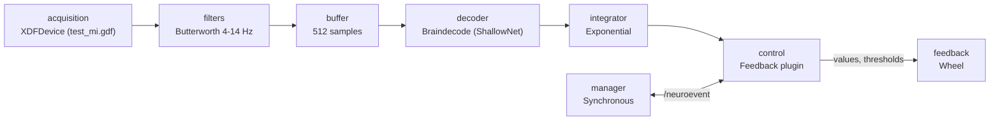

# A complete pipeline with a deep-learning model

**Goal.** Run a second complete pipeline, different from the one of [Run the complete pipeline without hardware](../hardware-free-pipeline/index.md): there a power spectrum feeds a classic classifier (Gaussian); here the **filtered signal itself** feeds a **deep network** (ShallowNet, trained with braindecode / PyTorch). You will see which stages change and which stay exactly the same.

It takes about 15 minutes and needs no code of your own, only a display for the feedback window.

**You will learn**

- that the stages are the same and only two pieces change when you change the kind of decoder: a **Buffer** instead of a Welch, and the **braindecode decoder** instead of a Gaussian;
- how a deep-learning model is described by a folder with a `manifest.yaml`;
- how to write the whole pipeline in one launch file and one yaml per concern.

**You need** ROS2neuro [installed](../../installation/index.md) with the package `ros2neuro_devel_test` (it holds the GDF), the Python libraries of the deep-learning decoder (`torch` and `braindecode`: see [the optional libraries](../../installation/apt.md#python-libraries-for-the-scikit-learn-and-braindecode-decoders-optional); the Docker image has them) and a display.

## 1. The plan



| Node | Plugin | What is different from the Welch / Gaussian pipeline |
|---|---|---|
| `filters` | [Butterworth](../../packages/filters/butterworth.md) high-pass 4 Hz then low-pass 14 Hz | the band the network was trained on |
| `buffer` | [`Buffer`](../../packages/processing/buffer.md) | **replaces the Welch**: it publishes the last 512 samples of every channel, not their spectrum |
| `decoder` | [`Braindecode`](../../packages/decoder/braindecode.md) | **replaces the Gaussian**: a PyTorch model, run in Python inside the node |
| `integrator`, `control`, `manager`, `feedback` | the same as in tutorial 8 | nothing: they only see probabilities |

The model is a folder, `ros2neuro_decoder_braindecode/extra/eegnet_mi_bhbf/`: a `manifest.yaml` (which network, its configuration, the channels it reads by label, the output classes) and `params.pt` (the weights). It is a **test model** trained on a handful of trials, so its accuracy means nothing: it is there to show the pipeline.

## 2. The files

Everything is in the folder of this tutorial: one launch file and one yaml per concern.

??? example "dl_pipeline.launch.py"
    ```python
    --8<-- "dl-pipeline/dl_pipeline.launch.py"
    ```

??? example "config/chain.yaml: the filters and the Buffer"
    ```yaml
    --8<-- "dl-pipeline/config/chain.yaml"
    ```

??? example "config/integrator.yaml"
    ```yaml
    --8<-- "dl-pipeline/config/integrator.yaml"
    ```

??? example "config/layout.yaml: classes and thresholds, the same for manager, control and feedback"
    ```yaml
    --8<-- "dl-pipeline/config/layout.yaml"
    ```

??? example "config/protocol.yaml: the trials (manager) and control's own parameters"
    ```yaml
    --8<-- "dl-pipeline/config/protocol.yaml"
    ```

The two other files, `acquisition.yaml` and `feedback.yaml`, are the usual ones: the acquisition replays the GDF, the feedback draws the wheel.

## 3. Run it

```bash
source /opt/ros/jazzy/setup.bash
cd path/to/docs/tutorials/dl-pipeline
ros2 launch ./dl_pipeline.launch.py
```

For 15 s nothing seems to happen: the manager waits (`duration.begin`) so that the network is loaded and every node has found the others. Then the wheel window shows an **evaluation** of four trials (two per class): the cue, the wheel moving with what the **network** says, and the outcome of every trial. The launch ends by itself after about a minute and the manager prints a line per trial:

```text
[manager]: Trial 1/4 (class: BOTH_FEET (771)): Hit  [hit=1 miss=0 timeout=0]
...
[manager]: Protocol ended
```

!!! note "Hit and Miss on a replayed file"
    The GDF is replayed in a loop and is not synchronized with the cues, so the Hits and Misses only show that the chain works.

## 4. Look at it

In another terminal, while it runs:

```bash
ros2 topic hz /processing/buffer           # the windows, one per frame
ros2 topic echo /classification/prediction --once   # the probabilities of the network
ros2 topic echo /integrated/raw --once              # smoothed by the integrator
ros2 topic echo /control_feedback/probabilities --once   # what the wheel draws: values and thresholds
```

## 5. Change something

* **The smoothing**: `integrator.params.alpha` in `config/integrator.yaml` (0.98 reacts slowly, 0.9 faster).
* **The thresholds**: `thresholds` in `config/layout.yaml`, or while it runs, `ros2 param set /control thresholds "[0.6, 0.6]"`.
* **Your own model**: a folder from [BCI decoders training](../../training/mi/index.md) with its `manifest.yaml`: give it to the decoder as `decoder.manifest` and make `processing.params.buffer` and the filters match what the model was trained on.

The same pipeline is replayed offline, step by step, in [Reproducibility › Pipeline](../../reproducibility/pipeline.md#the-deep-learning-pipeline-in-python).
