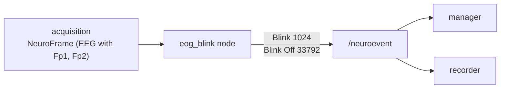

# Checking the EOG with frontal channels

Eye blinks and eye movements produce large electrical deflections, the electro-oculogram (EOG), that the
frontal EEG electrodes (**Fp1** and **Fp2**, just above the eyes) pick up much more strongly than anything the
brain does. In a BCI they matter twice: they contaminate the signal, and a trial in which the subject blinked
is often better discarded.

In this tutorial you write a node that **detects blinks on Fp1 and Fp2** and publishes them as events. You also
get a small simulator, so you can run everything without hardware and without frontal electrodes.

**You will learn**

- why a blink is easy to recognise on Fp1/Fp2 and how to detect it sample by sample;
- how to separate the signal from slow drifts with a baseline, and avoid false events with hysteresis;
- how to time-stamp an event with the exact sample that caused it;
- how this ties in with the stack: the event ids `1024` (Blink) and `1024 + 32768` (Blink Off) are the ones the
  [manager](../../packages/manager/index.md) already listens to.

**You need** a built ROS2neuro workspace. Read the [power threshold tutorial](../power-threshold-event/index.md)
first: this one builds on the same ideas.

The complete package is in the repository, under `docs/tutorials/eog-check/tutorial_eog_check/`, and it is
compiled by the CI of the repository.

## 1. What a blink looks like

A blink is a deflection of 100 to 300 µV that lasts about 200 to 400 ms. It has three properties that make it
detectable:

- it is **large** compared with the EEG (tens of µV);
- it is strongest on **Fp1 and Fp2**, with the **same polarity** on both (the eyelid moves both eyes together);
- it is much smaller on the central channels, where the motor rhythms are recorded.

So the mean of Fp1 and Fp2 is a good blink signal: it keeps the common-mode blink and averages out the
independent noise of the two electrodes.

!!! note "Eye movements"
    A horizontal eye movement has *opposite* polarity on the two sides, so it shows up in the difference of two
    lateral channels (F7 and F8, or the dedicated EOG channels) rather than in Fp1 and Fp2. This tutorial detects
    blinks. See the exercises for the next step.

## 2. The design



For every sample the node:

1. takes the mean of the frontal channels;
2. subtracts a slow **baseline** that follows the signal (so offsets and drifts do not matter);
3. starts a blink when the difference reaches a threshold, and ends it when it stays low for a short time;
4. publishes the event, stamped with the time of that sample.

As in the previous tutorial, the algorithm is in a header with no ROS code, so it can be tested on its own.

## 3. Package layout

```text
tutorial_eog_check/
├── CMakeLists.txt
├── package.xml
├── include/tutorial_eog_check/BlinkDetector.h   # the algorithm, no ROS
├── src/eog_blink_node.cpp                       # the detector node
├── src/fake_eog_node.cpp                        # a blink simulator for the demo
├── test/test_blink_detector.cpp
├── config/eog_blink.yaml
└── launch/eog_demo.launch.xml
```

## 4. The detector

```cpp title="include/tutorial_eog_check/BlinkDetector.h"
--8<-- "eog-check/tutorial_eog_check/include/tutorial_eog_check/BlinkDetector.h"
```

Three details make it robust:

- **Baseline.** A one-pole low-pass (`baseline_tau_s`, 2 s) follows the signal. The detector looks at the
  *deviation* from it, so a constant offset (the test uses 5000 µV) or a slow drift is not a blink. The baseline
  starts at the first sample to avoid a transient at startup.
- **Frozen baseline during a blink.** While a blink is open the baseline stops moving. Otherwise it would follow
  the blink and the deviation would shrink before the blink is over.
- **Hysteresis and release time.** The blink starts at `threshold`, but it ends only when the deviation stays
  under `threshold * hysteresis` for `release_s`. The waveform of a blink crosses zero and has ripples, and
  without this rule one blink would produce several events.

The detector uses the absolute value, because depending on the reference a blink can be positive or negative.

## 5. The node

```cpp title="src/eog_blink_node.cpp"
--8<-- "eog-check/tutorial_eog_check/src/eog_blink_node.cpp"
```

Things to notice:

- **Sample-major access.** The value of channel `c` at sample `s` is `sensor.data[s * channels + c]`. The node
  averages the frontal channels for every sample.
- **Channels by label.** `channels: ["Fp1", "Fp2"]` is resolved once from `sensor.labels`. If a label is missing
  the node says so and does nothing, instead of silently reading the wrong channel.
- **The sampling rate comes from the frame.** The detector is created at the first frame, so the node works at
  any rate.
- **Sample-accurate time stamps.** Unlike the previous tutorial, the event is stamped with
  `frame.header.stamp + s / samplerate`, the time of the sample that triggered it. A blink then lines up with
  the signal in the recorded file.
- **Event ids.** `1024` is *Blink* in the ROS2neuro catalog and its end is `1024 + 32768`
  ([event codes](../../concepts/protocols.md#event-codes)). The manager keeps track of whether a blink is in
  progress by listening to these two ids, so you do not need to change the manager to make it aware of your
  detector.

## 6. The simulator

Real recordings are not always at hand, and the test GDF of the workspace has no frontal electrodes. The package
includes a small simulator:

```cpp title="src/fake_eog_node.cpp"
--8<-- "eog-check/tutorial_eog_check/src/fake_eog_node.cpp"
```

It publishes five EEG channels (Fp1, Fp2, C3, Cz, C4) with a 10 Hz rhythm and noise, and a Gaussian blink every
four seconds, large and in phase on Fp1/Fp2 and ten times smaller elsewhere. It is a useful pattern in its own
right: **a tiny publisher with known content lets you test a node without any hardware**.

## 7. The test

```cpp title="test/test_blink_detector.cpp"
--8<-- "eog-check/tutorial_eog_check/test/test_blink_detector.cpp"
```

The tests cover one blink giving exactly one start and one end, a deflection that is too small, a negative blink,
a large constant offset, and two blinks in a row.

## 8. Build files

```xml title="package.xml"
--8<-- "eog-check/tutorial_eog_check/package.xml"
```

```cmake title="CMakeLists.txt"
--8<-- "eog-check/tutorial_eog_check/CMakeLists.txt"
```

## 9. Build and test

```bash
colcon build --packages-select tutorial_eog_check
colcon test  --packages-select tutorial_eog_check
colcon test-result --verbose
source install/setup.bash
```

If the package lives outside `src/`, add its path: `colcon build --paths path/to/tutorial_eog_check`.

## 10. Run it

```yaml title="config/eog_blink.yaml"
--8<-- "eog-check/tutorial_eog_check/config/eog_blink.yaml"
```

```xml title="launch/eog_demo.launch.xml"
--8<-- "eog-check/tutorial_eog_check/launch/eog_demo.launch.xml"
```

Start the demo:

```bash
ros2 launch tutorial_eog_check eog_demo.launch.xml
```

The detector reports one blink every four seconds:

```text
[eog_blink]: Using 2 frontal channel(s)
[eog_blink]: blink 1
[eog_blink]: blink 2
[eog_blink]: blink 3
```

In a second terminal look at the events:

```bash
ros2 topic echo /neuroevent --field event_id
```

```text
1024        blink starts
33792       blink ends (1024 + 32768)
1024
33792
```

Each blink lasts a bit more than a third of a second between its two events, which is the width of the waveform
the detector is following.

## 11. Use it on real data

- **Real electrodes.** Remap the input to your acquisition or filter output:
  `ros2 run tutorial_eog_check eog_blink_node --ros-args --params-file config/eog_blink.yaml -r /neurodata:=/acquisition/neurodata`.
  Make sure `channels` use the labels of your cap (`ros2 topic echo --once /acquisition/neurodata_info`).
- **Choose the threshold.** Ask the subject to blink a few times and look at the size of the deflection in the
  [visualizer](../../packages/visualizer.md). Set the threshold to about half of the blink amplitude, well above
  the amplitude of the EEG.
- **Filtering first.** Do not high-pass the signal above about 1 Hz before this node: it would distort the slow
  blink waveform. Detect blinks on the raw or lightly filtered signal, and filter afterwards for the BCI chain.
- **Record and reject.** Run the [recorder](../../packages/recorder/index.md) on `/neuroevent` and the blinks are in the
  GDF file. In an offline analysis they tell you which trials to discard.
- **Check the electrodes.** If no blink is ever detected, the frontal electrodes may have a bad contact. Asking
  the subject to blink is a quick way to check that Fp1 and Fp2 are recording.

## Troubleshooting

| Symptom | Likely cause |
|---|---|
| `Channel 'Fp1' is not in sensor 'EEG'` | the labels of the stream differ (`Fp1` vs `FP1`), or the cap has no frontal channels |
| no blink is detected | the threshold is above the blink amplitude: print the deviation or lower it |
| false blinks | the threshold is too low, or the signal has fast artifacts: raise it and the `release_s` |
| several events for one blink | `release_s` is too short or `hysteresis` too close to 1 |
| a blink is missed right after another | the previous one is still open: lower `release_s` |

## Exercises

1. Detect **horizontal eye movements**: use two lateral channels and look at their difference, which changes sign
   with the direction of the gaze.
2. Count the blinks per minute and log the rate every 10 seconds. A high rate is a sign of fatigue.
3. Add a service `reset` that clears the blink count, as the integrator does.
4. Combine this node with the [power threshold](../power-threshold-event/index.md) node: publish an event only
   when a blink *and* a rise of the frontal power occur together.

Next: [Showing the feedback in virtual reality](../vr-feedback/index.md).
