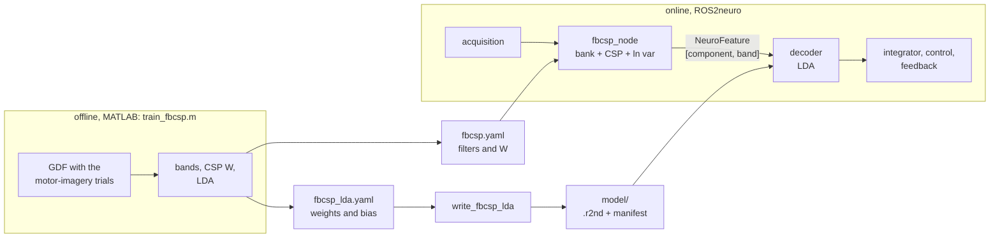

# Filter bank CSP: train it in MATLAB, run it in ROS2neuro

Common Spatial Patterns (CSP) is the classic way to find, in a motor-imagery EEG, the weighted sums of channels whose **variance** best
tells two classes apart. With a **filter bank** (FBCSP) it is done in several frequency bands at once, and a classifier decides on the
log-variances. ROS2neuro has no CSP node: in this tutorial you build one, as a worked **example** of how a method that is trained offline
becomes a part of the pipeline.

You train the method in MATLAB on a recorded file, you write a small node that applies it sample by sample, you teach the existing LDA
decoder to read what the node publishes, and you check the node against MATLAB.

**You will learn**

- how a method trained offline is brought online: what the training exports and what the node reads;
- how to publish your own feature so that the existing decoders can use it as it is;
- how to check that the node computes what MATLAB computes;
- how to bring a CSP trained elsewhere (Python, MNE) into the same node.

**You need** a built ROS2neuro workspace, MATLAB (R2019b or newer, no toolbox, with [BIOSIG](https://biosig.sourceforge.net) to read the GDF)
and the MATLAB functions of [Reproducibility in MATLAB](../../reproducibility/matlab.md) (`r2n/`). About 45 minutes.

!!! warning "An example, not a classifier to use"
    The recording has 20 trials, 10 per class. The numbers below show that the method and the node work; they do not say how well FBCSP
    would do on your subjects. Bands, number of components, epoch and classifier are the first things to change on your data.

## 1. The idea



For every band the node does, sample by sample,

```text
x  ->  band-pass of every channel  ->  c = W' x  ->  ln( mean of c^2 over the last N samples )
```

and publishes the log-variances of all the components of all the bands as one `NeuroFeature`. Everything the node needs is in **one
parameter file**, `fbcsp.yaml`, written by the training: the node has no knowledge of how CSP was trained.

## 2. Train it in MATLAB

`matlab/train_fbcsp.m` reads a GDF with the protocol events (cue 771 / 773, then CFeedback 781 for the part where the subject imagines)
and does four things:

1. **Filter bank.** For every band (here 8-12, 12-16, 16-20 and 20-26 Hz) it designs a high-pass and a low-pass Butterworth of order 2 with
   `r2n_butterworth` and filters the whole recording with `filter`: causal, as the node will do it.
2. **CSP.** For every band it averages the normalised covariance of the trials of each class, solves the generalised eigenvalue problem
   `eig(C1, C1 + C2)` and keeps the filters at the two ends of the spectrum (the variance is largest for one class, then for the other).
3. **Features and LDA.** The features are `ln` of the mean square of every component over a window of 512 samples, every 32 samples
   (the frame of the acquisition); the LDA has a shared covariance, shrunk by 0.1.
4. **Export**, and an honest accuracy: *leave-one-trial-out*, where the CSP is trained again in every fold (training it once on all the
   trials would make the accuracy optimistic).

```matlab
addpath('ros2neuro_matlab/r2n');                       % the functions of the page "Reproducibility in MATLAB"
train_fbcsp('test_mi.gdf', 'out')                      % the GDF of ros2neuro_decoder_py/extra
```

```text
test_mi.gdf: 20 trials (10 of class 771, 10 of class 773), 16 channels at 512 Hz
leave-one-trial-out: 75.5 % of the windows, 90.0 % of the trials (chance 50 %, 20 trials: read it as an indication)
written out/fbcsp.yaml and out/fbcsp_lda.yaml
```

??? example "train_fbcsp.m"
    ```matlab
    --8<-- "fbcsp/matlab/train_fbcsp.m"
    ```

The first file, `fbcsp.yaml`, is the parameter file of the node. For every band it holds the two filter sections (`b`, `a`, as MATLAB's
`filter` takes them) and `W`, row-major `[channels x components]`:

```yaml title="fbcsp.yaml (the first lines)"
--8<-- "fbcsp/tutorial_fbcsp/config/fbcsp.yaml:1:12"
```

!!! note "Write the numbers with a decimal point"
    ROS reads `[1, 0, 0]` as a list of integers and `[1.0, 0.0, 0.0]` as a list of doubles. The training always writes the decimal point, and the node accepts both.

## 3. The node

The computation is in a header, [`FbcspBank.h`](#the-code), that does not know ROS: filters, projection, window. It is tested alone, and the
node only reads the parameters, picks the channels of the training **by label** from every `NeuroFrame` and publishes.

```bash
colcon build --packages-select tutorial_fbcsp
colcon test  --packages-select tutorial_fbcsp
colcon test-result --verbose
```

The 9 tests of the bank use cases whose answer is known by hand: the identity gives `ln` of the mean square; a section is the difference
equation of `filter`; a sine of amplitude 3 has variance 4.5; the layout of the features is component-major; **cutting the signal in
frames of any size gives the same result**; the running sum of squares does not drift over many windows.

The feature the node publishes is the point where it fits the stack:

```text
name: fbcsp    type: TYPE_SPECTRUM    unit: ln(uV2)
shape: [components, bands]
axes:  channels  = ["csp1", "csp2"]        (the components)
       frequency = [10, 14, 18, 23] Hz     (the centre of each band)
```

The decoders read a tensor shaped like a spectrum, `[channels, frequency]`, and select cells of it. A CSP feature has the same shape,
`[component, band]`, so the node names its axes that way and **the LDA decoder reads it without any change**. This is the shortcut of the
example: if your method gives something that is not a table of that kind, publish it as a `TYPE_VECTOR` and write the decoder
that reads it (see [Decoder](../../packages/decoder/index.md)).

## 4. The decoder

The LDA decoder needs a model, a `.r2nd` and its `manifest.yaml`. `train_fbcsp.m` leaves the LDA as numbers (`fbcsp_lda.yaml`) and the tool
`write_fbcsp_lda` of the package turns them into the model with the `write_r2nd_lda` function of
[`ros2neuro_decoder_lda`](../../packages/decoder/lda.md):

```bash
ros2 run tutorial_fbcsp write_fbcsp_lda out/fbcsp_lda.yaml model/
```

```text
wrote model/fbcsp_lda.r2nd and model/manifest.yaml
```

Every cell `[component, band]` is a feature, in the order of the data of the `NeuroFeature`; the manifest says so in `features.selection`
and the decoder compares the axes of every message with it (channel labels and band centres), so a model that does not match its input
refuses the feature and says why, instead of giving wrong numbers.

## 5. Run it

The launcher takes the integrator, control, manager and feedback of `ros2neuro_devel_test` (the same two classes, 773 and 771) and puts the
FBCSP node and the LDA in the place of the filters, the Welch node and the Gaussian decoder:

```bash
ros2 launch tutorial_fbcsp fbcsp_bars.launch.xml protocol:=evaluation
```

```text
[fbcsp]: FBCSP: 4 bands x 2 components on 16 channels, window 512 samples, '/neurodata' -> '/features'
[decoder]: Decoder configured. input='/features' output='~/prediction' type='ros2neuro::decoder::LDA'
...
[manager]: Summary: hit=5 miss=1 timeout=0 accuracy=83.3%
```

Look at what flows, as in [the first tutorial](../hardware-free-pipeline/index.md):

```bash
ros2 topic echo /processing/fbcsp --field data              # 8 numbers: ln variance of [component, band]
ros2 topic echo /classification/prediction --field values   # the LDA probabilities
```

!!! note "The hits and misses of a replayed file"
    The GDF is replayed in a loop and is not synchronised with the cues of the protocol, so the 5 hits and 1 miss only show that the whole
    chain works, not that the classifier is good.

## 6. Check it against MATLAB

Record what the node and the decoder publish while the launcher runs (or any time the pipeline is up), then ask MATLAB to recompute it from the GDF:

```bash
ros2 topic echo /processing/fbcsp --field data --csv > features.csv
ros2 topic echo /classification/prediction --field values --csv > prediction.csv
```

```matlab
check_fbcsp('test_mi.gdf', 'config/fbcsp.yaml', 'config/fbcsp_lda.yaml', 'features.csv', 'prediction.csv')
```

```text
  PASS fbcsp features (843 messages, the first one is the window 136 of the file)  max |ROS - MATLAB| 2.38e-07 (tolerance 1.91e-06)
  PASS LDA decoder (827 messages)                                                  max |ROS - MATLAB| 1.02e-05 (tolerance 1.53e-05)
```

MATLAB filters the whole file with the coefficients of the yaml, applies `W` and takes the same windows. The features agree to **one float32 ULP**
over every message of the run. The check finds by itself which window the first saved message belongs to (the recording starts when the
replay starts, the messages are saved later). The second line checks the decoder on the features the node actually published: the scores
of the LDA are of the order of 130, where float32 rounds at 1.5e-5, which is what the tolerance is made of.

??? example "check_fbcsp.m"
    ```matlab
    --8<-- "fbcsp/matlab/check_fbcsp.m"
    ```

If you change `W` in the yaml (try it: change one number), the first line fails with a large difference. A check that cannot fail is not a check.

## 7. A CSP trained somewhere else

The node reads only `fbcsp.yaml`, so any CSP can use it. `python/write_fbcsp_yaml.py` writes the file from NumPy arrays, for example the
filters of MNE or scikit-learn:

```python
from write_fbcsp_yaml import write_fbcsp_yaml

# W[b] is [channels x components] for band b; the channels are in the order of the rows
write_fbcsp_yaml("fbcsp.yaml", channels=["FZ", "FC1", ...], bands=[(8, 12), (12, 16)], W=[W1, W2], fs=512, window=512)
```

The band-pass is designed with `scipy.signal.butter`, which gives the same coefficients as `r2n_butterworth` (the largest difference over a whole
file is 4e-16). Then train the classifier on the same features and write `fbcsp_lda.yaml` in the format above, or use any decoder that reads a
`[channels, frequency]` feature. If your bands are filtered in another way, write the `b` and `a` of the filter yourself: the node applies whatever
two sections the file gives it.

??? example "write_fbcsp_yaml.py"
    ```python
    --8<-- "fbcsp/python/write_fbcsp_yaml.py"
    ```

## 8. What to change for your data

| To change | Where |
|---|---|
| bands, order of the filters, components per band, window, shrinkage | the first lines of `train_fbcsp.m` |
| the epoch of the trials (here the continuous feedback, `781`) | the loop over the trials in `train_fbcsp.m` |
| the channels | they are the labels in `fbcsp.yaml`; the node finds them in the frames, so the order of the acquisition does not matter |
| the sample rate | the coefficients are written for it: train and run at the same rate |
| the classifier | `fit` and `predict` in `train_fbcsp.m`, and the tool that writes the model |

What this example leaves out, so that you know: the CSP is trained on the whole recording at once (no separate calibration and test
sessions), there is no selection of bands or components, the covariance is not regularised, and the window of the features is fixed.
A real study needs all of those.

## The code

??? example "FbcspBank.h: filters, CSP and log-variance, with no ROS"
    ```cpp
    --8<-- "fbcsp/tutorial_fbcsp/include/tutorial_fbcsp/FbcspBank.h"
    ```

??? example "fbcsp_node.cpp: the node"
    ```cpp
    --8<-- "fbcsp/tutorial_fbcsp/src/fbcsp_node.cpp"
    ```

??? example "write_fbcsp_lda.cpp: the model for the decoder"
    ```cpp
    --8<-- "fbcsp/tutorial_fbcsp/src/write_fbcsp_lda.cpp"
    ```

??? example "test_fbcsp_bank.cpp: the tests"
    ```cpp
    --8<-- "fbcsp/tutorial_fbcsp/test/test_fbcsp_bank.cpp"
    ```
