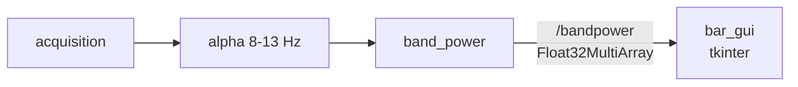

# A feedback window that follows the band power

The feedback is what closes the loop: the subject **sees** the result of their brain activity and learns to change it. The feedback of ROS2neuro
([`ros2neuro_feedback`](../../packages/feedback/index.md)) draws bars and a wheel with `neurodraw`. Before using it, it helps to see how little a feedback needs. In this
tutorial you write the smallest one: a window with **one bar that follows the band power of a channel**.

**Goal.** A window with a bar that grows when the alpha power of the channel you choose goes up, driven by the node of the [band power tutorial](../band-power/index.md).

**You will learn**

- how to write a ROS 2 node in **Python** and install it with a C++-style `CMakeLists.txt`;
- how to turn a measured value into a position on the screen (**normalization**);
- how to run `tkinter` and ROS 2 in the same program;
- how to change a parameter while the program runs.

**You need** the [band power tutorial](../band-power/index.md) built (`tutorial_band_power`), and a display. `tkinter` comes with Python (on Ubuntu: `sudo apt install python3-tk`). About 20 minutes.

## 1. The plan



Everything up to `/bandpower` is the previous tutorial. The new node only has to do three things: **read** a number, **scale** it to 0..1, **draw** a rectangle of that height.

## 2. Scale the value

The band power is `ln(µV²)` and can be any number, for example between 1 and 2.5; a bar needs a number between 0 (empty) and 1 (full). We choose two limits, `minimum` and `maximum`,
and map linearly:

```python
--8<-- "feedback-gui/tutorial_feedback_gui/scripts/bar_gui.py:normalize"
```

Anything outside the limits is **clipped**, so the bar never leaves its frame. It is the same idea as the *thresholds* of the BCI: a feedback is always a value
compared with a scale. The right limits depend on the subject and the channel: you will set them with a parameter, not in the code.

## 3. The node

We build the class in four pieces.

**Parameters.** The channel to show (counting from 1, as people do) and the two limits:

```python
--8<-- "feedback-gui/tutorial_feedback_gui/scripts/bar_gui.py:parameters"
```

**The subscription.** Like in the [publisher and subscriber tutorial](../publisher-subscriber/index.md), in Python:

```python
--8<-- "feedback-gui/tutorial_feedback_gui/scripts/bar_gui.py:subscription"
```

**The callback.** For every message it picks the channel, normalizes the value and keeps it. Notice that the parameters are read **at every message**, so a change of `channel` or
`maximum` takes effect immediately, without restarting:

```python
--8<-- "feedback-gui/tutorial_feedback_gui/scripts/bar_gui.py:callback"
```

**The window.** A black canvas with an outline (the full scale), a bar and a text. The bar is a rectangle that we **only resize**:

```python
--8<-- "feedback-gui/tutorial_feedback_gui/scripts/bar_gui.py:window"
```

**Drawing.** The bar goes from the bottom of the frame up to `value` times its height:

```python
--8<-- "feedback-gui/tutorial_feedback_gui/scripts/bar_gui.py:draw"
```

## 4. ROS and tkinter in one program

Both libraries want to own the main loop: `rclpy.spin()` for ROS and `mainloop()` for tkinter. The simple solution is to let tkinter own it and call a function every 30 ms
that **serves the pending ROS messages** (`spin_once` with timeout 0, which returns at once) and then redraws:

```python
--8<-- "feedback-gui/tutorial_feedback_gui/scripts/bar_gui.py:loop"
```

At 16 messages per second and 33 redraws per second the bar is smooth. The callback and the drawing run in the same thread, so no locks are needed.

??? example "The complete script, `scripts/bar_gui.py`"
    ```python
    --8<-- "feedback-gui/tutorial_feedback_gui/scripts/bar_gui.py"
    ```

## 5. Install and launch

A Python script is not compiled, it is only **installed** as an executable where `ros2 run` looks for it (and it must be executable: `chmod +x`):

```cmake title="CMakeLists.txt"
--8<-- "feedback-gui/tutorial_feedback_gui/CMakeLists.txt"
```

The launch file reuses the launch file of the previous tutorial (`IncludeLaunchDescription`) and adds the window. Including is how you build a bigger system out of tested
pieces:

```python title="launch/bar_gui.launch.py"
--8<-- "feedback-gui/tutorial_feedback_gui/launch/bar_gui.launch.py:include"
```

```python
--8<-- "feedback-gui/tutorial_feedback_gui/launch/bar_gui.launch.py:gui"
```

```bash
colcon build --packages-select tutorial_band_power tutorial_feedback_gui
source install/setup.bash
ros2 launch tutorial_feedback_gui bar_gui.launch.py
```

The window with the bar opens (and the visualizer of the previous tutorial, which is part of the included launch file). The default channel is the first, Fz. Another one:

```bash
ros2 launch tutorial_feedback_gui bar_gui.launch.py channel:=9
```

`channel:=9` is a **launch argument**, passed to the node as a parameter: channel 9 is Cz in the order of the labels.

## 6. Tune the bar while it runs

The bar is not using the whole range? Change the limits from another terminal, with the window open:

```bash
ros2 param get /bar_gui channel
ros2 param set /bar_gui maximum 3.0
ros2 param set /bar_gui minimum 1.0
ros2 param set /bar_gui channel 14
```

```text
Integer value is: 9
Set parameter successful
```

This is how you calibrate a feedback on a subject: look at the numbers in the label of the window (`ch 9: 1.84`) for a minute with the subject at rest, and
put `minimum` and `maximum` around them.

## From here to the real feedback

The feedback of ROS2neuro does the same three things, with more care:

| This tutorial | The stack |
|---|---|
| a number on `/bandpower` | the **flow** of `control`: normalized values and thresholds ([control](../../packages/control/index.md)) |
| `minimum` / `maximum` | the **thresholds** of every class, which end the trial when reached |
| tkinter rectangle | the plugins `Bar` and `Wheel`, drawn with `neurodraw` ([feedback](../../packages/feedback/index.md)) |
| nothing else | the phases of the trial (fixation, cue, outcome), heard on `/neuroevent` |

The [pipeline without hardware](../hardware-free-pipeline/index.md) shows it complete.

## Troubleshooting

| Symptom | Likely cause |
|---|---|
| `No module named tkinter` | `sudo apt install python3-tk` (in the container too) |
| `couldn't connect to display` | no display (SSH, or `DISPLAY` not set in the container) |
| the window opens and stays at `waiting...` | `/bandpower` has no messages: check [the band power tutorial](../band-power/index.md) |
| `channel 20 is not in 1..16` | the stream has 16 channels; `channel` counts from 1 |
| `No executable found` | the script is not executable or not in `install(PROGRAMS ...)`: `chmod +x scripts/bar_gui.py`, rebuild |
| the bar is always full or always empty | the limits are not around your values: tune them as in section 6 |

## Exercises

1. Change the colour of the bar when it crosses a **threshold** (a fourth parameter) and draw a white line at that height.
2. Show **two bars**, for C3 and C4 (two channels), and the difference between them: it is the lateralization used in motor imagery BCIs.
3. Replace the fixed limits by an **automatic scale**: the minimum and the maximum of the last 30 seconds.
4. Read the integrated probabilities (`/integrated/raw`, `NeuroPrediction`) of the [pipeline](../full-pipeline/index.md) instead of the band power: you have just built a bar for a classifier.

Next: [Write a filter plugin](../filter-plugin/index.md), the first of the tutorials that write C++ plugins for the stack.
