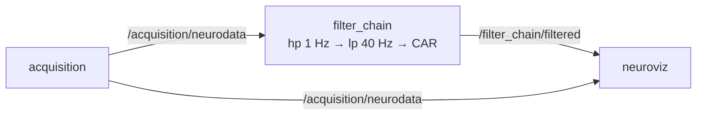

# Build a filter chain

Raw EEG is dominated by slow drifts, the mains hum and the offset of every electrode. Before any decoding you clean it. In ROS2neuro this is the
job of the **filter chain**: one node that applies an ordered list of filters to every frame, described in a YAML file. You do not write code.

**Goal.** Build a chain that keeps the EEG between **1 and 40 Hz** and subtracts the common average, start it on the replayed EEG, and **check in the visualizer** that
it does what you expect.

**You will learn**

- how a chain is written in YAML (the list of filters, the parameters of each);
- how to start `filter_chain_node` from the command line and from a launch file;
- how to connect the chain to the acquisition with a **remap**;
- how to compare the signal before and after the filter.

**You need** the [previous tutorial](../acquisition-recording/index.md) (the acquisition and the visualizer). About 20 minutes.

## 1. The plan



The filter node reads the raw frames and publishes **new frames with the same structure** (same channels, same samples) on another topic. The
raw signal is still there for anyone who wants it, and the visualizer can show both.

## 2. Write the chain

A chain has three things: its **name**, the **list of filters** (in order), and the **parameters** of each filter. All of it is under a
section named after the node, `filter_chain`:

**The skeleton.** `configname` is a prefix; every other parameter starts with it. `filters` is the order in which they are applied:

```yaml
filter_chain:
  ros__parameters:
    configname: eeg_preprocessing
    eeg_preprocessing.filters: [hp, lp, car]
```

`hp`, `lp` and `car` are names *we* choose for the three filters; they only have to match the lines that follow.

**A high-pass filter.** It removes the slow drift. A Butterworth filter has an `order`, a `cutoff` frequency and a `type`;
it also needs the sampling rate of the signal:

```yaml
    eeg_preprocessing.hp.class: ros2neuro_filters_butterworth/ButterworthFloat
    eeg_preprocessing.hp.type: highpass
    eeg_preprocessing.hp.order: 4
    eeg_preprocessing.hp.cutoff: 1.0
    eeg_preprocessing.hp.samplerate: 512.0
```

`class` is the **plugin**: the filters are plugins, each in its own package, and this line says which one to load. The [filters](../../packages/filters/index.md) page
lists them all.

**A low-pass filter.** The same plugin with `type: lowpass`. A high-pass followed by a low-pass is a **band-pass**:

```yaml
    eeg_preprocessing.lp.class: ros2neuro_filters_butterworth/ButterworthFloat
    eeg_preprocessing.lp.type: lowpass
    eeg_preprocessing.lp.order: 4
    eeg_preprocessing.lp.cutoff: 40.0
    eeg_preprocessing.lp.samplerate: 512.0
```

**A spatial filter.** The common average reference (CAR) subtracts, from every channel, the average of all the channels. It has no parameters:

```yaml
    eeg_preprocessing.car.class: ros2neuro_filters_car/CarFloat
```

Put the pieces together in one file:

```yaml title="config/filter_chain.yaml"
--8<-- "signal-chain/tutorial_signal_chain/config/filter_chain.yaml"
```

!!! warning "`samplerate` must match the acquisition"
    The Butterworth filter computes its coefficients from the sampling rate you write here; it does **not** read it from the data. If the
    amplifier runs at 256 Hz and the file says `512.0`, the cutoffs are wrong and nothing warns you.

## 3. Start it, from the command line

The acquisition is running ([tutorial 3](../acquisition-recording/index.md), or `ros2 launch tutorial_signal_chain acquisition_viewer.launch.py`). Start the chain in another terminal:

```bash
ros2 run ros2neuro_filters filter_chain_node --ros-args \
  --params-file $(ros2 pkg prefix tutorial_signal_chain)/share/tutorial_signal_chain/config/filter_chain.yaml \
  -r /neurodata:=/acquisition/neurodata
```

```text
[filter_chain]: FilterChain configured. chain='eeg_preprocessing' definitions='filters'
```

Two details in the command:

- `--params-file` gives the YAML. The node is called `filter_chain` (its default name), which is why the section of the file is `filter_chain:`.
- `-r /neurodata:=/acquisition/neurodata` is a **remap**: the node listens by default to `/neurodata`, but our acquisition publishes on `/acquisition/neurodata`, so we
  rename the input. A remap changes a topic name from outside, without touching the code of the node.

!!! failure "Do not use `-p input_topic:=...`"
    The topics of the chain are already declared by the node and `-p input_topic:=...` / `-p output_topic:=...` stops it with *parameter already declared*. Use
    a remap: `-r /neurodata:=<your topic>` for the input and `-r '~/filtered:=<your topic>'` for the output (**quote it**: the shell would expand a bare `~` to your home folder and the remap would silently do nothing).

Check that the node is alive:

```bash
ros2 node list
ros2 topic list -t
ros2 topic hz /filter_chain/filtered
```

```text
/acquisition
/filter_chain
/acquisition/neurodata [ros2neuro_msgs/msg/NeuroFrame]
/acquisition/neurodata_info [ros2neuro_msgs/msg/NeuroFrameInfo]
/filter_chain/filtered [ros2neuro_msgs/msg/NeuroFrame]
average rate: 16.008
```

The output topic is `~/filtered`: `~` means "the name of the node", so a node called `filter_chain` publishes on `/filter_chain/filtered`. **The name of the node is the
name of the output topic**: remember it for the [next tutorial](../multiple-chains/index.md).

## 4. Start it, from a launch file

Everything in one command. The new node is the filter chain:

```python title="launch/filter_chain.launch.py"
--8<-- "signal-chain/tutorial_signal_chain/launch/filter_chain.launch.py:chain"
```

`name='filter_chain'` must be the same as the section of the YAML; `remappings` is the `-r` of the command line.

??? example "The complete launch file"
    ```python
    --8<-- "signal-chain/tutorial_signal_chain/launch/filter_chain.launch.py"
    ```

```bash
ros2 launch tutorial_signal_chain filter_chain.launch.py
```

## 5. Check it with the visualizer

A filter you do not look at is a filter you cannot trust. The launch file opened `neuroviz`.

1. In the **Topic** box choose `/acquisition/neurodata` and press **Start**: this is the raw EEG, with slow waves and offset.
2. Press **Stop**, choose `/filter_chain/filtered`, **Start**: the slow waves are gone and the traces stay around zero.

For a more careful comparison open **two visualizers** (two windows), one on each topic, and put them side by side: the same samples, before and after. Add the
**Spectrum** tab (the `+` of the [visualizer tutorial](../visualizer/index.md#7-add-the-welch-spectrum)) to both and look at the frequencies:

| What you expect | Why |
|---|---|
| the power below 1 Hz drops | the 1 Hz high-pass |
| the power above 40 Hz drops | the 40 Hz low-pass (a 4th order Butterworth falls gradually, not like a wall) |
| the traces share a common part less | the CAR subtracted what all the channels have in common |

!!! tip "The filters of the visualizer are not these"
    The filters in the sidebar of the Time Scope only change the **view** of that tab. The chain changes the **data** that the next nodes receive.
    Use the sidebar to explore, and the chain for what the pipeline will use.

## Troubleshooting

| Symptom | Likely cause |
|---|---|
| `/filter_chain/filtered` does not appear | the chain is not running, or it was started with another name: the topic is `/<name>/filtered` |
| the chain starts but no frames come out | the remap is missing or wrong: `ros2 topic info /acquisition/neurodata` must list a subscriber |
| `Failed to load filter` / class not found | the package of the plugin is not installed or not sourced (`ros2 pkg list | grep filters`) |
| the parameters seem to be ignored | the section of the YAML is not the name of the node |
| `parameter already declared` | you used `-p input_topic` or `-p output_topic`: use a remap |
| the node dies with *corrupted* memory when the acquisition has **two sensors** | the chain applies one state to every sensor of the frame; filter a stream with a single block of channels (the GDF of these tutorials) |

## What you learned

- a chain is a YAML: `filters` is the order, `<name>.class` the plugin, the rest its parameters;
- the node name is the section of the file **and** the prefix of the output topic;
- a remap connects nodes whose topic names differ;
- the visualizer compares signals before and after a filter.

Next: [Run several filter chains in parallel](../multiple-chains/index.md).
