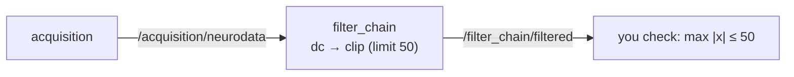

# Write a filter plugin

The [filter chain](../filter-chain/index.md) you started is a list of filters read from a YAML file, and every filter is a **plugin**: a small class in its own
package that the chain loads by name. When the filters of the stack are not enough, you write another one. In this tutorial you write the simplest useful
filter and put it in a chain.

**Goal.** Write a filter called **Clip** that limits every sample to the range `[-limit, +limit]` (it bounds the effect of large artifacts on the filters that
follow), build it as a plugin package, test it **without ROS**, and load it in a running chain. At the end you check on the output topic that no sample
exceeds the limit.

**You will learn**

- the interface a filter implements and how its parameters arrive;
- how a plugin is registered (`plugins.xml`, `PLUGINLIB_EXPORT_CLASS`, CMake);
- how to test a filter without ROS running;
- how to put the filter in a chain from a YAML file.

**You need** the [filter chain tutorial](../filter-chain/index.md) and a built ROS2neuro workspace. About 20 minutes. Read
[Plugins](../../concepts/plugins.md) first if the pluginlib mechanism is new to you.

The complete package is in the repository, under `docs/tutorials/filter-plugin/tutorial_filter_plugin/`. The page includes its files, so the code below is the code that builds.

## 1. The plan

The chain gives every `NeuroFrame` to each filter as a matrix of floats shaped `[samples x channels]`, and the filter returns a matrix of the **same shape**. A filter
derives from [`ros2neuro::filters::Filter<float>`](../../packages/filters/index.md) and implements two methods:

| Method | Called | Job |
|---|---|---|
| `bool configure()` | once | read the parameters of this filter with `getParam`, return `false` if they are invalid |
| `DynamicMatrix<T> apply(const DynamicMatrix<T>& input)` | for every frame | transform the data |

`DynamicMatrix<T>` is an Eigen dynamic matrix. A filter must not change the dimensions of the data.



We need five files, plus a YAML file to use it:

```text
tutorial_filter_plugin/
├── CMakeLists.txt
├── package.xml
├── plugins.xml                      # registers the class for pluginlib
├── include/tutorial_filter_plugin/Clip.h
├── src/Clip.cpp                     # exports the class
├── test/test_clip.cpp
└── config/filter_chain_clip.yaml    # example chain
```

You can create the folder with `ros2 pkg create --build-type ament_cmake tutorial_filter_plugin`, then replace the generated files with the ones below.

## 2. The filter, step by step

We write `Clip.h`. It is a **template** on the sample type, like the filters of the stack (`T` is `float` in a real chain). Start from the empty shape:

```cpp
template<typename T>
class Clip : public Filter<T> {
  public:
    Clip(void) { this->name_ = "clip"; }
    bool configure(void) override;                              // read the parameters
    DynamicMatrix<T> apply(const DynamicMatrix<T>& input) override;   // one frame in, one frame out
};
```

**Reading the parameter.** `getParam("limit", limit)` reads the parameter `limit` of **this** filter (the chain passes each filter only its own parameters, with the prefix
removed). When the parameter is missing it returns `false` and the default stays. An invalid value makes `configure()` return `false`: the chain then refuses to start,
which is better than silently running with a wrong setting.

```cpp title="include/tutorial_filter_plugin/Clip.h"
--8<-- "filter-plugin/tutorial_filter_plugin/include/tutorial_filter_plugin/Clip.h:configure"
```

**Transforming a frame.** One line of Eigen: clamp every element from below to `-limit` and from above to `+limit`. Keep `apply()` free of allocations when you can,
because it runs on every frame:

```cpp
--8<-- "filter-plugin/tutorial_filter_plugin/include/tutorial_filter_plugin/Clip.h:apply"
```

??? example "The complete header"
    ```cpp
    --8<-- "filter-plugin/tutorial_filter_plugin/include/tutorial_filter_plugin/Clip.h"
    ```

## 3. Register the class

The chain creates filters by name, so the class must be known to the class loader. `PLUGINLIB_EXPORT_CLASS(Derived, Base)` does that, and the base class must be exactly the one
the chain loads, [`ros2neuro::filters::Filter<float>`](../../packages/filters/index.md):

```cpp title="src/Clip.cpp"
--8<-- "filter-plugin/tutorial_filter_plugin/src/Clip.cpp"
```

Then a description file tells pluginlib what the plugin is called:

```xml title="plugins.xml"
--8<-- "filter-plugin/tutorial_filter_plugin/plugins.xml"
```

- `path` is the library built by the package (the `add_library` name);
- `name` is what users write in the YAML (`tutorial_filter_plugin/ClipFloat`);
- `type` is the C++ class, `base_class_type` the interface (with `<` and `>` escaped).

## 4. Build files

```xml title="package.xml"
--8<-- "filter-plugin/tutorial_filter_plugin/package.xml"
```

```cmake title="CMakeLists.txt"
--8<-- "filter-plugin/tutorial_filter_plugin/CMakeLists.txt"
```

The two lines that make this a plugin are the shared `add_library` and `pluginlib_export_plugin_description_file(ros2neuro_filters plugins.xml)`: the second one tells
[`ros2neuro_filters`](../../packages/filters/index.md) where to find your `plugins.xml`.

## 5. Test it before you run it

A filter is plain C++, so it can be tested without a running ROS graph. The test calls the public `configure(name, type, params, logger)` of the base class, which is
what the chain does, feeds a matrix whose answer we know, and checks the rejection of an invalid limit:

```cpp title="test/test_clip.cpp"
--8<-- "filter-plugin/tutorial_filter_plugin/test/test_clip.cpp"
```

## 6. Build

From the root of your workspace, with ROS 2 and the ROS2neuro workspace sourced:

```bash
colcon build --packages-select tutorial_filter_plugin
colcon test  --packages-select tutorial_filter_plugin
colcon test-result --verbose
source install/setup.bash
```

If the package lives outside `src/`, add its path: `colcon build --paths path/to/tutorial_filter_plugin`. Check that it is installed:

```bash
ros2 pkg prefix tutorial_filter_plugin
```

## 7. Use it in a chain

Now the YAML. It is the chain you wrote in the [filter chain tutorial](../filter-chain/index.md) with a different list: `dc` first (it removes the offset of each channel), then `clip`.
The order of the list is the order of execution.

```yaml title="config/filter_chain_clip.yaml"
--8<-- "filter-plugin/tutorial_filter_plugin/config/filter_chain_clip.yaml"
```

Start the replayed EEG in one terminal and the chain with the new filter in another:

```bash
# terminal 1: the replayed EEG (16 channels, 512 Hz) and the visualizer
ros2 launch tutorial_signal_chain acquisition_viewer.launch.py

# terminal 2: the chain with the new filter
ros2 run ros2neuro_filters filter_chain_node --ros-args \
  --params-file $(ros2 pkg prefix tutorial_filter_plugin)/share/tutorial_filter_plugin/config/filter_chain_clip.yaml \
  -r /neurodata:=/acquisition/neurodata
```

The chain logs `FilterChain configured. chain='clipchain'`.

!!! warning "Use the GDF replay, not the dummy acquisition"
    The dummy acquisition publishes the EEG **and** an EMG block in every frame. `filter_chain_node` keeps one filter state for the whole frame, and
    with two blocks of different size it crashes. The replayed GDF has one block (16 EEG channels), which is what the chain expects.

## 8. Check that it works

We want a number, not an impression: the largest absolute value on the output, and how many samples touch the limit. This small script (save it as `max_abs.py` anywhere)
subscribes to a topic and prints both:

```python
import sys
import rclpy
from rclpy.node import Node
from ros2neuro_msgs.msg import NeuroFrame

rclpy.init()
node = Node('max_abs')
frames = []
node.create_subscription(NeuroFrame, sys.argv[1], frames.append, 10)
while len(frames) < 20:
    rclpy.spin_once(node, timeout_sec=1)

values = [abs(x) for f in frames[5:] for x in f.sensors[0].data]   # skip the first frames
limit = float(sys.argv[2])
print(sys.argv[1], 'max|x| = %.2f' % max(values),
      '| samples at the limit: %d of %d' % (sum(v >= limit - 1e-4 for v in values), len(values)))
```

```bash
python3 max_abs.py /filter_chain/filtered 50
```

```text
/filter_chain/filtered max|x| = 50.00 | samples at the limit: 29 of 7680
```

Nothing exceeds `50`, and a few samples, the large excursions of the EEG, are flat at the limit. Change `limit` to `10.0` in the YAML, restart the chain (the YAML is read at start)
and run the script again with `10`: now `2211` of the `7680` samples are at the limit. You can also select `/filter_chain/filtered` in the
[visualizer](../visualizer/index.md) and watch the tops of the waves cut off.

## Troubleshooting

| Symptom | Likely cause |
|---|---|
| `class ... does not exist` | the workspace is not sourced after the build, or the YAML class name differs from `name` in `plugins.xml` |
| the chain starts but nothing is published | the input topic: the chain reads `/neurodata`, remap it to your acquisition topic |
| `configure` fails | the parameter has the wrong type; `limit` must be a number (`50.0`) |
| the chain crashes with `malloc(): corrupted top size` | the acquisition publishes more than one block per frame (the dummy: EEG and EMG), see the warning above |

## Exercises

1. Add a parameter `mode` (`hard` or `soft`) and implement a soft clip with `tanh`.
2. Make `limit` a per-channel vector read with `getParam("limits", std::vector<double>&)`.
3. Read how [`ros2neuro_filters_butterworth`](../../packages/filters/butterworth.md) keeps a state between frames, and write a filter that needs one.

## What you learned

- a filter is a class with `configure()` and `apply()`, loaded by name from the chain;
- a plugin is registered by `PLUGINLIB_EXPORT_CLASS`, a `plugins.xml` and one line of CMake;
- the maths of a filter can be tested without ROS, and then checked on real topics with a few lines.

Next: [Write an integrator plugin](../integrator-plugin/index.md).
