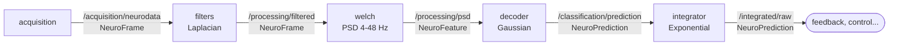

# Build the whole pipeline step by step

You can now start an acquisition, a filter chain and a visualizer. A decoding pipeline adds three more stages: the **spectral
processing** that turns the signal into features, the **decoder** that turns the features into probabilities, and the **integrator** that smooths them. In this tutorial you
write **one launch file for all of them**, add the stages one at a time and check each one before adding the next.

**Goal.** Start `acquisition → filters → welch → decoder → integrator` on the replayed EEG, and follow one piece of data from the first stage to the last.

**You will learn**

- the stages of a decoding pipeline and the topic that links each pair;
- how to write the launch file stage by stage, with the remaps that chain the topics;
- why the order of the nodes in a launch file matters;
- how to check a pipeline with `ros2 topic` and with the visualizer.

**You need** the previous tutorials (acquisition, filter chain). About 25 minutes.

## 1. The plan



Every arrow is a topic, and the **message type changes along the chain**: frames of signal, then a feature (the spectrum), then a
prediction (the probability of each class). Each node only needs to know the name of the topic it reads and the one it writes. If you
rename a topic you change one remap, not the code.

## 2. Stage by stage

Every stage is a `Node(...)` in the launch file `launch/pipeline.launch.py`. The parameters of the filter, welch and integrator
are in one YAML, `config/pipeline.yaml`; each section is named after its node (`/filters`, `/welch`, `/integrator`).

### Stage 1: the acquisition

Same node as before. It publishes `/acquisition/neurodata`.

```python
--8<-- "signal-chain/tutorial_signal_chain/launch/pipeline.launch.py:acquisition"
```

### Stage 2: the filters

The classic decoders for motor imagery use a **Laplacian** spatial filter: every channel minus the average of its neighbours, which sharpens
the activity under each electrode. The chain has one filter:

```yaml title="config/pipeline.yaml (section /filters)"
/filters:
  ros__parameters:
    filters.chain: [laplacian]
    filters.laplacian.class: ros2neuro_filters_laplacian/LaplacianFloat
    filters.laplacian.nchannels: 16
    filters.laplacian.layout: "0 0 1 0 0; 2 3 4 5 6; 7 8 9 10 11; 12 13 14 15 16"
```

Note `filters.chain` and not `configname`: when `configname` is missing the node uses the prefix `filters`. The `layout` is the map of the electrodes
(the numbers are the channels, in the order of the labels; `0` is an empty place). The node:

```python
--8<-- "signal-chain/tutorial_signal_chain/launch/pipeline.launch.py:filters"
```

Both its input and its output are remapped: it reads the acquisition and writes `/processing/filtered` (instead of `/filters/filtered`), a name that tells what the topic is, not who made it.

**Check it** (launch with only these two nodes first if you like: comment out the others in `LaunchDescription`):

```bash
ros2 topic hz /processing/filtered      # 16 Hz, as the acquisition
```

### Stage 3: the spectral processing

The decoder does not read the signal but its **power spectrum**. The node `processing_node` is generic as the acquisition is: the
**plugin** says what it computes, here `Welch` (the power spectral density of the last second, in `ln(power/Hz)`, from 4 to 48 Hz every 2 Hz):

```yaml title="config/pipeline.yaml (section /welch)"
/welch:
  ros__parameters:
    processing.plugin: ros2neuro::processing::Welch
    processing.params.feature: psd
    processing.params.sensor: EEG
    processing.params.samplerate: 512
    processing.params.wlength: 256
    processing.params.wtype: hamming
    processing.params.overlap: 128
    processing.params.buffer: 512
    processing.params.frequencies: "4:2:48"
    processing.params.log: true
```

The numbers are not arbitrary: the model of the decoder was trained on a PSD with exactly these frequencies. `sensor: EEG` is the name of the block
of the frame that is analysed. The node:

```python
--8<-- "signal-chain/tutorial_signal_chain/launch/pipeline.launch.py:welch"
```

**Check it:** this is the first stage that does not publish a frame but a `NeuroFeature`, so look at its shape and axes:

```bash
ros2 topic echo /processing/psd --field shape --once
```

```text
array('I', [16, 23])
```

16 channels by 23 frequencies (4, 6, ..., 48 Hz). The axes tell which is which:

```bash
ros2 topic echo /processing/psd --field axes --once
```

```text
[NeuroAxis(name='channels', unit='index', labels=['Fz', 'FC3', ... 'CP4']), NeuroAxis(name='frequency', unit='Hz', values=[4.0, 6.0, ..., 48.0])]
```

!!! tip "Always print `shape` and `axes` before you read a feature"
    The order of the axes depends on the node and its configuration (see [Messages](../../concepts/messages.md#neurofeature)).

### Stage 4: the decoder

The decoder loads a **model**: a folder with a `manifest.yaml` (what the model expects as input, which classes it outputs) and the trained weights. We
use the Gaussian classifier (both hands against both feet) that comes with `ros2neuro_devel_test`. The node has only one parameter, the manifest:

```python
--8<-- "signal-chain/tutorial_signal_chain/launch/pipeline.launch.py:decoder"
```

The decoder checks the feature against the manifest, and takes only what the model uses (here three values: FC3 at 12 Hz, FC2 at 12 and 14 Hz). If the
channels or the frequencies do not match the manifest, it reports an error instead of computing with the wrong values.

**Check it:**

```bash
ros2 topic echo /classification/prediction --field fields --once
ros2 topic echo /classification/prediction --field values --once
```

```text
['773', '771']
array('f', [0.7726884484291077, 0.22731153666973114])
```

`773` and `771` are the codes of the two classes (both hands, both feet) and `values` their probabilities, which add up to 1. The values of this
particular run are not meaningful: the replayed EEG is not synchronized with any task.

### Stage 5: the integrator

A decoder answers 16 times per second and each answer is noisy. The **exponential integrator** smooths the sequence: `y = alpha * y + (1 - alpha) * x`, and with
`alpha = 0.98` the memory is about 50 predictions, that is 3 seconds at 16 per second: a high `alpha` is smooth and slow, a low one follows the decoder closely.

```yaml title="config/pipeline.yaml (section /integrator)"
/integrator:
  ros__parameters:
    input_topic: /classification/prediction
    output_topic: /integrated/raw
    integrator.name: mi_exponential_integrator
    integrator.type: ros2neuro::integrator::Exponential
    integrator.params.alpha: 0.98
    integrator.rejection: -1.0
```

```python
--8<-- "signal-chain/tutorial_signal_chain/launch/pipeline.launch.py:integrator"
```

The integrator reads and writes by **parameters** (`input_topic`, `output_topic`), not by remaps: each node of the stack has its own way, read the page of the package.

```bash
ros2 topic echo /integrated/raw --field values --once
```

```text
array('f', [0.45337972044944763, 0.5466200709342957])
```

Smoothed values: this topic is the output of the pipeline, what the [control and feedback nodes](../../concepts/protocols.md) of ROS2neuro use to
move the bars of the [feedback](../../packages/feedback/index.md).

## 3. Put it together: who starts first

```python
--8<-- "signal-chain/tutorial_signal_chain/launch/pipeline.launch.py:description"
```

A topic does not remember: a node that subscribes after a message was published never receives it. If the acquisition started together with
the others, the filter, welch and decoder would lose the first frames. And the **order of the list does not help**: `ros2 launch` starts all the
processes within a few milliseconds, and each one needs some time to be discovered by the others. So the source is wrapped in a `TimerAction` that starts it
**3 seconds later**, when every listener is ready. It is the same trick the launchers of the stack use (their `DELAY` constant).

??? example "The complete launch file"
    ```python
    --8<-- "signal-chain/tutorial_signal_chain/launch/pipeline.launch.py"
    ```

```bash
ros2 launch tutorial_signal_chain pipeline.launch.py
```

```text
[filters]: FilterChain configured. chain='filters' definitions='filters'
[welch]: Processing configured. type='ros2neuro::processing::Welch' ...
[decoder]: Decoder configured. input='/features' output='~/prediction' type='ros2neuro::decoder::Gaussian'
[integrator]: Integrator configured. input='/classification/prediction' output='/integrated/raw' ...
[acquisition]: Started device 'xdf_file'      (about 3 seconds after the others)
```

(The log of `welch` and `decoder` shows their *default* topics, `/neurodata` and `/features`: the remaps rename them afterwards. Trust `ros2 topic info`, not that line.)

## 4. Check the whole pipeline

The checks of a pipeline are always the same, from the outside:

```bash
ros2 node list                       # every node is there, once
ros2 topic list -t                   # every topic, with the type that is expected
ros2 topic hz /processing/psd        # data flows at the expected rate
ros2 topic echo <topic> --field values --once
```

```text
/acquisition
/decoder
/filters
/integrator
/welch
...
/processing/psd                 [ros2neuro_msgs/msg/NeuroFeature]
/classification/prediction      [ros2neuro_msgs/msg/NeuroPrediction]
/integrated/raw                 [ros2neuro_msgs/msg/NeuroPrediction]
```

`ros2 node list` shows `/acquisition` twice if an old launch is still alive: stop it, or you will mix two pipelines.

**With the visualizer.** The launch file opened `neuroviz`: it shows any `NeuroFrame` topic, so you can look at the signal **at the input and at the output of the
filters**: `/acquisition/neurodata` and `/processing/filtered`. To see the **spectrum** that the decoder reads, add the Spectrum tab on the filtered topic
([visualizer tutorial](../visualizer/index.md#7-add-the-welch-spectrum)): the power it shows between 8 and 14 Hz (the mu rhythm) is what this model looks at. The visualizer cannot show a `NeuroFeature` or a `NeuroPrediction`: for those use `ros2 topic echo`.

!!! tip "If something does not arrive"
    Go from the beginning, one `ros2 topic hz` at a time: the first topic with no rate is the stage that does not work. A stage with
    no output almost always has a topic name that does not match the next one (look at the remaps), or a parameter section that does not
    match its node name.

## What you learned

- a decoding pipeline is a chain of generic nodes (filters, processing, decoder, integrator) whose behaviour is chosen by YAML and by plugins;
- the nodes are linked only by topic names, set with remaps or parameters;
- the source is started a few seconds after the listeners (`TimerAction`), so that nobody loses the first data;
- every stage is checked on its own topic, with the same few commands.

You now know what the ready-made launchers of [`ros2neuro_devel_test`](../../packages/devel-test.md) do. The [hardware-free pipeline](../hardware-free-pipeline/index.md) runs the same chain with the
manager, the control and the feedback on top.

Next: [Run the complete pipeline without hardware](../hardware-free-pipeline/index.md).
