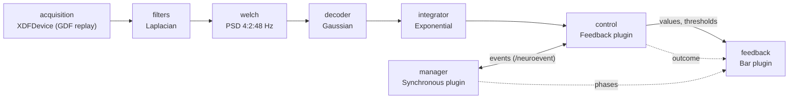

# Running the whole pipeline without hardware

In this tutorial you start a complete ROS2neuro pipeline on your computer, from the acquisition to the feedback
the subject would see, **without an amplifier**. The EEG comes from a GDF file that is replayed as if it were
live. You will run a calibration, look at what each node publishes, and see where each piece of the
[architecture](../../concepts/architecture.md) lives.

It takes about 10 minutes and needs no code. It is also the quickest way to check that your installation works.

**You need** ROS2neuro [installed](../../installation.md) (from apt, or built in a workspace) with the package [`ros2neuro_devel_test`](../../packages/devel-test.md), and a display for the
feedback window.

## 1. What will run

The launcher starts one node per stage of the chain:



| Node | Package | Plugin or model |
|---|---|---|
| `acquisition` | [`ros2neuro_acquisition`](../../packages/acquisition/index.md) | [`ros2neuro::acquisition::XDFDevice`](../../packages/acquisition/xdf.md), replays `data/test.gdf` in a loop at 16 frames per second |
| `filters` | [`ros2neuro_filters`](../../packages/filters/index.md) | Laplacian spatial filter |
| `welch` | [`ros2neuro_processing`](../../packages/processing/index.md) | plugin [`ros2neuro::processing::Welch`](../../packages/processing/spectral.md): power spectral density, 4 to 48 Hz in steps of 2 |
| `decoder` | [`ros2neuro_decoder`](../../packages/decoder/index.md) | [`ros2neuro::decoder::Gaussian`](../../packages/decoder/gaussian.md), model `data/models/gaussian` (both hands / both feet) |
| `integrator` | [`ros2neuro_integrator`](../../packages/integrator/index.md) | [`ros2neuro::integrator::Exponential`](../../packages/integrator/exponential.md), `alpha 0.98` |
| `control` | [`ros2neuro_control`](../../packages/control/index.md) | [`ros2neuro::control::Feedback`](../../packages/control/feedback.md): reads the integrator, knows the thresholds, drives the feedback |
| `manager` | [`ros2neuro_manager`](../../packages/manager/index.md) | [`ros2neuro::manager::Synchronous`](../../packages/manager/synchronous.md): runs the trials |
| `feedback` | [`ros2neuro_feedback`](../../packages/feedback/index.md) | [`ros2neuro::feedback::Bar`](../../packages/feedback/bar.md), one bar per class |

!!! note "The `welch` node depends on the decoder"
    This pipeline uses a classic decoder (Gaussian), which reads a power spectrum, so a Welch node sits between the filters and
    the decoder. A deep-learning decoder (the test `decoder/shallow`) reads a window of
    the signal instead: there the `welch` node is replaced by a `buffer` node. See [Processing](../../packages/processing/index.md).

## 2. Launch it

```bash
source /opt/ros/jazzy/setup.bash
source install/setup.bash

ros2 launch ros2neuro_devel_test feedback_bars2.launch.py protocol:=calibration
```

The arguments:

| Argument | Values | Meaning |
|---|---|---|
| `protocol` | `calibration`, `evaluation`, `control` | which [protocol](../../concepts/protocols.md) the manager runs (default `evaluation`) |
| `integrator` | `exponential`, `buffer` | which integrator plugin (default `exponential`) |
| `gdf_file` | path | which file to replay |

A window with two bars opens. The log shows each node loading its plugin:

```text
[acquisition]: Loaded plugin 'ros2neuro::acquisition::XDFDevice'
[manager]: Layout: protocol classes [BOTH_HANDS (773), BOTH_FEET (771)], rest_mode=none
[decoder]:   Decoder configured. input='/features' output='~/prediction' type='ros2neuro::decoder::Gaussian'
[control]: Layout: protocol classes [...], output classes [...], rest_mode=none, K=2
[manager]: Synchronous: 6 trials, begins in 3000 ms
[manager]: Trial 1/6 (class: BOTH_FEET (771))
```

The manager runs the trials and writes their events; control does the rest. In a **calibration** control drives the bars with an autopilot (the target class rises towards its
threshold), as the subject would do when training a classifier. In an **evaluation** the bars follow the real
output of the classifier and control writes the outcome (Hit, Miss or Timeout), and in **control** control resets the integrator when a class reaches its
threshold. Try the three:

```bash
ros2 launch ros2neuro_devel_test feedback_bars2.launch.py protocol:=evaluation
ros2 launch ros2neuro_devel_test feedback_bars2.launch.py protocol:=control
```

!!! note "Calibration and evaluation on a replayed file"
    The GDF is not synchronised with the cues, so the hits and misses of an evaluation only show that the chain
    works, not that the classifier is good.

The session ends by itself when the protocol ends: the manager and control are started with `on_exit="shutdown"`. Close the
window with ESC to end it earlier.

## 3. Look inside

Open a second terminal, source the workspace and inspect the running graph.

**The nodes**

```bash
ros2 node list
```

```text
/acquisition
/control
/decoder
/feedback
/filters
/integrator
/manager
/welch
```

**The topics and their types**

```bash
ros2 topic list -t
```

```text
/acquisition/neurodata          [ros2neuro_msgs/msg/NeuroFrame]
/acquisition/neurodata_info     [ros2neuro_msgs/msg/NeuroFrameInfo]
/processing/filtered            [ros2neuro_msgs/msg/NeuroFrame]
/processing/psd                 [ros2neuro_msgs/msg/NeuroFeature]
/classification/prediction      [ros2neuro_msgs/msg/NeuroPrediction]
/integrated/raw                 [ros2neuro_msgs/msg/NeuroPrediction]
/control_feedback/probabilities [ros2neuro_msgs/msg/NeuroControl]
/neuroevent                     [ros2neuro_msgs/msg/NeuroEvent]
```

Each one is a stage of the chain of [Topics and services](../../concepts/topics.md). Follow the data from the
acquisition to the feedback:

```bash
ros2 topic hz /acquisition/neurodata                        # 16 Hz: the frame rate
ros2 topic echo /processing/psd --field shape --once       # the shape of the PSD feature
ros2 topic echo /classification/prediction --field values  # decoder output, per class
ros2 topic echo /integrated/raw --field values             # after the integrator
ros2 topic echo /control_feedback/probabilities            # what the feedback draws
```

**The events**

```bash
ros2 topic echo /neuroevent --field event_id
```

During a calibration trial you see the sequence of the [protocol](../../concepts/protocols.md#event-codes):

```text
1        Start
786      Fixation
773      cue of the class (here BOTH_HANDS)
781      CFeedback: the continuous feedback starts
897      Hit
```

each followed by its *Off* (the same id plus 32768: `32769`, `33554`, `33541`, `33549`, `33665`). These are the events
a recorder would write in the GDF file next to the signal (these launchers do not record).

!!! warning "Check shape and axes"
    Print the `shape` and `axes` of the PSD feature before you use it in your own node. The order of the axes
    (channels and frequency) depends on the node and its configuration. See [Messages](../../concepts/messages.md#neurofeature).

## 4. Where the parameters are

Everything is in `ros2neuro_devel_test/data/config/`:

| File | Configures |
|---|---|
| `acquisition_test.yaml`, `psd_pipeline.yaml` | acquisition, and the filters and welch of the processing chain (the decoder manifest is in `data/models/gaussian/`) |
| `integrator_exponential.yaml`, `integrator_buffer.yaml` | the integrator |
| `layout.yaml` | `classes`, `rest_mode`, `thresholds`: loaded by the manager, control **and** the feedback |
| `protocol_calibration.yaml`, `protocol_evaluation.yaml`, `protocol_control.yaml` | the protocol: `/manager` (trials, durations) and `/control` (the plugin, the length of the feedback) |
| `feedback_bars.yaml`, `feedback_wheel.yaml` | the drawing |

Try changing something. For example, in `layout.yaml` change `thresholds: [0.7, 0.7]` to `[0.9, 0.9]` and in
`protocol_calibration.yaml` change `trials`. After editing, rebuild the package, because the launch files use the
installed copies:

```bash
colcon build --packages-select ros2neuro_devel_test
source install/setup.bash
```

## 5. Other launchers

| Launcher | What it shows |
|---|---|
| `feedback_wheel.launch.py` | the same pipeline with the wheel (exactly two classes) |
| `feedback_bars4.launch.py` | four bars with different thresholds (a fictitious 4-class Gaussian model) |

The tests of every stage (the same nodes one stage at a time, each checked against MATLAB) and the rules for the layout are in
[`ros2neuro_devel_test`](../../packages/devel-test.md): `ros2 launch ros2neuro_devel_test decoder_qda.launch.py` runs a stage, `check_decoder_qda` (MATLAB) checks it.

## What you learned

- every stage is a node, and the stages are chained only by topics;
- the plugin of each stage is selected by a parameter in a YAML file;
- the manager runs the trials and control drives the feedback, on top of the signal chain, talking through the events;
- you can replace the amplifier with a file, and nothing else changes.

Next: [Looking at the signals with the visualizer](../visualizer/index.md).
