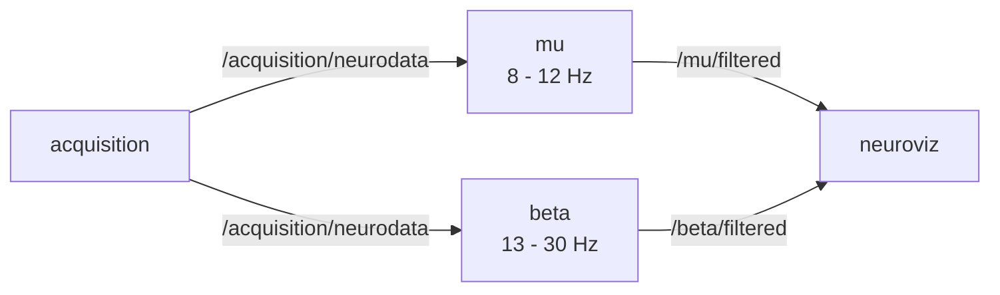

# Run several filter chains in parallel

One chain turns **one** input into **one** output. Often you need more than one view of the same EEG: the mu rhythm (8 to 12 Hz) and the beta rhythm (13 to 30 Hz) to compare, a
clean signal for the decoder and a lightly filtered one for the blink detector, or one band per CSP in a filter-bank classifier. The answer is simple: **start the same node
several times**, each with its own name and its own chain.

**Goal.** Start two chains in parallel on the same EEG, one for the mu band and one for the beta band, and look at both in the visualizer. Then connect two chains **in series**.

**You will learn**

- how to start the same executable twice under two names;
- why the name of the node picks the section of the YAML and the output topic;
- the difference between chains in **parallel** and in **series**.

**You need** the [filter chain tutorial](../filter-chain/index.md). About 15 minutes.

## 1. The plan



Both nodes subscribe to the same raw topic: a topic can have as many listeners as you like. Each one publishes on its own topic.

## 2. One file, two sections

The section of the YAML is the **name of the node**. Two nodes, two sections, in the same file:

```yaml title="config/two_chains.yaml"
--8<-- "signal-chain/tutorial_signal_chain/config/two_chains.yaml"
```

Both sections use the same prefix (`band`), and that is fine: the parameters of `/mu` are not seen by `/beta`. Each one is a band-pass made
of a high-pass at the lower edge and a low-pass at the upper edge.

## 3. Start the node twice

In the launch file the same `Node(...)` is created twice with different names. A small function avoids repeating it:

```python title="launch/two_chains.launch.py"
--8<-- "signal-chain/tutorial_signal_chain/launch/two_chains.launch.py:chains"
```

- `name=name` gives `mu` and `beta`: they read `/mu:` and `/beta:` of the file, and publish `/mu/filtered` and `/beta/filtered`;
- the `remappings` are the same for both, because both listen to the raw signal.

??? example "The complete launch file"
    ```python
    --8<-- "signal-chain/tutorial_signal_chain/launch/two_chains.launch.py"
    ```

```bash
ros2 launch tutorial_signal_chain two_chains.launch.py
```

## 4. Check

```bash
ros2 node list
ros2 topic list -t
ros2 topic hz /mu/filtered
```

```text
/acquisition
/beta
/mu
/acquisition/neurodata [ros2neuro_msgs/msg/NeuroFrame]
/acquisition/neurodata_info [ros2neuro_msgs/msg/NeuroFrameInfo]
/beta/filtered [ros2neuro_msgs/msg/NeuroFrame]
/mu/filtered [ros2neuro_msgs/msg/NeuroFrame]
average rate: 16.008
```

Each chain keeps the rate of the acquisition, 16 frames per second. In the visualizer choose `/mu/filtered`, then `/beta/filtered`: the first keeps only
the 8 to 12 Hz content, the second the 13 to 30 Hz. To see both at once start a second visualizer in another terminal
(`ros2 run ros2neuro_visualizer neuroviz`), one window per topic, and add the Spectrum tab to each.

## 5. In parallel or in series

| | Parallel (this tutorial) | Series |
|---|---|---|
| shape | the two chains read the **same** topic | the second chain reads the output of the first |
| use | several views of the raw signal | steps with different roles: a common cleaning first, then one band |
| remap of the second | `-r /neurodata:=/acquisition/neurodata` | `-r /neurodata:=/common/filtered` |

A series is the same thing with another remap. For example, a common cleaning chain and then a band on its output:

```python
common = Node(package='ros2neuro_filters', executable='filter_chain_node', name='common', ...,
              remappings=[('/neurodata', '/acquisition/neurodata')])        # publishes /common/filtered
mu = Node(package='ros2neuro_filters', executable='filter_chain_node', name='mu', ...,
          remappings=[('/neurodata', '/common/filtered')])                 # reads the cleaned signal
```

This is exactly what the [FBCSP test](../../packages/processing/fbcsp.md) does: one common chain, then one chain per band.

!!! note "Why not a single longer chain?"
    A chain is a line: one input, one output. Whenever you need **two outputs from the same input** (two bands, two montages) you need two
    nodes. Whenever two stages must be **one after the other** with the same output, put them in the same chain.

## Troubleshooting

| Symptom | Likely cause |
|---|---|
| the node starts but filters nothing as you wrote | its name is not a section of the file (`/mu`, `/beta`): `ros2 param list /mu` shows what it read |
| two nodes publish on the same topic | they have the same name; give each a different one |
| `/mu/filtered` is empty | the remap of `/neurodata` is missing in that node |
| CPU is high with many chains | each chain filters the whole frame: only start the bands you use |

## Exercises

1. Add a third chain `theta` (4 to 8 Hz) and look at it.
2. Put a CAR filter in a common chain and read both bands from it (series).
3. Record one band with the [recorder](../acquisition-recording/index.md): the recorder reads one data topic, so set `topic_data` to `/mu/filtered` (and keep `topic_info` on the acquisition).

Next: [Build the whole pipeline step by step](../full-pipeline/index.md).
