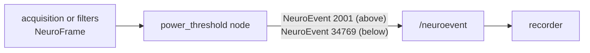

# Raising an event when the power of a channel crosses a threshold

In this tutorial you write a new ROS 2 package with a node that watches the **power** of one or more channels
and publishes a `NeuroEvent` when it goes above a threshold, and another one when it comes back down. It is the
basis of many things: marking artifacts, detecting that a muscle contracts, triggering a stimulus, or checking
that a subject is relaxed.

Because the event is published on `/neuroevent`, the [recorder](../../packages/recorder/index.md) writes it in the
GDF/BDF file next to the signal, with no extra work.

**You will learn**

- how to read a `NeuroFrame` (sample-major layout, labels, timestamps);
- how to compute the power of a channel and detect a threshold crossing without bursts of events (hysteresis);
- how to publish a `NeuroEvent` that is correctly aligned with the data;
- how to change a parameter of a running node.

**You need** a built ROS2neuro workspace. No hardware: the tutorial runs on the dummy acquisition.
Read [Messages and data types](../../concepts/messages.md) first if the message layout is new to you.

The complete package is in the repository, under `docs/tutorials/power-threshold-event/tutorial_power_threshold/`,
and it is compiled by the CI of the repository.

## 1. The design



For every frame the node does four things:

1. picks the channels to monitor (by label) in a sensor block;
2. computes the power of each of them;
3. feeds the powers to a small detector with two states, *below* and *above*;
4. publishes an event on every change of state.

The detector and the power computation are in a **header with no ROS code**, so they can be tested on their
own. The node is the thin ROS layer around them. This split is the pattern to follow in your own nodes.

## 2. Package layout

```text
tutorial_power_threshold/
├── CMakeLists.txt
├── package.xml
├── include/tutorial_power_threshold/ThresholdDetector.h   # power + detector, no ROS
├── src/power_threshold_node.cpp                           # the node
├── test/test_threshold_detector.cpp
└── config/power_threshold.yaml
```

Create it with `ros2 pkg create --build-type ament_cmake --node-name power_threshold_node tutorial_power_threshold`
and replace the generated files with the ones below.

## 3. Power and threshold detection

```cpp title="include/tutorial_power_threshold/ThresholdDetector.h"
--8<-- "power-threshold-event/tutorial_power_threshold/include/tutorial_power_threshold/ThresholdDetector.h"
```

### Reading a sample-major block

`NeuroSensor.data` holds all the channels of sample 0, then all the channels of sample 1, and so on, so the
element of a channel at a given sample is `data[sample * channels + channel]`. `channel_power()` walks one
channel of that layout.

### What "power" means here

The power is the **variance** of the samples of the frame: the mean of the squared deviations from the frame
mean, in `unit^2` (`uV^2` for EEG). Removing the mean means that a constant offset is not counted as power. A
sine of amplitude `A` has power `A^2 / 2`, which is what the test checks.

!!! tip "Other definitions of power"
    For the power in a frequency band, take a `NeuroFeature` from the [spectral nodes](../../packages/processing/spectral.md)
    and sum the bins of the band, or filter the signal with a Butterworth band-pass in the
    [filter chain](../../packages/filters/index.md) before this node. A frame is short (32 samples at 16 frames
    per second and 512 Hz), so for a slow rhythm average the power over a few frames first.

### Hysteresis

If the power hovers around the threshold, a naive detector would publish a burst of events. The detector goes
*above* when **any** monitored channel reaches the threshold, and goes back *below* only when **all** of them are
under `threshold * hysteresis` (0.8 by default). The gap between the two levels absorbs the noise.

## 4. The node

```cpp title="src/power_threshold_node.cpp"
--8<-- "power-threshold-event/tutorial_power_threshold/src/power_threshold_node.cpp"
```

Things to notice:

- **Parameters** are declared with defaults in the constructor, so the node works without a YAML file.
- **Channel selection** is by label (`channels: ["C3", "C4"]`). The indices are resolved at the first frame,
  because the labels travel with every `NeuroSensor`. An empty list monitors every channel of the sensor.
- **The event is stamped with the time at the end of the frame**, computed from the frame header:
  `frame.header.stamp` is the time of the *first* sample, so the end is
  `stamp + samples / samplerate`. The recorder places the event using `header.stamp`, so stamping with the
  acquisition time instead of `now()` keeps the event aligned with the data even when processing is delayed.
- **The end of the event** is published as `event_id + 32768`, the ROS2neuro convention for *Off*
  (see the [event codes](../../concepts/protocols.md#event-codes)). The default id 2001 does not collide with the
  ids reserved by the stack (1, 781, 786, 897, 898, 899, 1024).
- **The threshold can be changed at runtime** through the parameter callback, which also rejects invalid values.

## 5. The test

```cpp title="test/test_threshold_detector.cpp"
--8<-- "power-threshold-event/tutorial_power_threshold/test/test_threshold_detector.cpp"
```

The tests check that the right channel is read from the sample-major block, that the power of a sine is
`A^2 / 2`, that a crossing is reported once with the hysteresis, that any channel can raise the state and all must
fall back, and that the threshold can change.

## 6. Build files

```xml title="package.xml"
--8<-- "power-threshold-event/tutorial_power_threshold/package.xml"
```

```cmake title="CMakeLists.txt"
--8<-- "power-threshold-event/tutorial_power_threshold/CMakeLists.txt"
```

The package depends only on `rclcpp` and `ros2neuro_msgs`. The executable is installed in `lib/<package>`, which
is where `ros2 run` looks for it.

## 7. Build and test

```bash
colcon build --packages-select tutorial_power_threshold
colcon test  --packages-select tutorial_power_threshold
colcon test-result --verbose
source install/setup.bash
```

If the package lives outside `src/`, add its path: `colcon build --paths path/to/tutorial_power_threshold`.

## 8. Run it

The configuration:

```yaml title="config/power_threshold.yaml"
--8<-- "power-threshold-event/tutorial_power_threshold/config/power_threshold.yaml"
```

Start a synthetic acquisition and the node:

```bash
# terminal 1
ros2 launch ros2neuro_acquisition_dummy dummy_acquisition.launch.py

# terminal 2
ros2 run tutorial_power_threshold power_threshold_node --ros-args \
  --params-file $(ros2 pkg prefix tutorial_power_threshold)/share/tutorial_power_threshold/config/power_threshold.yaml \
  -r /neurodata:=/acquisition/neurodata
```

The node prints the strongest power every two seconds. The dummy signal is a steady sinusoid, so the number is
constant:

```text
[power_threshold]: Monitoring 2 channel(s) of sensor 'EEG'
[power_threshold]: strongest channel power: 1408.9
```

That is how you choose a threshold: look at the power in the condition you want to detect and in the one you
want to ignore. The configured threshold, 5000, is above the dummy signal, so no event has been published.

Now watch the events in a third terminal and lower the threshold below the power of the signal:

```bash
# terminal 3
ros2 topic echo /neuroevent

# terminal 4
ros2 param set /power_threshold threshold 500.0
```

The node logs the crossing and publishes the event:

```text
[power_threshold]: ABOVE: channel C4 power 1408.9 (threshold 500.0)
```

```text
event_id: 2001
description: power C4
```

Raise the threshold again:

```bash
ros2 param set /power_threshold threshold 5000.0
```

and the node publishes the end of the event, `2001 + 32768 = 34769`:

```text
[power_threshold]: below: channel C4 power 1408.9 (threshold 5000.0)
```

```text
event_id: 34769
description: power C4
```

An invalid value is refused by the parameter callback: `ros2 param set /power_threshold threshold -1.0` answers
`Setting parameter failed: threshold must be positive`.

## 9. Use it in a real pipeline

- **On filtered data.** Remap the input to the output of the [filter chain](../../packages/filters/index.md)
  (`-r /neurodata:=/filter_chain/filtered`). Use a band-pass to monitor a band, and a high-pass for muscle
  activity.
- **Record the events.** The [recorder](../../packages/recorder/index.md) already listens to `/neuroevent`: start
  it with the same topic and the events are saved in the GDF file.
- **React to the events.** Any node can subscribe to `/neuroevent` and filter on `event_id == 2001`, for example to
  start a stimulus.
- **Choose the id.** Use a different `event_id` for each node that publishes events, so the recorded file tells
  them apart. Keep clear of the ids listed in [Protocols](../../concepts/protocols.md#event-codes).

## Troubleshooting

| Symptom | Likely cause |
|---|---|
| nothing is logged | the input topic: the node reads `/neurodata`, remap it to the acquisition or filter output |
| `Channel 'X' is not in sensor 'EEG'` | the label does not match the ones of the stream (`ros2 topic echo --once /acquisition/neurodata_info`) |
| a burst of events | the hysteresis is too close to 1, or the signal is very noisy: lower `hysteresis` or average the power |
| the event is recorded at the wrong time | the event was stamped with `now()` instead of the frame time |

## Exercises

1. Report the power in dB (`10 * log10(power)`) in the log and in the threshold.
2. Add a parameter `min_duration_s`: publish the event only if the power stays above the threshold for that long.
3. Replace the frame variance with the power of a band computed by a
   [Welch](../../packages/processing/spectral.md) node and read it from a `NeuroFeature`.

Next: [Checking the EOG with frontal channels](../eog-check/index.md).
