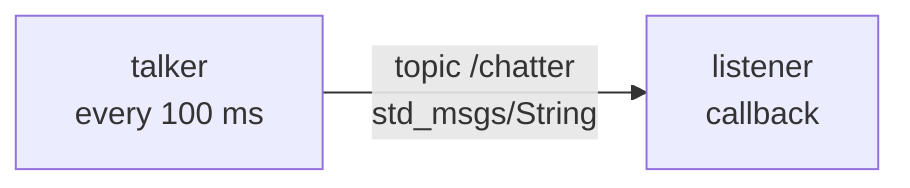

# Your first publisher and subscriber

The smallest useful ROS 2 program is a node that **publishes** something and another that **listens** to it. Every node
of ROS2neuro (the filters, the decoder, your own detectors) is made of the same two pieces. In this tutorial you write both, one line at a time.

**Goal.** A `talker` that publishes the text `hello world N` ten times per second on the topic `chatter`, and a `listener` that prints what it hears. At the end you start both with one launch file.

**You will learn**

- how to create a ROS 2 package (C++) and build it with `colcon`;
- how to create a **publisher** and call it from a **timer**;
- how to create a **subscriber** with a callback;
- how to start the two nodes together and inspect the topic.

**You need** a [ROS 2 basics](../ros2-basics/index.md) refresher and a ROS 2 Jazzy environment. No hardware. About 15 minutes.

The complete package is in the repository, under `docs/tutorials/publisher-subscriber/tutorial_pubsub/`, and every block of
code below is taken from its files: what you read is what builds.

## 1. The plan



The two nodes know nothing about each other: they only agree on the **name** of the topic (`chatter`) and on the **type** of the
message (`std_msgs/msg/String`, which has a single field, `data`). That is the whole contract.

## 2. Create the package

```bash
cd ~/ros2neuro_ws/src          # any workspace, or an empty folder
ros2 pkg create --build-type ament_cmake tutorial_pubsub
```

This makes the folders `src/` and `include/` and the two files that describe a package. Open `package.xml` and say what the
package needs: `rclcpp` (the C++ library of ROS 2) and `std_msgs` (the message we use).

```xml title="package.xml"
--8<-- "publisher-subscriber/tutorial_pubsub/package.xml"
```

## 3. The talker, step by step

Create `src/talker.cpp`. We build it in four steps.

**Step 1: a node.** A node is a class that derives from `rclcpp::Node`. Its constructor gives it a name, `talker`: it is the
name you will see in `ros2 node list`.

```cpp
class Talker : public rclcpp::Node {
public:
  Talker() : Node("talker") {
    // ... we add the publisher and the timer here
  }
};
```

**Step 2: a publisher.** The publisher is created *on the node*, with the type of the message and the name of the topic:

```cpp title="in the constructor"
--8<-- "publisher-subscriber/tutorial_pubsub/src/talker.cpp:publisher"
```

**Step 3: a timer.** A publisher does nothing by itself. We want a message every 100 ms, so we create a timer that calls a
function at that rate:

```cpp title="in the constructor, after the publisher"
--8<-- "publisher-subscriber/tutorial_pubsub/src/talker.cpp:timer"
```

**Step 4: the function the timer calls.** It builds the message, publishes it and writes it in the log:

```cpp title="a method of the class"
--8<-- "publisher-subscriber/tutorial_pubsub/src/talker.cpp:publish"
```

Last, `main` starts ROS 2, creates the node and **spins** it: `spin` is the loop that keeps the node alive and runs its
timer and its callbacks.

```cpp title="main"
--8<-- "publisher-subscriber/tutorial_pubsub/src/talker.cpp:main"
```

??? example "The complete file, `src/talker.cpp`"
    ```cpp
    --8<-- "publisher-subscriber/tutorial_pubsub/src/talker.cpp"
    ```

## 4. The listener, step by step

The listener is shorter. The subscriber is created like the publisher, with the **same topic and type**, and with a function to
call for every message:

```cpp title="in the constructor"
--8<-- "publisher-subscriber/tutorial_pubsub/src/listener.cpp:subscription"
```

```cpp title="a method of the class"
--8<-- "publisher-subscriber/tutorial_pubsub/src/listener.cpp:callback"
```

The `main` is the same as the talker's, with `Listener`.

??? example "The complete file, `src/listener.cpp`"
    ```cpp
    --8<-- "publisher-subscriber/tutorial_pubsub/src/listener.cpp"
    ```

!!! note "Callbacks and time"
    A callback runs when a message arrives, so it must be quick: if it takes longer than the time between two messages they pile up in the queue (the `10` of
    `create_subscription`) and the oldest are lost. In ROS2neuro this is the rule for every node that reads a `NeuroFrame`, which arrives 16 times per second.

## 5. Tell CMake what to build

`CMakeLists.txt` lists the two executables and where to install them. `ros2 run` looks for them in `lib/<package>`:

```cmake title="CMakeLists.txt"
--8<-- "publisher-subscriber/tutorial_pubsub/CMakeLists.txt"
```

## 6. Build and run

```bash
cd ~/ros2neuro_ws
colcon build --packages-select tutorial_pubsub
source install/setup.bash
```

If the package lives outside `src/`: `colcon build --paths path/to/tutorial_pubsub`.

In one terminal:

```bash
ros2 run tutorial_pubsub talker
```

```text
[INFO] [1795525032.464274832] [talker]: published: 'hello world 0'
[INFO] [1795525032.564319948] [talker]: published: 'hello world 1'
```

In a second terminal (do not forget to `source install/setup.bash`):

```bash
ros2 run tutorial_pubsub listener
```

```text
[INFO] [1795525032.664432748] [listener]: heard: 'hello world 2'
```

The listener starts hearing from the message that is published after it appears: what was sent before is lost. This is also true for
the events of ROS2neuro, which is why the launch files of the stack start the acquisition a few seconds after the other nodes.

## 7. Look at it from outside

With both nodes running, ROS 2 knows the graph:

```bash
ros2 node list
ros2 topic list -t
ros2 topic info /chatter
ros2 topic hz /chatter
```

```text
/listener
/talker
/chatter [std_msgs/msg/String]
Type: std_msgs/msg/String
Publisher count: 1
Subscription count: 1
average rate: 9.997
```

The rate is the 10 Hz of the timer. `ros2 topic echo /chatter` shows the messages without any listener of yours: **any** node, or
you with a terminal, can subscribe to a topic. It is how you will check the signals of ROS2neuro.

## 8. One command for both: a launch file

```xml title="launch/talk_and_listen.launch.xml"
--8<-- "publisher-subscriber/tutorial_pubsub/launch/talk_and_listen.launch.xml"
```

`CMakeLists.txt` already installs the `launch/` folder, so after a build:

```bash
ros2 launch tutorial_pubsub talk_and_listen.launch.xml
```

Both nodes start, and their logs appear in the same terminal. This is the pattern of the [next tutorials](../acquisition-recording/index.md), with one
node per stage of the BCI.

## Troubleshooting

| Symptom | Likely cause |
|---|---|
| `Package 'tutorial_pubsub' not found` | you did not `source install/setup.bash` in this terminal |
| the listener prints nothing | the topic name or the type differ between the two nodes: compare `ros2 topic info /chatter -v` |
| `No executable found` | the executable is not in the `install(TARGETS ...)` line of `CMakeLists.txt` |
| you changed the code and nothing changed | you did not run `colcon build` again |

## Exercises

1. Change the rate to 2 Hz without recompiling: declare a parameter `rate` in the talker (`declare_parameter`) and set it with `--ros-args -p rate:=2.0`.
2. Publish a number instead of a text (`std_msgs/msg/Float32`) and print it from the listener.
3. Start two listeners: both hear every message. Start two talkers: what do you see in `ros2 topic hz`?

Next: [Acquire, view and record the EEG](../acquisition-recording/index.md).
