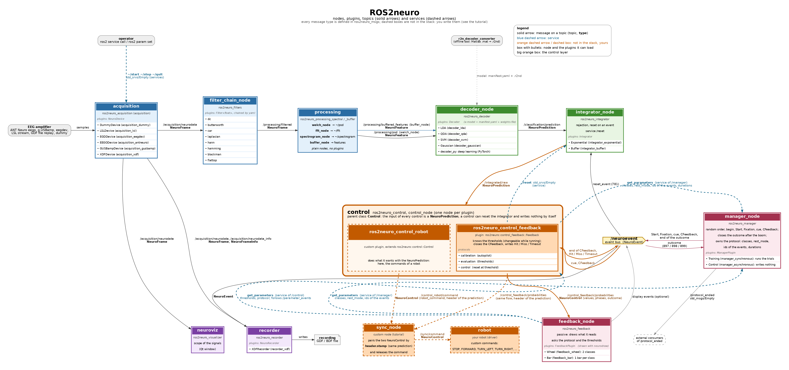

# Controlling a robot in step with the feedback

In this tutorial you write the two things that the stack leaves to you when a **robot** has to move together with what the subject
sees: a **control plugin** for the robot (`ros2neuro_control_robot`) and a **synchronization node** that keeps the robot in step with
the feedback by looking at the **header** of the messages.

[](../../assets/robot_control_architecture.png)

**You will learn**

- that every [control](../../packages/control/index.md) takes a `NeuroPrediction` as input and may do whatever it wants with it;
- how to write a control plugin (`configure`, `on_prediction`) and register it;
- why two controls that read the same integrator can be paired by the header of what they publish;
- how to synchronize two topics with `message_filters` (exact time).

**You need** a built ROS2neuro workspace and about 30 minutes. It helps to have done
[Writing an integrator plugin](../integrator-plugin/index.md): the registration steps are the same.

The complete package is in the repository, under `docs/tutorials/robot-control/tutorial_robot_control/`.

## 1. The idea

The [integrator](../../packages/integrator/index.md) publishes one `NeuroPrediction` for every prediction of the decoder, on
`/integrated/raw`. Two controls read it, each in its own `control_node` (a node loads **one** control plugin):

| | [`ros2neuro_control_feedback`](../../packages/control/feedback.md) (in the stack) | `ros2neuro_control_robot` (yours) |
|---|---|---|
| input | the `NeuroPrediction` | the same `NeuroPrediction` |
| output | the flow that the feedback draws: a `NeuroControl` on `/control_feedback/probabilities` | the commands of the robot: a `NeuroControl` on `/control_robot/command` |
| header of the output | the one of the prediction | the one of the prediction (**you copy it**) |

Both outputs are made from the same prediction and carry its `header.stamp`: for the same prediction the two stamps are **equal**.
That is all that the synchronization needs. The node `sync_node` pairs a flow message and a command with the same stamp and only then
releases the command to the robot: the robot receives a command when the feedback has the values of the same prediction, so what
the robot does is what the subject is shown at that moment.

!!! note "Where the stamps are equal"
    In **control** and **evaluation** the flow carries the values of the integrator, with the header of the prediction they come from.
    The few flow messages that are not made from a prediction (the neutral vector the feedback shows between trials) have a stamp of
    their own and never find a command with the same stamp: they are dropped by the synchronization, which is what you want. In a
    **calibration** the feedback shows an autopilot, not the integrator: there is nothing to synchronize with.

## 2. Package layout

```text
tutorial_robot_control/
├── CMakeLists.txt
├── package.xml
├── plugins.xml
├── include/tutorial_robot_control/
│   ├── robot_commands.hpp    # the commands of THIS robot
│   ├── robot_control.hpp     # the control plugin
│   └── sync_node.hpp         # the synchronization
├── src/
│   ├── robot_commands.cpp
│   ├── robot_control.cpp
│   ├── sync_node.cpp  sync_node_main.cpp
│   └── fake_robot_node.cpp   # the "robot": it only says what it would do
├── config/robot_control.yaml
├── launch/robot_control.launch.xml
└── test/                     # the commands, the plugin through the control node, the synchronization
```

## 3. The commands of the robot

The commands are **yours**: ROS2neuro knows nothing about them. A command is an integer in the `commands` of a `NeuroControl`, named by
the action `robot_command`.

```cpp title="include/tutorial_robot_control/robot_commands.hpp"
--8<-- "robot-control/tutorial_robot_control/include/tutorial_robot_control/robot_commands.hpp"
```

```cpp title="src/robot_commands.cpp"
--8<-- "robot-control/tutorial_robot_control/src/robot_commands.cpp"
```

## 4. The control plugin

A control plugin derives from [`ros2neuro::control::Control`](../../packages/control/index.md) and implements two things:

- `configure(node, context)`: read the parameters from the `node` it is given, create what it needs on it (here, a publisher);
- `on_prediction(prediction)`: called for every `NeuroPrediction`. It must return quickly.

The `context` offers `request_reset()` (to reset the integrator), `now()`, `ok()`, `request_shutdown()` and `flush_input()`: the plugin
here does not need it. See [ros2neuro_control](../../packages/control/index.md) for the interface.

```cpp title="include/tutorial_robot_control/robot_control.hpp"
--8<-- "robot-control/tutorial_robot_control/include/tutorial_robot_control/robot_control.hpp"
```

```cpp title="src/robot_control.cpp"
--8<-- "robot-control/tutorial_robot_control/src/robot_control.cpp"
```

!!! important "Copy the header"
    `message.header = prediction.header;` is the line that makes the synchronization possible. If you stamp the command with `now()`
    nobody will be able to tell which prediction it belongs to.

!!! warning "A pitfall"
    `node->get_parameter("commands").as_integer_array()` returns a reference into a temporary parameter: iterating over it directly is
    undefined behavior (the compiler warns). Keep the `rclcpp::Parameter` in a variable first, as the code does.

## 5. Registration

```xml title="plugins.xml"
--8<-- "robot-control/tutorial_robot_control/plugins.xml"
```

```cmake title="CMakeLists.txt"
--8<-- "robot-control/tutorial_robot_control/CMakeLists.txt"
```

The description file is registered with **[`ros2neuro_control`](../../packages/control/index.md)**, the package that loads control plugins
(`pluginlib_export_plugin_description_file(ros2neuro_control plugins.xml)`), and the class is exported with
`PLUGINLIB_EXPORT_CLASS(tutorial::control::RobotControl, ros2neuro::control::Control)`.

## 6. The synchronization

`sync_node` is an ordinary node, not a plugin. It subscribes to the two `NeuroControl` topics with `message_filters` and an **exact
time** policy: a callback fires only when both topics have a message with the **same `header.stamp`**.

```cpp title="include/tutorial_robot_control/sync_node.hpp"
--8<-- "robot-control/tutorial_robot_control/include/tutorial_robot_control/sync_node.hpp"
```

```cpp title="src/sync_node.cpp"
--8<-- "robot-control/tutorial_robot_control/src/sync_node.cpp"
```

The order of arrival does not matter (the filter keeps the first message until the other one comes), and a message with no partner is
simply dropped. `queue_size` says how many messages of each topic it can hold while waiting.

## 7. The robot

The robot of the tutorial only says what it would do; replace it with the driver of yours. It listens to `/sync/command`, **not** to
`/control_robot/command`: that is what keeps it in step.

```cpp title="src/fake_robot_node.cpp"
--8<-- "robot-control/tutorial_robot_control/src/fake_robot_node.cpp"
```

## 8. Run it

The parameters and the launch file:

```yaml title="config/robot_control.yaml"
--8<-- "robot-control/tutorial_robot_control/config/robot_control.yaml"
```

```xml title="launch/robot_control.launch.xml"
--8<-- "robot-control/tutorial_robot_control/launch/robot_control.launch.xml"
```

Build the package and start the pipeline with its feedback in one terminal, the robot side in another:

```bash
colcon build --packages-select tutorial_robot_control && source install/setup.bash

# terminal 1: the pipeline, in control (the flow carries the values of the integrator)
ros2 launch ros2neuro_devel_test gaussian_wheel.launch.xml protocol:=control record:=false

# terminal 2: the robot control, the synchronization and the robot
ros2 launch tutorial_robot_control robot_control.launch.xml
```

The node of the robot control is named `control_robot` (the one of the feedback is `/control`): that is why the launch file gives it a
name. The robot says what it does when the command changes:

```text
[robot]: robot: waiting for commands on '/sync/command'
[robot]: robot: STOP
[robot]: robot: FORWARD
[robot]: robot: STOP
```

Look at the three topics, and compare the stamps of the same prediction:

```bash
ros2 topic echo /control_feedback/probabilities --field header.stamp
ros2 topic echo /control_robot/command --field header.stamp
ros2 topic echo /sync/command --field header.stamp
```

## 9. Test it

```bash
colcon test --packages-select tutorial_robot_control
```

- `test_robot_commands`: the command of a prediction (threshold, ties, an unexpected number of classes);
- `test_robot_control`: the plugin **loaded by the control node**, like in a real launch: the command, and the header of the prediction;
- `test_sync_node`: a command is released when the stamps are equal, in any order of arrival; nothing when they differ; a flow without a
  command releases nothing; a stream of pairs.

## What you learned

- every control takes a `NeuroPrediction` and writes what it wants; the control for the feedback and yours read the same integrator;
- the **header** of a message is a key: copy it from the prediction and two outputs of the same prediction can be paired later;
- an exact-time synchronization releases the robot only when the feedback shows the same values;
- the robot, its commands and the synchronization are yours: the stack only gives you the `Control` class and the flow.

Next: [Filter bank CSP: train it in MATLAB, run it in ROS2neuro](../fbcsp/index.md).
