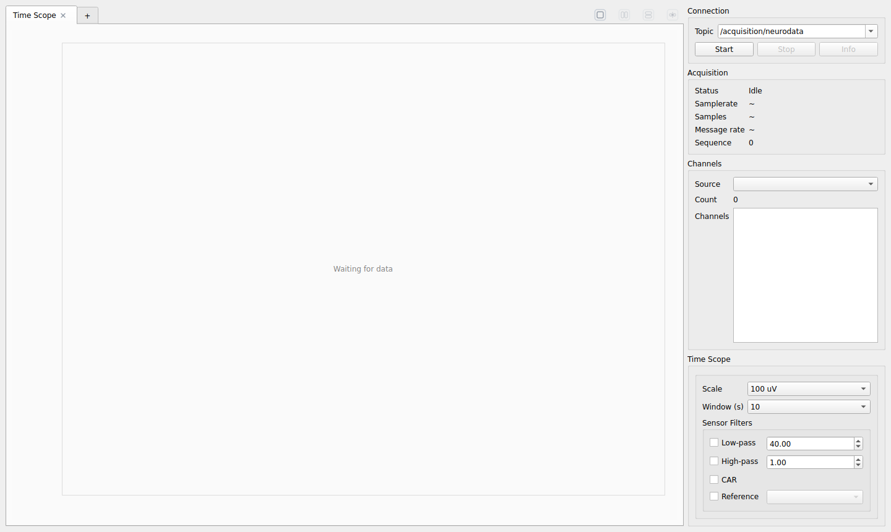
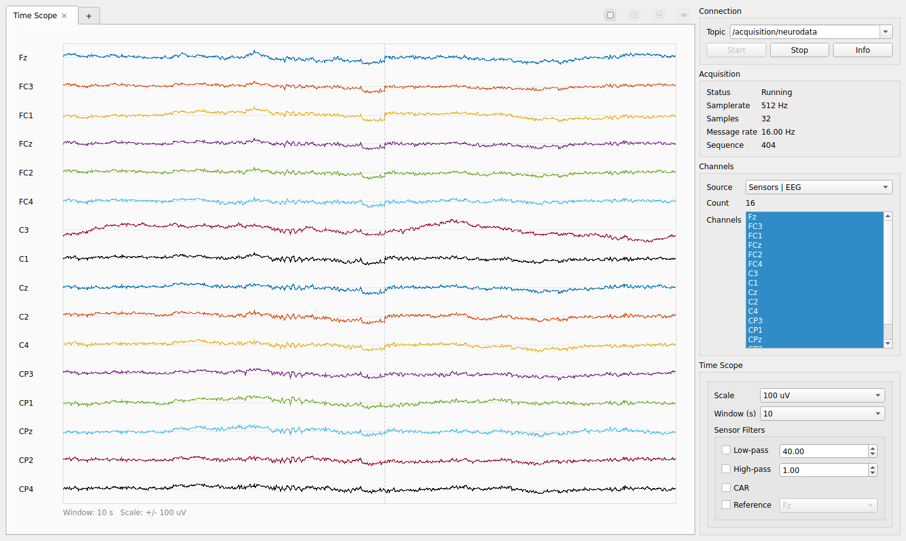
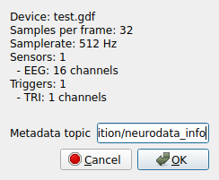
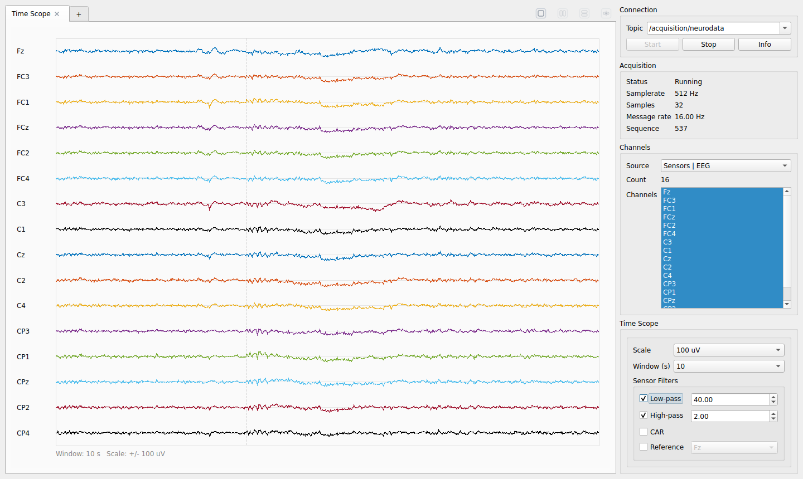
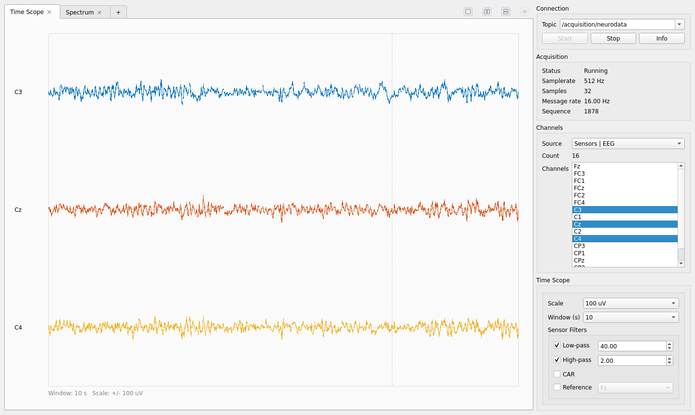
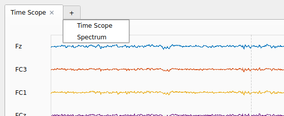
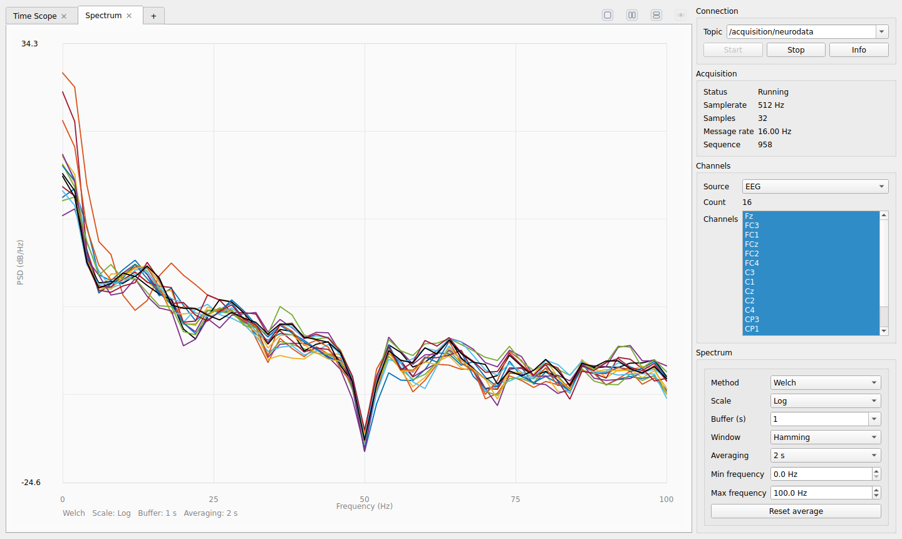
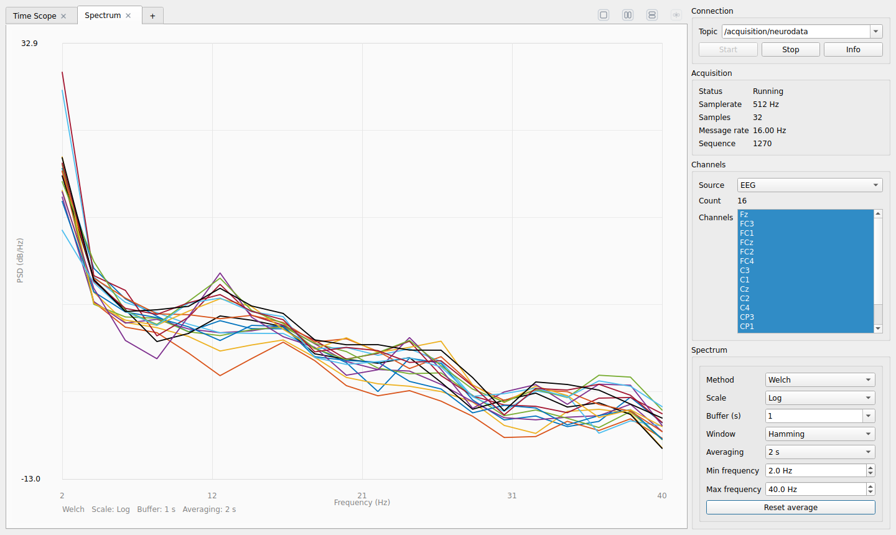
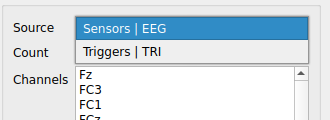
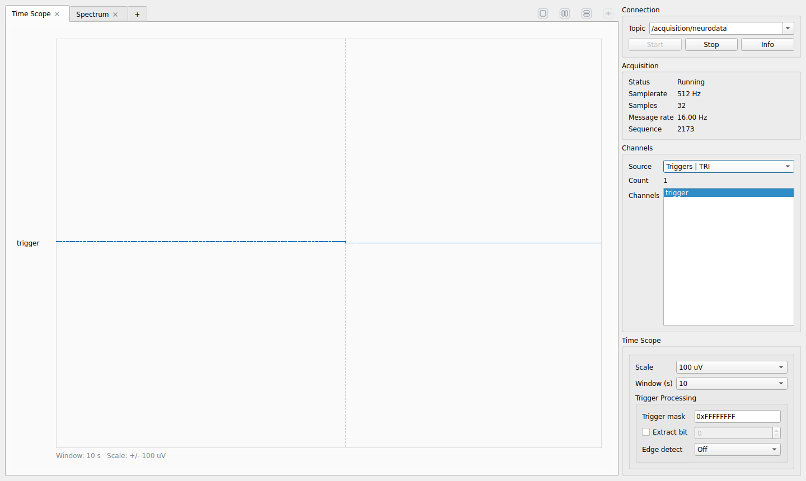

# Looking at the signals with the visualizer

The visualizer, `neuroviz`, is the oscilloscope of ROS2neuro: it shows the EEG that flows on a topic, lets you filter
and select it, and shows its spectrum. It is the first thing to open when you connect an amplifier, and the quickest
way to see whether a recording is clean.

In this tutorial you open the visualizer on a recorded EEG, filter the signal between **2 and 40 Hz**, look at a few
channels, add a **Welch power spectrum** with the `+` button, and put the signal and the spectrum side by side.

**You will learn**

- the four areas of the window and what each one shows;
- how to filter and select channels in the Time Scope;
- how to add the Spectrum tab and read the Welch spectrum;
- how to arrange several tabs, and how to look at the trigger lines.

**You need** a built ROS2neuro workspace (with `ros2neuro_visualizer` and `ros2neuro_devel_test`) and a display.
No hardware: the EEG comes from a recorded GDF file. About 15 minutes.

## 1. Start a data source

The visualizer shows a `NeuroFrame` topic, so first we need something that publishes it. We replay a recorded GDF
file as if it were a live amplifier: 16 EEG channels at 512 Hz, sent 16 times per second.

```yaml title="acquisition_gdf.yaml"
--8<-- "visualizer/acquisition_gdf.yaml"
```

The file `acquisition_gdf.yaml` is in this tutorial's folder. Start the acquisition node with it, giving the GDF that
comes with `ros2neuro_devel_test`:

```bash
ros2 run ros2neuro_acquisition acquisition --ros-args \
  --params-file acquisition_gdf.yaml \
  -p acquisition.filename:=$(ros2 pkg prefix ros2neuro_devel_test)/share/ros2neuro_devel_test/extra/test.gdf
```

The node publishes `/acquisition/neurodata` and `/acquisition/neurodata_info`.

!!! tip "No file at hand?"
    `ros2 launch ros2neuro_acquisition_dummy dummy_acquisition.launch.py` publishes a synthetic signal on the same
    topics (16 EEG channels, 8 EMG channels and a trigger). It is made of sinusoids, so the spectrum shows sharp
    peaks instead of a realistic shape.

## 2. Open the visualizer

In a second terminal:

```bash
ros2 run ros2neuro_visualizer neuroviz
```

{ .screenshot }

The big area on the left holds the **tabs**: at the start there is one, the *Time Scope*. The right sidebar has four
areas:

| Area | What it is for |
|---|---|
| **Connection** | the topic to listen to, and the **Start**, **Stop** and **Info** buttons |
| **Acquisition** | the state of the stream: status, sample rate, samples per frame, message rate and a sequence counter |
| **Channels** | which block of the frame to show (the **Source**) and which of its channels |
| the **view** area (here *Time Scope*) | the controls of the active tab: they change when you change tab |

## 3. Connect and watch the EEG

The **Topic** box lists the `NeuroFrame` topics found in the system. Choose `/acquisition/neurodata` (open the list with the
arrow) and press **Start**.

{ .screenshot }

The sixteen channels scroll in the Time Scope. The **Acquisition** area confirms what the stream is: *Running*,
**512 Hz**, **32 samples** per frame and **16 Hz** message rate (that is 512 / 32). The channel names come from the
labels carried by the frames.

The **Info** button opens the description of the stream, taken from `NeuroFrameInfo`: the device, the samples per
frame and the sample rate, and how many channels each block has.

{ .screenshot style="max-width: 260px;" }

Two controls of the Time Scope set the view:

- **Scale** is the amplitude of the traces (here ±100 µV);
- **Window (s)** is how many seconds are on screen (1, 2, 5, 10, 20 or 30).

## 4. Filter the signal between 2 and 40 Hz

Raw EEG contains slow drifts that make the traces wander. In the **Sensor Filters** box, at the bottom of the sidebar:

1. tick **High-pass** and set it to **2** Hz;
2. tick **Low-pass** and leave it at **40** Hz.

(The defaults are 1 Hz and 40 Hz: change the high-pass value and press Tab.)

{ .screenshot }

Compare it with the previous picture: the slow waves on Fz and C3 are gone and the traces are centred. Two more
filters are in the same box: **CAR** (common average reference) subtracts the average of the channels from each one,
and **Reference** subtracts a single channel that you choose.

!!! note "The filters are only a view"
    The filters of the Time Scope change what you see in that tab. They do **not** change the data published on the
    topic: the other nodes still receive the raw frames. To filter the signal for the rest of the pipeline you use the
    [filter chain](../../packages/filters/index.md).

## 5. Look at a few channels

The **Channels** list shows every channel of the source, all selected. Click one to select only that one, and
Ctrl-click to add others. Here we keep the three central channels, C3, Cz and C4:

{ .screenshot }

With fewer channels the traces are taller and easier to read. Select them all again by clicking the first and
Shift-clicking the last.

## 6. Add the Welch spectrum

The `+` next to the tab opens a menu with the kinds of tab you can add:

{ .screenshot style="max-width: 360px;" }

Choose **Spectrum**. A new tab appears and the right sidebar shows its controls.

{ .screenshot }

The tab computes the power spectral density (PSD) of the EEG itself, with the Welch method, from the frames it
receives: there is no extra node to start. The vertical axis is the PSD in dB/Hz and each colour is a channel.
The spectrum falls with the frequency, as the spectrum of the EEG does. The narrow dip at 50 Hz is typical of a notch
filter on the power line applied to this recording (with other data, a peak at 50 Hz would be line noise).

The controls of the **Spectrum** area:

| Control | Meaning |
|---|---|
| **Method** | `Welch` (average of the periodograms of overlapping segments: smoother) or `FFT` (a single transform: more detail, more noise) |
| **Scale** | `Log` (dB) or `Linear` |
| **Buffer (s)** | seconds of signal the spectrum is computed on: 0.5, 1, 2, 4 or 8 |
| **Window** | the window applied to each segment: Hamming, Hann, Blackman, Flattop or Rectangular |
| **Averaging** | average the spectra of the last 2, 4 or 8 seconds, or all of them, to get a steadier curve (`Off` shows each one) |
| **Min / Max frequency** | the range of the horizontal axis |
| **Reset average** | restart the averaging |

To match the filter of the previous step, set **Min frequency** to **2** Hz and **Max frequency** to **40** Hz:

{ .screenshot }

The **Channels** list works in this tab too: select a few channels to compare them. **Buffer** and **Averaging**
trade responsiveness for stability: a longer buffer resolves the frequencies better, and a longer average makes the
curve steadier but slower to follow a change.

## 7. The signal and the spectrum together

Each tab can be placed in a pane. The four buttons at the top right of the tab area choose the arrangement: *Single panel*,
*Two panels left/right*, *Two panels top/bottom* and *Equalize panel sizes*.
Press *Two panels left/right*: the visualizer puts the tabs in two panes.

{ .screenshot }

On the left the Time Scope with the 2-40 Hz filter, on the right the Welch spectrum between 2 and 40 Hz. Both are
live. You can also drag a tab from a pane to the other, rename a tab with a double click and close it with its `x`.

## 8. The trigger lines

A frame carries, besides the EEG, digital trigger lines. Open the **Source** list in the **Channels** area: it lists the
blocks of the frame, here the EEG and the trigger `TRI`.

{ .screenshot style="max-width: 340px;" }

Choose the trigger source. The Time Scope shows the trigger line and, instead of the *Sensor Filters*, a **Trigger
Processing** box:

{ .screenshot }

| Control | Meaning |
|---|---|
| **Trigger mask** | a bit mask applied to the value, for example `0xFFFFFFFF` keeps every bit |
| **Extract bit** | show only one bit of the value (choose which with the number next to it) |
| **Edge detect** | `Off`, `Rising`, `Falling` or `Both`: show the edges of the line instead of its level |

This recording has no trigger activity in this stretch, so the line is flat. With a real task, where the markers
are sent on the trigger line, the edges show when each event happened.

## Troubleshooting

| Symptom | Likely cause |
|---|---|
| the topic list is empty or the view says "Waiting for data" | the acquisition is not running, or it publishes on another topic (`ros2 topic list -t`) |
| nothing happens when you press Start | the topic name in the box is not the one that publishes: pick it from the list |
| the Spectrum is flat or empty | the buffer has not filled yet: wait a second or two, or use a longer **Buffer** |
| the traces are flat lines | the **Scale** is too small or too large for the signal: change it |
| the filter makes the first seconds look odd | filters need a moment to settle after you enable them |

## What you learned

- the visualizer reads any `NeuroFrame` topic, and its filters are only a view;
- one tab shows the signal in time, another computes its Welch spectrum, and they can sit side by side;
- the same panel shows the metadata of the stream and the trigger lines.

Next: [Writing a filter plugin](../filter-plugin/index.md).
