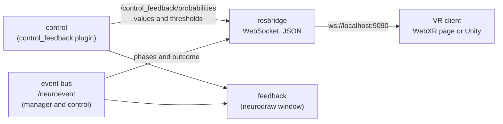
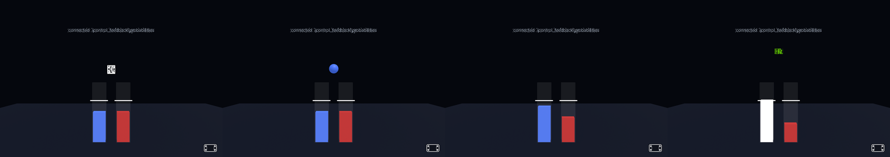
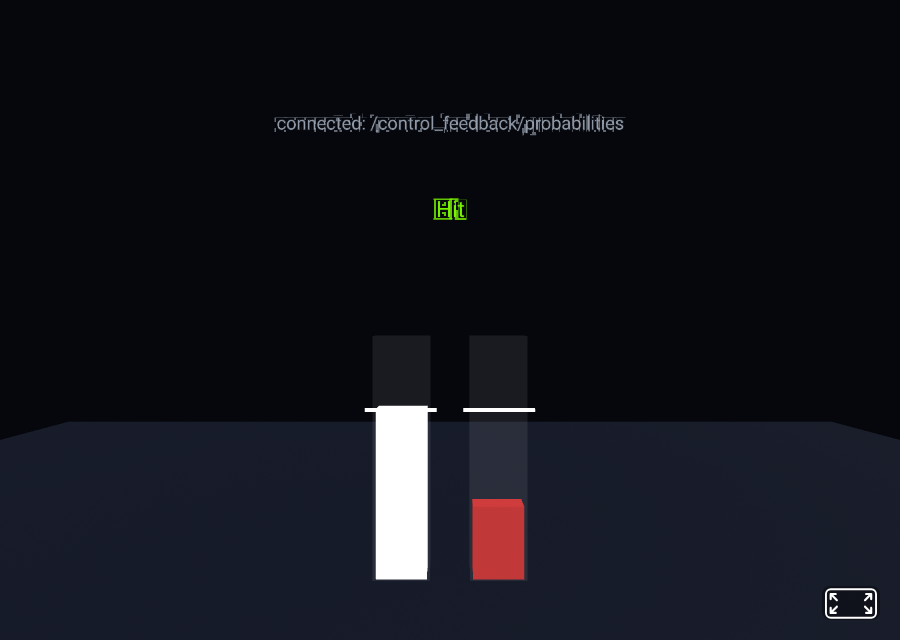
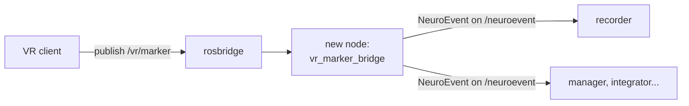

# Feedback in virtual reality (WebXR and Unity)

The feedback of a BCI does not have to be a window on a monitor. In this tutorial you send the feedback of ROS2neuro to
a **virtual reality** scene: the subject sees the bars rise towards their thresholds inside the headset.

The VR side is **passive**: it only *receives* what ROS2neuro produces and draws it. It decides nothing, exactly like the
[feedback](../../packages/feedback/index.md) of the stack. (At the end we sketch how the VR could also send markers
back, without implementing it.)

!!! warning "What has been tested"
    | Part | Status |
    |---|---|
    | rosbridge, the WebXR page, the data flow from ROS2neuro | **tested**: run end to end in Chrome (headless), with the real pipeline: the bars, the thresholds, the cross, the cue and the outcome |
    | entering immersive mode on a headset (WebXR) | **not tested**: described, no headset was available |
    | the Unity example | **not tested**: it is only an example of possible code, not verified in Unity or on a headset |

**Goal.** Build a **WebXR page** that connects to ROS2neuro through rosbridge and draws the bars, the thresholds, the fixation cross, the cue and the outcome of a trial, **running the real pipeline**.
Then see the same idea in a Unity script, and where a marker from the VR would enter the stack.

**You will learn**

- what the feedback hears (the flow of control and the event bus) and how to read it from outside ROS;
- how rosbridge turns ROS 2 topics into a WebSocket that any VR engine can read;
- a WebXR page (A-Frame) that shows the feedback, and a Unity script that does the same idea;
- where a marker from the VR would enter ROS2neuro.

**You need** a built ROS2neuro workspace, a desktop browser (Firefox or Chrome) and, to try immersive mode, a headset with
a WebXR browser. Read [Protocols](../../concepts/protocols.md) first if control, the manager and the feedback are new to you.
About 30 minutes.

## 1. The plan



A feedback hears **two** things, and so does the VR. [`control_feedback`](../../packages/control/feedback.md) publishes the **flow**: the values
of the classes and the thresholds in force. The [manager](../../packages/manager/index.md) and control write the **phases** of the trial on the event bus,
`/neuroevent`: the fixation, the cue, the outcome. Any program that can read those two topics can be a feedback. VR engines do not speak ROS 2, but
they all speak WebSocket, so we put a **bridge** in between: **rosbridge** subscribes to the topics and serves them as JSON to its WebSocket clients.

### What is in the flow

The flow is a `NeuroControl` message published on `/control_feedback/probabilities`. It carries the **values and the thresholds**, and nothing else:

| Field | Content |
|---|---|
| `fields` | the class codes as strings, then `threshold:<code>` for each of them, for example `["773", "771", "threshold:773", "threshold:771"]` |
| `values` | the normalized value of each class (they sum to 1: the height of its bar), then the thresholds in force, for example `[0.42, 0.58, 0.7, 0.7]` |
| `actions`, `commands` | `seq`, a counter |

A VR that draws one bar per entry of `fields` would draw four bars here: the entries that start with `threshold:` are the lines, not classes. The
thresholds are in the flow so that a change at runtime (`ros2 param set /control thresholds "[0.8, 0.8]"`) moves the lines in every feedback.

### What is on the event bus

The phases of the trial are `NeuroEvent` messages on `/neuroevent` (the field `event_id`). They are not in the flow. The ids are the
[event codes](../../concepts/protocols.md#event-codes) of the stack:

| Id | Meaning | Written by |
|---|---|---|
| `1`, `786` | start, **fixation** (the cross) | manager |
| the code of a class (`773`, `771`...) | the **cue** | manager |
| `781` | the continuous feedback starts | manager |
| `897`, `898`, `899` | the outcome: Hit, Miss, Timeout | control |
| each of them `+ 32768` | the same event ends | the manager (start, fixation, cue and the outcome, after the *boom*), control (the continuous feedback) |
| `id + 16384` | "this was shown", published by a feedback after drawing | not a phase: ignore it |

## 2. Install and start rosbridge

```bash
sudo apt install ros-jazzy-rosbridge-suite
```

Start it **in a terminal where the ROS2neuro workspace is sourced**, so that it knows the message type:

```bash
source /opt/ros/jazzy/setup.bash
source install/setup.bash
ros2 launch rosbridge_server rosbridge_websocket_launch.xml
```

It prints `Rosbridge WebSocket server started on port 9090`. Port 9090 is where the VR client connects.

!!! note "Why the workspace must be sourced"
    rosbridge converts a message to JSON using its definition. If [`ros2neuro_msgs`](../../packages/msgs-data.md#ros2neuro_msgs) is not found, the subscriptions to
    `ros2neuro_msgs/msg/NeuroControl` and `ros2neuro_msgs/msg/NeuroEvent` fail.

## 3. Start a pipeline that produces a feedback flow

Any launcher of `feedback/` in [`ros2neuro_devel_test`](../../reproducibility/packages/index.md) will do. A calibration shows every phase of a trial and drives the bars by itself, so we use it.
The launcher has no command-line arguments: the protocol is the constant `PROTOCOL` at the top of the file (as delivered, `protocol_evaluation.yaml`). Change the word after
`protocol_` to `calibration` in `feedback/bars2/feedback_bars2.launch.py`, rebuild and launch (see [the hardware-free tutorial](../hardware-free-pipeline/index.md)):

```bash
colcon build --packages-select ros2neuro_devel_test && source install/setup.bash
ros2 launch ros2neuro_devel_test feedback_bars2.launch.py
```

The bars window of the stack opens (you can leave it open, it receives the same flow). Note that the session ends by itself when the protocol ends, after about a minute: start it again
when you need more.

## 4. The WebXR page, step by step

The page is a single file that uses [A-Frame](https://aframe.io) (WebXR) and [roslibjs](https://github.com/RobotWebTools/roslibjs) (the JavaScript client of rosbridge). Both are loaded
from a CDN, with their versions pinned. We build it in six pieces, from the settings to the connection.

**1. Settings.** Everything is optional and comes from the URL (`?host=...&thresholds=0.7,0.7`). The event ids are those of the [protocol](../../concepts/protocols.md#event-codes). A class is
coloured by its **position**, never by its code, with the rest (`783`) in yellow: the same rule as the feedback of the stack.

```js title="webxr/index.html"
--8<-- "vr-feedback/webxr/index.html:settings"
```

**2. The scene.** An A-Frame scene (the camera, a floor, two lights and an empty `#feedback` entity) holds everything. `el()` creates an element inside it:

```js
--8<-- "vr-feedback/webxr/index.html:scene"
```

**3. The bars.** At the first message of the flow we build one bar per entry of `fields` that is **not** `threshold:...`: a thin transparent frame, the bar itself and its white threshold line.
We also create the fixation cross, the cue (a sphere) and the outcome text, hidden until the manager asks for them. A bar grows upwards from the floor, so its position is half its height:

```js
--8<-- "vr-feedback/webxr/index.html:bars"
```

**4. The flow.** Every message sets the height of each bar to its value. The `threshold:<code>` entries move the white lines, also when you change the thresholds while running, and a bar at or above
its threshold turns white. The query parameter `?thresholds=0.7,0.7` is only the position of the lines until the first message brings the real ones.

```js
--8<-- "vr-feedback/webxr/index.html:flow"
```

**5. The phases.** The events show or hide the fixation cross and the cue (a sphere with the colour of the target bar), and the outcome writes *Hit*, *Miss* or *Timeout* above the bars.
The events that end something (`id + 32768`) hide it. This is the same logic as `feedback_controller.cpp`.

```js
--8<-- "vr-feedback/webxr/index.html:events"
```

!!! warning "Do not throttle the subscription to the events"
    roslibjs can limit the rate of a subscription with `throttle_rate`. Do not use it on `/neuroevent`: the manager writes two events in the same instant
    (the end of the fixation and the cue), and a throttle would drop the second one, so you would never see the cue.

**6. The connection.** `ROSLIB.Ros` opens the WebSocket to `ws://<host>:<port>` and reconnects every two seconds if it drops; the text above the bars says whether it is connected.
It subscribes to `/control_feedback/probabilities` as `ros2neuro_msgs/msg/NeuroControl` and to `/neuroevent` as `ros2neuro_msgs/msg/NeuroEvent`.

```js
--8<-- "vr-feedback/webxr/index.html:connect"
```

??? example "The complete page"
    ```html
    --8<-- "vr-feedback/webxr/index.html"
    ```

### Run it

Serve the folder with any static web server. For example, from the folder that contains `index.html`:

```bash
python3 -m http.server 8000
```

and open, in the browser of the same computer:

```text
http://localhost:8000/index.html?thresholds=0.7,0.7
```

The query parameters, all optional, are `host`, `port`, `topic` (the flow), `events` (the event bus) and `thresholds`.

The bars rise and fall with the classifier, and each trial of the calibration goes through its phases. Here are four
moments of a trial, from left to right: the fixation cross, the cue (the blue sphere says that the target is the first class), the
feedback (the blue bar rises towards its threshold line), and the outcome, a *Hit*, written when the bar touches the threshold and turns white:

{ .screenshot }

{ .screenshot style="max-width: 560px;" }

On a desktop browser the scene is a normal 3D view that you can look around with the mouse (and move with W, A, S, D).
The small button at the bottom right of the window is **Enter VR**, which starts the immersive mode on a headset.

### On a headset

This part is **not tested**, because no headset was available. What is known about WebXR:

- immersive mode requires a **secure context**: `https://`, or `http://localhost`;
- a page served over `https://` is normally not allowed to open a plain `ws://` connection (mixed content), except to `localhost`.

For a standalone headset such as the Meta Quest, two ways to satisfy both rules are:

- **Port forwarding over USB.** With `adb reverse tcp:8000 tcp:8000` and `adb reverse tcp:9090 tcp:9090`, the headset's
  `localhost` reaches the computer, and you open the same `http://localhost:8000/...` URL in the headset's browser.
- **HTTPS and `wss://`.** Serve the page with a certificate, and start rosbridge with its `certfile` and `keyfile`
  parameters so it speaks `wss://`. The headset and the computer must be on the same network.

## 5. The same idea in Unity

!!! danger "Example, not tested"
    The Unity code below has **not been run** in Unity or on a headset. It is a possible implementation, written from the
    rosbridge protocol and the API of the NativeWebSocket package, to show how the same idea looks in a game engine. Expect
    to adapt it (Unity version, render pipeline, XR setup).

The structure is the same as the WebXR page: a client that speaks rosbridge, and a script that draws the bars.

**1. The rosbridge client.** It opens the WebSocket, sends the `subscribe` request and raises an event for each message
of the flow. It uses the [NativeWebSocket](https://github.com/endel/NativeWebSocket) package
(*Package Manager → Add package from git URL*: `https://github.com/endel/NativeWebSocket.git#upm`) and Unity's
`JsonUtility`, so there is no other dependency.

```csharp title="unity/RosbridgeClient.cs"
--8<-- "vr-feedback/unity/RosbridgeClient.cs"
```

**2. The bars.** It builds one cube per class at the first message of the flow, sets the heights and moves the threshold lines with the `threshold:` entries, and handles
the cross, the cue and the outcome from the event bus, as the WebXR page does.

```csharp title="unity/FeedbackBars.cs"
--8<-- "vr-feedback/unity/FeedbackBars.cs"
```

To use them: put both scripts in the `Assets` folder, create an empty GameObject, add the two components, drag the client
into the `client` field of `FeedbackBars` (`thresholds` is only the position of the lines until the flow brings the real ones). Place the object in front of the camera. For a headset
you also need the XR setup of your project (for example the OpenXR plugin and an XR Origin), which is standard Unity work
and not described here.

## 6. Sending markers from the VR to ROS2neuro (a suggestion)

So far the VR only listens. A VR experiment often also needs to say *when* something happened in the scene: a stimulus
appeared, the subject pressed a button, a level started. Those markers should end up in the recorded file next to the
EEG. **This is not implemented here**; this is where it would go, and which nodes would change.



| Piece | Change |
|---|---|
| VR client (the page or the Unity script) | publish a message on a topic such as `/vr/marker` through rosbridge (with roslibjs, `new ROSLIB.Topic({...}).publish(...)`) |
| rosbridge | none: it already forwards publications from its clients to ROS 2 |
| **new node**, e.g. `vr_marker_bridge` | subscribes to `/vr/marker` and republishes a `NeuroEvent` on `/neuroevent`. It is the only new code |
| recorder | none: it already records every `NeuroEvent` on `/neuroevent` in the GDF/BDF file |
| manager | none. It stays the only publisher of the **protocol** events |
| integrator, other nodes | none, unless one should react to the marker (the integrator can reset on an event, `integrator.reset_event`) |

Points to decide when you implement it:

- **Event ids.** Choose ids that do not collide with the ones reserved by the stack (1, 781, 786, 897, 898, 899, the class codes of the cues, and the
  `Off` and `Shown` ranges), for example from 2000 up, and use a different `family_id` for the VR markers so the recorded
  file tells them apart. Follow the *On/Off* convention (`id` and `id + 32768`) for events that have a duration.
- **Timing.** The marker travels through the network, so it reaches ROS2neuro a little after it happened. If the
  bridge node time-stamps it on arrival, the stamp is late by that latency. For precise alignment, the VR can send its own
  timestamp, or the marker can be sent on a hardware trigger line that the acquisition records with the signal.
- **The display events of the feedback.** [`ros2neuro_feedback`](../../packages/feedback/index.md) already has an option, `publish_display_events`, that publishes
  *"this was shown"* events after drawing. A VR feedback could do the same with the instant at which the frame was displayed,
  which is the marker that matters for analysis.

## Troubleshooting

| Symptom | Likely cause |
|---|---|
| the page says `cannot reach ws://localhost:9090` | rosbridge is not running, or runs on another computer: set `host` in the URL |
| connected, but nothing moves | the pipeline is not running or has ended (a calibration lasts about a minute), or the topic differs: check `ros2 topic list` |
| rosbridge says it cannot find the type `ros2neuro_msgs/msg/NeuroControl` or `NeuroEvent` | rosbridge was started in a terminal where the workspace is not sourced |
| the bars move but there is no cross or cue | the page does not hear `/neuroevent` (another name: use `?events=`), or the subscription is throttled (`throttle_rate`): remove it |
| twice as many bars as classes | the page draws the `threshold:` entries of the flow as classes: it is written for an older flow, use the page of this tutorial |
| a bar never reaches its threshold line | the line is the threshold in force in control (`ros2 param get /control thresholds`): lower it, or the classifier does not get that far |
| no *Enter VR* button on the headset | the page is not in a secure context: see "On a headset" |

## What you learned

- a feedback hears two things, the flow of control (values and thresholds) and the event bus (phases and outcome), and any program can read them;
- rosbridge exposes both as JSON over a WebSocket, so a browser or a game engine can be a feedback;
- a passive VR feedback is the same few lines as the feedback of the stack: bars from the class entries of the flow, lines from its `threshold:` entries,
  phases and outcome from `/neuroevent`.

Next: [Control a robot in sync with the feedback](../robot-control/index.md).
