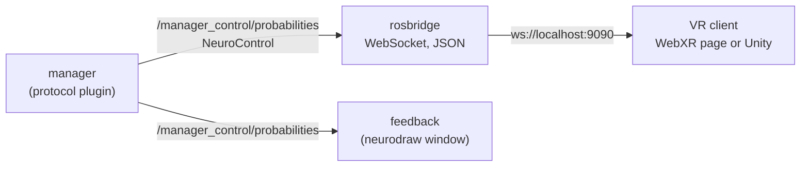
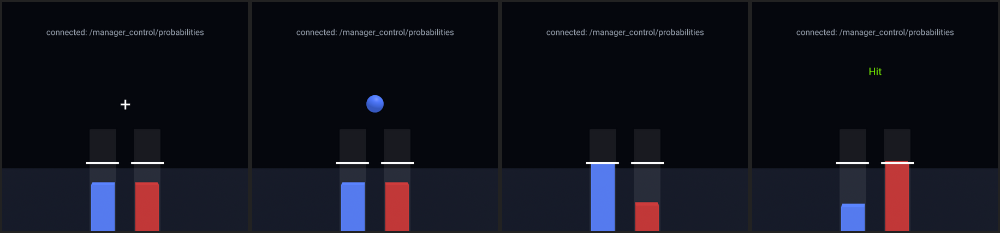
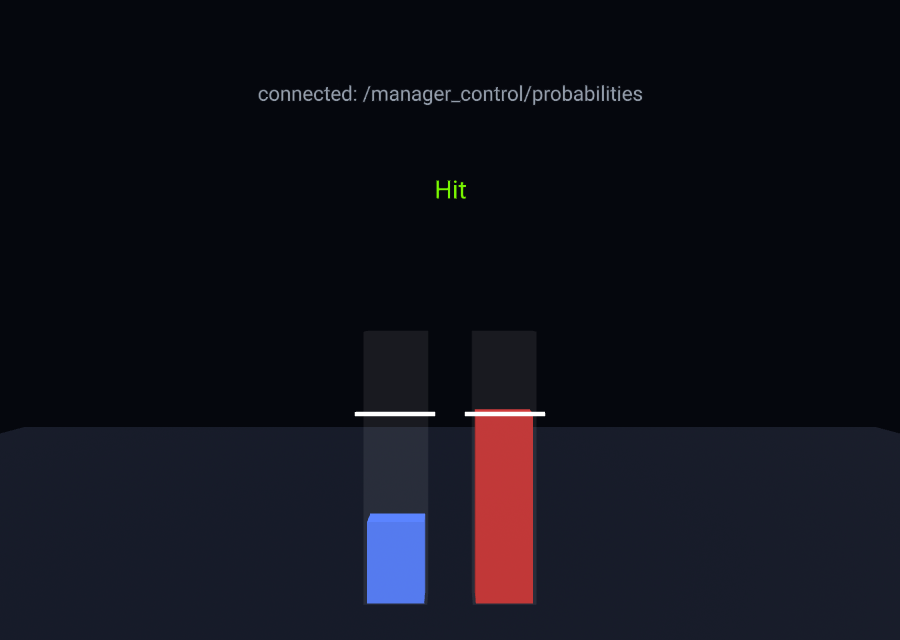
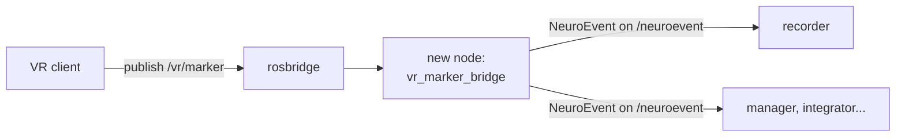

# Showing the feedback in virtual reality

The feedback of a BCI does not have to be a window on a monitor. In this tutorial you send the feedback of ROS2neuro to
a **virtual reality** scene: the subject sees the bars rise towards their thresholds inside the headset.

The VR side is **passive**: it only *receives* what ROS2neuro produces and draws it. It decides nothing, exactly like the
[feedback](../../packages/feedback/index.md) of the stack. (At the end we sketch how the VR could also send markers
back, without implementing it.)

!!! warning "What has been tested"
    | Part | Status |
    |---|---|
    | rosbridge, the WebXR page, the data flow from ROS2neuro | **tested**: run end to end on a desktop browser, with the real pipeline |
    | entering immersive mode on a headset (WebXR) | **not tested**: described, no headset was available |
    | the Unity example | **not tested**: it is only an example of possible code, not verified in Unity or on a headset |

**You will learn**

- what the manager sends to the feedback and how to read it from outside ROS;
- how rosbridge turns ROS 2 topics into a WebSocket that any VR engine can read;
- a WebXR page (A-Frame) that shows the feedback, and a Unity script that does the same idea;
- where a marker from the VR would enter ROS2neuro.

**You need** a built ROS2neuro workspace, a desktop browser (Firefox or Chrome) and, to try immersive mode, a headset with
a WebXR browser. Read [Protocols](../../concepts/protocols.md) first if the manager and the feedback are new to you.
About 30 minutes.

## 1. The idea



The [manager](../../packages/manager/index.md) already publishes everything a feedback needs, on one topic, the
**flow**. Any program that can read that topic can be a feedback. VR engines do not speak ROS 2, but they all speak
WebSocket, so we put a **bridge** in between: **rosbridge** subscribes to the topic and serves it as JSON to its
WebSocket clients.

### What is in the flow

The flow is a `NeuroControl` message published on `/manager_control/probabilities`:

| Field | Content |
|---|---|
| `fields` | the class codes as strings, for example `["773", "771"]` |
| `values` | the normalized value of each class (they sum to 1): the height of its bar |
| `actions`, `commands` | pairs: `seq` is a counter; `event` carries the phase of the trial; `outcome` carries the result |

The `event` values are the [event codes](../../concepts/protocols.md#event-codes) of the stack: `786` is the fixation
cross, the code of a class (`773`, `771`...) is the **cue**, and each of them is followed by the same id plus `32768`
when it ends. The `outcome` is `897` (Hit), `898` (Miss) or `899` (Timeout). This is what the feedback reads, and
what we read in the VR.

You can see it live. With a pipeline running (step 3):

```bash
ros2 topic echo /manager_control/probabilities
```

## 2. Install and start rosbridge

```bash
sudo apt install ros-jazzy-rosbridge-suite
```

Start it **in a terminal where the ROS2neuro workspace is sourced**, so that it knows the message type:

```bash
source /opt/ros/jazzy/setup.bash
source install/setup.bash
ros2 launch rosbridge_server rosbridge_websocket_launch.xml
```

It prints `Rosbridge WebSocket server started on port 9090`. Port 9090 is where the VR client connects.

!!! note "Why the workspace must be sourced"
    rosbridge converts a message to JSON using its definition. If [`ros2neuro_msgs`](../../packages/msgs-data.md#ros2neuro_msgs) is not found, the subscription to
    `ros2neuro_msgs/msg/NeuroControl` fails.

## 3. Start a pipeline that produces a feedback flow

Any launcher of [`ros2neuro_devel_test`](../../packages/devel-test.md) will do. A calibration shows every phase of a
trial, so we use it:

```bash
ros2 launch ros2neuro_devel_test gaussian_bars.launch.xml protocol:=calibration record:=false
```

The bars window of the stack opens (you can leave it open, it receives the same flow). Note that the session ends by
itself when the protocol ends, after about a minute: start it again when you need more.

## 4. The WebXR page

The page is a single file that uses [A-Frame](https://aframe.io) (WebXR) and
[roslibjs](https://github.com/RobotWebTools/roslibjs) (the JavaScript client of rosbridge). Both are loaded from a CDN,
with their versions pinned.

```html title="webxr/index.html"
--8<-- "vr-feedback/webxr/index.html"
```

How it works:

1. **Connection.** `ROSLIB.Ros` opens the WebSocket to `ws://<host>:<port>` and reconnects every two seconds if it
   drops. The text above the bars says whether it is connected.
2. **Subscription.** It subscribes to `/manager_control/probabilities` as `ros2neuro_msgs/msg/NeuroControl`.
3. **Bars.** At the first message it builds one bar per entry of `fields`, coloured by **position** (blue, red, green,
   purple...), never by code, with the rest (`783`) in yellow: the same rule as the feedback of the stack. Every message
   sets the height of each bar to its `value`.
4. **Thresholds.** They are **not** in the flow (the feedback gets them from its own parameters), so they are given in the
   URL, in the order of the bars: `?thresholds=0.7,0.7`. A bar at or above its threshold turns white.
5. **Phases.** `event` shows or hides the fixation cross and the cue (a sphere with the colour of the target bar), and
   `outcome` writes *Hit*, *Miss* or *Timeout* above the bars. This is the same logic as `feedback_controller.cpp`.

!!! warning "Do not throttle the subscription"
    roslibjs can limit the rate of a subscription with `throttle_rate`. Do not use it here: the manager sends an event
    (fixation, cue, outcome) in the same instant as another message, and a throttle would drop the second one, so you
    would never see the cross or the cue.

### Run it

Serve the folder with any static web server. For example, from the folder that contains `index.html`:

```bash
python3 -m http.server 8000
```

and open, in the browser of the same computer:

```text
http://localhost:8000/index.html?thresholds=0.7,0.7
```

The query parameters, all optional, are `host`, `port`, `topic` and `thresholds`.

The bars rise and fall with the classifier, and each trial of the calibration goes through its phases. Here are four
moments, from left to right: the fixation cross, the cue (the blue sphere says that the target is the first class), the
feedback (the blue bar reaches its threshold and lights up), and the outcome of a later trial, a *Hit*:

{ .screenshot }

{ .screenshot style="max-width: 560px;" }

On a desktop browser the scene is a normal 3D view that you can look around with the mouse (and move with W, A, S, D).
The small button at the bottom right of the window is **Enter VR**, which starts the immersive mode on a headset.

### On a headset

This part is **not tested**, because no headset was available. What is known about WebXR:

- immersive mode requires a **secure context**: `https://`, or `http://localhost`;
- a page served over `https://` is normally not allowed to open a plain `ws://` connection (mixed content), except to `localhost`.

For a standalone headset such as the Meta Quest, two ways to satisfy both rules are:

- **Port forwarding over USB.** With `adb reverse tcp:8000 tcp:8000` and `adb reverse tcp:9090 tcp:9090`, the headset's
  `localhost` reaches the computer, and you open the same `http://localhost:8000/...` URL in the headset's browser.
- **HTTPS and `wss://`.** Serve the page with a certificate, and start rosbridge with its `certfile` and `keyfile`
  parameters so it speaks `wss://`. The headset and the computer must be on the same network.

## 5. The same idea in Unity

!!! danger "Example, not tested"
    The Unity code below has **not been run** in Unity or on a headset. It is a possible implementation, written from the
    rosbridge protocol and the API of the NativeWebSocket package, to show how the same idea looks in a game engine. Expect
    to adapt it (Unity version, render pipeline, XR setup).

The structure is the same as the WebXR page: a client that speaks rosbridge, and a script that draws the bars.

**1. The rosbridge client.** It opens the WebSocket, sends the `subscribe` request and raises an event for each message
of the flow. It uses the [NativeWebSocket](https://github.com/endel/NativeWebSocket) package
(*Package Manager → Add package from git URL*: `https://github.com/endel/NativeWebSocket.git#upm`) and Unity's
`JsonUtility`, so there is no other dependency.

```csharp title="unity/RosbridgeClient.cs"
--8<-- "vr-feedback/unity/RosbridgeClient.cs"
```

**2. The bars.** It builds one cube per class at the first message, sets the heights, and handles the cross, the cue and
the outcome as the WebXR page does.

```csharp title="unity/FeedbackBars.cs"
--8<-- "vr-feedback/unity/FeedbackBars.cs"
```

To use them: put both scripts in the `Assets` folder, create an empty GameObject, add the two components, drag the client
into the `client` field of `FeedbackBars` and set the `thresholds`. Place the object in front of the camera. For a headset
you also need the XR setup of your project (for example the OpenXR plugin and an XR Origin), which is standard Unity work
and not described here.

## 6. Sending markers from the VR to ROS2neuro (a suggestion)

So far the VR only listens. A VR experiment often also needs to say *when* something happened in the scene: a stimulus
appeared, the subject pressed a button, a level started. Those markers should end up in the recorded file next to the
EEG. **This is not implemented here**; this is where it would go, and which nodes would change.



| Piece | Change |
|---|---|
| VR client (the page or the Unity script) | publish a message on a topic such as `/vr/marker` through rosbridge (with roslibjs, `new ROSLIB.Topic({...}).publish(...)`) |
| rosbridge | none: it already forwards publications from its clients to ROS 2 |
| **new node**, e.g. `vr_marker_bridge` | subscribes to `/vr/marker` and republishes a `NeuroEvent` on `/neuroevent`. It is the only new code |
| recorder | none: it already records every `NeuroEvent` on `/neuroevent` in the GDF/BDF file |
| manager | none. It stays the only publisher of the **protocol** events |
| integrator, other nodes | none, unless one should react to the marker (the integrator can reset on an event, `integrator.reset_event`) |

Points to decide when you implement it:

- **Event ids.** Choose ids that do not collide with the ones reserved by the stack (1, 781, 786, 897, 898, 899, 1024, and the
  `Off` and `Shown` ranges), for example from 2000 up, and use a different `family_id` for the VR markers so the recorded
  file tells them apart. Follow the *On/Off* convention (`id` and `id + 32768`) for events that have a duration.
- **Timing.** The marker travels through the network, so it reaches ROS2neuro a little after it happened. If the
  bridge node time-stamps it on arrival, the stamp is late by that latency. For precise alignment, the VR can send its own
  timestamp, or the marker can be sent on a hardware trigger line that the acquisition records with the signal.
- **The display events of the feedback.** [`ros2neuro_feedback`](../../packages/feedback/index.md) already has an option, `publish_display_events`, that publishes
  *"this was shown"* events after drawing. A VR feedback could do the same with the instant at which the frame was displayed,
  which is the marker that matters for analysis.

## Troubleshooting

| Symptom | Likely cause |
|---|---|
| the page says `cannot reach ws://localhost:9090` | rosbridge is not running, or runs on another computer: set `host` in the URL |
| connected, but nothing moves | the pipeline is not running or has ended (a calibration lasts about a minute), or the topic differs: check `ros2 topic list` |
| rosbridge says it cannot find the type `ros2neuro_msgs/msg/NeuroControl` | rosbridge was started in a terminal where the workspace is not sourced |
| the bars move but there is no cross or cue | the subscription is throttled (`throttle_rate`): remove it |
| a bar never reaches its threshold line | the thresholds in the URL do not match the ones of the manager (`layout.yaml`) |
| no *Enter VR* button on the headset | the page is not in a secure context: see "On a headset" |

## What you learned

- the manager's flow carries everything a feedback needs, and any program can read it;
- rosbridge exposes it as JSON over a WebSocket, so a browser or a game engine can be a feedback;
- a passive VR feedback is the same few lines as the feedback of the stack: bars from `values`, phases from `event`,
  result from `outcome`.
